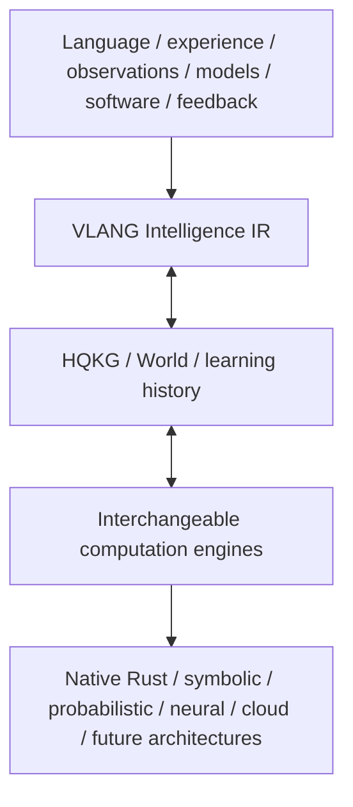

# VIVIM V1.0 — Future-Proof Personal Intelligence Operating System

**Date:** 2026-11-25  
**Status:** Strategic research proposal; not a production acceptance claim.  
**Scope:** VIVIM ARBOR, native Rust intelligence, local-first ownership, hardware-constrained continual learning.  
**Principle:** Every breakthrough in artificial intelligence should make VIVIM stronger, never obsolete.

# Era I — Design VIVIM for the AI landscape of 2035

Do not build an alternative to the LLM. Build the architecture that survives the LLM.

Language models may become faster, cheaper and radically different. Future architectures may support native continual learning, persistent neural memory and efficient inference on consumer hardware. Today's model limitations must not be the enduring competitive advantage. The system should benefit from AI breakthroughs without requiring fundamental redesign.

## 1. What changes and what survives

| Replaceable technology | Enduring personal asset |
| --- | --- |
| Foundation models | Personal knowledge |
| Neural architectures | Accumulated experience |
| Inference costs | User ownership |
| Context windows | Verified relationships |
| Training techniques | Learned preferences |
| Computing hardware | Executable capabilities |
| Agent frameworks | Identity and permissions |
| Application interfaces | Understanding of the user's world |

Build around the enduring assets. Make the technology that computes over them replaceable. Even if future models provide near-perfect reasoning at negligible cost, VIVIM should remain the system that owns, organizes and applies an individual's intelligence.

## 2. Future scenarios we must survive

| Scenario | Architectural response |
| --- | --- |
| Near-zero-cost LLM inference | Use it without surrendering ownership |
| Continually learning models | Integrate as adaptive intelligence engines |
| Powerful phone-local models | Distribute computation across personal devices |
| Persistent neural memory | Integrate alongside explicit knowledge |
| AI-native operating systems | Preserve portable intelligence across operating systems |
| Ubiquitous autonomous agents | Provide shared context, capabilities and accountability |
| Post-transformer architectures | Replace engines, not personal intelligence |
| Loss of provider or internet access | Continue locally with acquired capabilities |

Research signals: Google's [Nested Learning](https://research.google/blog/introducing-nested-learning-a-new-ml-paradigm-for-continual-learning/) and [Titans/MIRAS](https://research.google/blog/titans-miras-helping-ai-have-long-term-memory/) investigate multi-timescale learning and neural memory. Accommodate these directions rather than competing against them.

# Era II — Universal architecture for intelligence

## 3. Separate intelligence from its implementation

Extend VLANG toward a portable intelligence intermediate representation (IR), inspired by the decoupling principles of [LLVM](https://llvm.org/) and [MLIR](https://mlir.llvm.org/).

The IR represents knowledge, intent, skills, predictions, evidence and constraints. It is an enduring asset; engines interpreting it evolve. Extend existing VLANG and canonical typed contracts rather than introducing a duplicate compiler or graph. Host retains effect authority.

## 4. Reprogrammability at every level

The existing graph architecture includes replaceable engine slots, typed DAGs and incremental invalidation. Extend these foundations across six independently evolving dimensions:

| Dimension | What evolves |
| --- | --- |
| Knowledge | What VIVIM knows |
| Language | How it understands |
| Reasoning | How it reaches conclusions |
| Computation | How it solves problems |
| Behavior | How it acts |
| Learning | How it improves itself |

Learning algorithms themselves must be replaceable. Do not permanently hardcode our 2026 understanding of machine learning.

## 5. Differential intelligence

Apply incremental computation to knowledge and reasoning. [Differential Dataflow](https://github.com/TimelyDataflow/differential-dataflow) is a relevant research and implementation reference, not a mandatory dependency.

A changed observation propagates only through affected knowledge, prediction, plan and computation dependencies. Correcting a project preference must not trigger reprocessing of the user's entire history.

Reuse HQKG change sets, invalidation, scoped graphs and typed DAG caching. Evaluate sparse activation and incremental propagation against full recomputation. This is a candidate path to real-time learning on constrained hardware.

## 6. Knowledge lifecycle

Every acquired intelligence record needs a lifecycle:

| Property | Purpose |
| --- | --- |
| Meaning | What the knowledge represents |
| Evidence | Why it is believed |
| Confidence | Reliability and uncertainty |
| Validity | When and where it applies |
| Dependencies | What it relies on |
| Computation | How it can be used |
| Cost | Resources required to maintain it |
| Revision | How it has changed |

Corrections propagate. If a fundamental assumption becomes false, dependent conclusions must not remain silently accepted. Preserve provenance, scoped access, conflict handling, revocation and uncertainty.

## 7. Internal intelligence market

Select the least expensive authorized engine capable of meeting a task's measured reliability requirements. Candidate engines include native rules, graph reasoning, small local models and frontier models. Route by empirical accuracy, confidence, latency, resource consumption and authorization, not by an unvalidated ranking.

When a powerful model discovers a solution, capture transferable knowledge as evidence-backed semantics or validated reusable procedures where possible. Avoid repeatedly paying the reasoning cost for behavior already learned. Engines may propose; only existing Host contracts authorize effects.

## 8. Machine-independent personal identity

A portable intelligence package should preserve personal knowledge, preferences, language mappings, learned procedures, compatible neural adapters, provenance, evaluation history and configuration.

It must not require one provider, one embedding model, one hardware accelerator or one proprietary model-memory format. Follow the principles of [local-first software](https://www.inkandswitch.com/local-first/): durable user ownership, offline usefulness, portability and privacy. Engine-specific representations should remain replaceable or regenerable where practical.

# Era III — Build for the long term without overengineering today

## 9. Ten-year strategic horizons

- **2026–27 — Foundation:** native semantic graph, VLANG, continuous memory, deterministic execution, learned language and reusable skills.
- **2027–29 — Hybrid adaptive intelligence:** continually learning neural engines, skill synthesis, predictive and multimodal understanding, distributed personal computation.
- **2029–35 — Portable intelligence ecosystem:** intelligence migrates between devices and incorporates new computation architectures independently of any provider.

These are strategic horizons, not forecasts or delivery promises.

## 10. Evolution of existing ARBOR subsystems

| Existing subsystem | Future-proof evolution |
| --- | --- |
| HQKG | Versioned, executable, temporal knowledge substrate |
| VLANG | Universal intelligence IR |
| Oracle | Contextual and predictive world modeling |
| Studio | Continuously adapting environmental perception |
| AutoWiki | Human-readable projection and correction of intelligence |
| Programmability | Compositional reasoning and skill compilation |
| Engine registry | Adaptive computational engine selection |
| Host | Stable identity, authority, execution and persistence |
| VIVIM Labs | Intelligence evolution and evaluation laboratory |

Do not rewrite these systems wholesale. Establish contracts allowing them to evolve together. Rust-first, canonical ARBOR main, native GPUI as the product renderer, mobile PWA as its authenticated viewport. Keep private personal World data separate from the development knowledge index.

Existing source references:
- [HQKG](https://github.com/owenservera/ARBOR/tree/main/native/hqkg)
- [Native programmability](https://github.com/owenservera/ARBOR/tree/main/core/programmability)
- [Studio core convergence](https://github.com/owenservera/ARBOR/blob/main/docs/product/STUDIO-CORE-CONVERGENCE-R001.md)
- [Canonical deliverable tracker](https://github.com/owenservera/ARBOR/issues/33)

## 11. Future-proof acceptance tests

- [ ] Replace the primary LLM without losing learned capabilities.
- [ ] Disconnect the internet and continue performing known tasks.
- [ ] Learn a new expression immediately from a correction.
- [ ] Generalize learned behavior to an unseen request.
- [ ] Replace a reasoning engine without rebuilding personal memory.
- [ ] Correct one fact and update its dependent conclusions.
- [ ] Transfer intelligence to another machine.
- [ ] Install a new learning algorithm without rewriting the graph.
- [ ] Demonstrate improving accuracy and declining computational cost with experience.
- [ ] Allow the user to inspect, modify, export or delete acquired intelligence.

Benchmark on actual ARBOR code and real authorized tasks: unseen-task accuracy, local task coverage, correction retention, learning latency, CPU/RAM/disk usage, erroneous execution rates, and external inference cost. Distinguish source implementation, tests, deployment and physical acceptance. No checkbox is complete by publication of this proposal.

## 12. Ultimate strategic position

VIVIM is a Personal Intelligence Operating System: the operating layer for acquiring, maintaining, evolving and deploying an individual's artificial intelligence, not necessarily a replacement for Windows or Linux.

| Conventional software concept | VIVIM equivalent |
| --- | --- |
| Filesystem | Persistent intelligence graph |
| Process scheduler | Cognitive scheduler |
| Compiler | VLANG |
| Device drivers | Studio and native capability adapters |
| Applications | Composable intelligence skills |
| System monitor | AutoWiki |
| CPU | Interchangeable reasoning engines |

The LLM can be a teacher or an interchangeable reasoning engine rather than the permanent brain. Intelligence should accumulate in personally owned, inspectable, reusable assets.

This is a proposed architecture, not a claim of original invention of the underlying techniques or proven system performance. Its central hypothesis must be tested against simpler alternatives on constrained hardware.

**My machine. My data. My intelligence.**

**Every breakthrough in artificial intelligence should make VIVIM stronger, never obsolete.**
