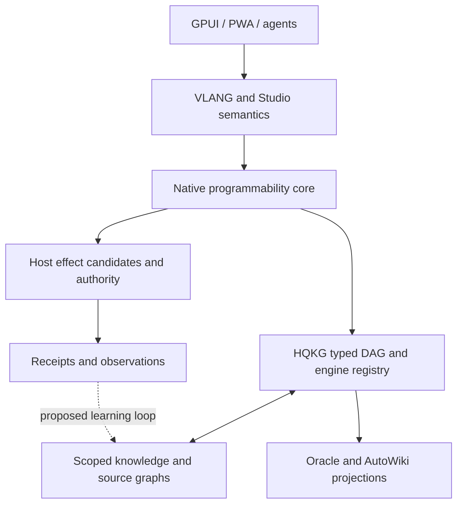
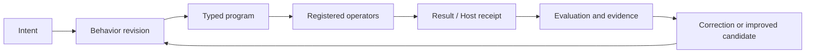

# VIVIM V1.0 — Rust reprogrammable graph architecture
Date: 2026-11-25. Status: source-reviewed architecture and proposed convergence; not production acceptance.
Companion: [Future-proof personal intelligence](FUTURE-PROOF-PERSONAL-INTELLIGENCE-R001.md).
Reviewed ARBOR snapshot: [c6ce7f67625243c10a72dbfc5095b0f1d68ee376](https://github.com/owenservera/ARBOR/commit/c6ce7f67625243c10a72dbfc5095b0f1d68ee376).

## Era I — Existing architecture and evidence

The durable asset is personally owned knowledge, semantics and executable behavior, independent of the implementation of intelligence engines. HQKG is the existing computational substrate; VLANG, Studio, Oracle and AutoWiki contribute semantic meaning and projections. Host remains the sole real-world effect and approval authority. GPUI is the one native product renderer; PWA is its authenticated remote viewport. Do not create another graph database, scheduler, compiler, authority or renderer.

This is a target convergence diagram; edges are not proof of deployment.

### Source evidence matrix
| Component | Current source behavior | Gap |
|---|---|---|
| [Graph and journal](https://github.com/owenservera/ARBOR/blob/c6ce7f67625243c10a72dbfc5095b0f1d68ee376/native/hqkg/src/lib.rs) | BTreeMap nodes/edges, adjacency indexes, epochs, search, BFS, Dijkstra, topological order, PageRank; HQJ1 snapshots, HQD1 deltas, checked save and verified compaction | String-based properties; performance at scale unmeasured |
| [Engine registry](https://github.com/owenservera/ARBOR/blob/c6ce7f67625243c10a72dbfc5095b0f1d68ee376/native/hqkg/src/engine.rs) | CAS replacement of trusted in-process implementations, Arc leases, interface/capability compatibility, budget checks between calls | No arbitrary live loading, preemption or behavioral equivalence proof |
| [Native validator](https://github.com/owenservera/ARBOR/blob/c6ce7f67625243c10a72dbfc5095b0f1d68ee376/core/programmability/src/lib.rs) | Bounded 64-step typed transformation DAG, source revisions, risk/classification constraints, stable topological order; pure bridge excludes effect candidates | Caller policy is not authority; richer typed values and operator semantics required |
| [Typed DAG](https://github.com/owenservera/ARBOR/blob/c6ce7f67625243c10a72dbfc5095b0f1d68ee376/native/hqkg/src/typed_dag.rs) | Revision-pinned runs, generation-aware materialization, bounded cache | Coarse graph epoch invalidation; persistent reusable programs not established |
| [Development engine](https://github.com/owenservera/ARBOR/blob/c6ce7f67625243c10a72dbfc5095b0f1d68ee376/native/hqkg/src/development_engine.rs) / [bridge](https://github.com/owenservera/ARBOR/blob/c6ce7f67625243c10a72dbfc5095b0f1d68ee376/native/hqkg/src/native_program.rs) | Actual indexed source, import, symbol, dependent and semantic computations; semantic inspect/impact/compose, bounded closure and session cache | Static evidence, not live runtime verification |
| Generic pure engine | Decodes fields and emits fingerprint/count, not general reasoning | Connect actual domain operators; distinguish scaffolding from meaningful computation |
| [Product kernel](https://github.com/owenservera/ARBOR/blob/c6ce7f67625243c10a72dbfc5095b0f1d68ee376/core/programmability/src/product_kernel.rs) | Existing native command, context, Wiki, recovery, rules, visual, navigation, activity and workstation transformations | Expose composable typed operators through existing runtime; avoid duplicate implementation |
| [Algorithm adapter](https://github.com/owenservera/ARBOR/blob/c6ce7f67625243c10a72dbfc5095b0f1d68ee376/native/hqkg/src/algorithm_adapter.rs) | 30 research definitions and trusted driver registration | Catalog entries are not 30 executable algorithms |
| [Change sets](https://github.com/owenservera/ARBOR/blob/c6ce7f67625243c10a72dbfc5095b0f1d68ee376/native/hqkg/src/graph_change_set.rs) / [ledger](https://github.com/owenservera/ARBOR/blob/c6ce7f67625243c10a72dbfc5095b0f1d68ee376/native/hqkg/src/apply_ledger.rs) | Merge/split, tombstones, durable idempotency records | In-memory apply then separate ledger record; graph persistence and acknowledgement need atomic/reconciled lifecycle |
| [Durable DAG](https://github.com/owenservera/ARBOR/blob/c6ce7f67625243c10a72dbfc5095b0f1d68ee376/native/hqkg/src/durable_dag.rs) | Redacted durable execution descriptions, not computed payloads | Durable learned-program storage and restart activation not established |
| [Scoped graph](https://github.com/owenservera/ARBOR/blob/c6ce7f67625243c10a72dbfc5095b0f1d68ee376/native/hqkg/src/scoped_graph.rs) / [context](https://github.com/owenservera/ARBOR/blob/c6ce7f67625243c10a72dbfc5095b0f1d68ee376/native/hqkg/src/context_retrieval.rs) / [invalidation](https://github.com/owenservera/ARBOR/blob/c6ce7f67625243c10a72dbfc5095b0f1d68ee376/native/hqkg/src/invalidate.rs) | Scoped provenance, bounded BFS/context budget, revision checks | Provenance requires owner authentication; finer dependency tracking |
| [Rust syntax](https://github.com/owenservera/ARBOR/blob/c6ce7f67625243c10a72dbfc5095b0f1d68ee376/native/hqkg/src/rust_syntax.rs) / [semantic source](https://github.com/owenservera/ARBOR/blob/c6ce7f67625243c10a72dbfc5095b0f1d68ee376/native/hqkg/src/semantic_source.rs) | AST extraction via syn, source anchors and static impact | Not rustc name/type resolution or macro expansion |
| [Host native program broker](https://github.com/owenservera/ARBOR/blob/c6ce7f67625243c10a72dbfc5095b0f1d68ee376/apps/vivim-host/control/native-program.mjs) | Source-checked bounded Rust validation of inert R0 programs | Not general program execution |

Source inspection only. Tests authored in [development composition](https://github.com/owenservera/ARBOR/blob/c6ce7f67625243c10a72dbfc5095b0f1d68ee376/native/hqkg/tests/development_composition.rs) and [validated pure programs](https://github.com/owenservera/ARBOR/blob/c6ce7f67625243c10a72dbfc5095b0f1d68ee376/native/hqkg/tests/validated_pure_program.rs) cover caching, swap, cancellation, stale scopes, semantic composition and closure; not independently executed for this review. Current local binary and full deployment unverified. Some README descriptions predate implementation changes.

## Era II — Architectural decisions and convergence
Five logical views: knowledge, semantic, computational, execution and evolution. Use shared typed contracts and scoped identities, not a single unrestricted database. Keep private World data outside the development index. Distinguish stable logical identity, exact source revision, engine generation, program revision, policy revision, and observed runtime state.

Four levels of reprogrammability:
1. Semantic: aliases, terminology and corrections.
2. Behavioral: new parameterized DAGs using existing operators.
3. Algorithmic: replace compatible installed engines through the registry.
4. Software evolution: verified compiled Rust releases; hot swap only where available and safe.

Proposed typed records, implemented through existing owner contracts: Intent, Capability, SemanticPattern, Behavior, Program, Operator, Policy, Observation, Correction, Evaluation, Prediction, Experience. Candidate relationships include resolves-to, composes, depends-on, constrains, produces, contradicts, supersedes and validated-by. Do not treat names as new stores or require all records for initial delivery.

A learned Behavior revision should bind a canonical intent, typed parameter schema, exact program/operator versions, source dependency identities, applicability predicates, evaluation evidence, provenance, resource bounds, and predecessor revision. Host authorization is independently checked for each effect at execution. User correction creates a new candidate revision, not silent mutation of history or expansion of grants. Support inspection, export, deletion, invalidation and rollback.

Publish changes with a durable transaction or recoverable intent/commit protocol joining program revision, graph change, engine generation metadata and idempotency receipt. Define crash points and restart reconciliation before activation. Reinstall trusted engine objects at restart from an approved manifest; persisted descriptors do not serialize executable code. Preserve generation leases, verify interface and behavior, and reject stale provenance. Synchronous native drivers require cooperative cancellation or isolated worker processes for hard resource containment.

Fine-grained invalidation: include source revision/digest, operator implementation identity, policy and program revision and complete dependency footprint, including query membership/negative dependencies. Reuse across unrelated graph epochs only with evidence; otherwise recompute. Benchmark against full recomputation.

## Era III — Delivery and evaluation
Follow [graph convergence work program](RUST-GRAPH-CONVERGENCE-WORK-R001.md). Initial experiments use real existing code and authorized real inputs; no synthetic success receipts. Route exact learned intents -> deterministic matching -> graph retrieval/inference -> bounded compositional synthesis -> optional local model -> authorized external model. Escalate only on measured need; do not claim model-free general intelligence.

Example: first AI-assisted project update composes repo inspection, source comparison, impact analysis, task retrieval and Wiki update. Store reusable typed behavior; next request resolves project parameter and invokes the program. Open-ended synthesis may still need inference; actual writes use Host authorization and current receipts.

Illustrative latency targets on the owner workstation, not measured: exact intent <1 ms; semantic match <10 ms; bounded retrieval <20 ms; cached program resolution <5 ms; small pure computation <50 ms; incremental projection <100 ms; Wiki update <250 ms excluding external I/O. Establish baseline p50/p95, peak RAM, disk, CPU, accuracy, stale reuse, false acceptance and external inference count. Compare equivalent tasks and report coverage, not just latency.

Future-proofing: VLANG IR and learned behavior assets survive replacing model, algorithm or hardware. Integrate neural learning where beneficial without forcing personal knowledge to depend on model weights. See foundational proposal sections 3–8 and 10–11.

No implementation or release changes were made by this documentation audit.
