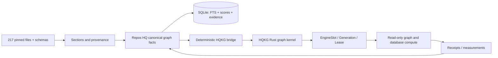

# HQKG integration contract — Repos HQ graph library

**Canonical graph authoring and scoring:** `owenservera/repos-hq/research/agentic-knowledge-graph`.
**Portable graph/compute kernel:** `owenservera/repos-hq/research/rust-knowledge-graph`.
**Version:** `repos-hq.hqkg-bridge/1`; status **staged adapter, not installed**.

## Architectural decision

Keep one reusable **Rust graph compute kernel**, one HQ **canonical knowledge and taxonomy authority**, and one **SQLite indexing/projection** for searchable data. Separate data and placement from code implementation and execution authority.



### What is reused from the Rust core

| Existing Rust surface | Repos HQ mapping | Action |
|---|---|---|
| `Graph`, `Node`, `Edge`, `NodeKind::Other` | File, SectionVariant, SectionType, SchemaAsset, Algorithm etc. | Import via stable namespace + typed properties |
| `Graph::shortest_path/reachable/topological/least_cost_path/page_rank` | Provenance paths, impact, dependency DAG, ranked neighborhoods | Reuse directly; select edge types explicitly |
| `Journal` | Local graph state and replay | Keep as local runtime cache, **not** Git source or canonical SQLite |
| `EngineRegistry::install/pin` | Algorithm definition → slot → generation → lease | Reuse CAS and capability compatibility |
| `Graph::record_engine_swap` | `EngineSlot`, `ComputeEngine`, `active_engine`, `supersedes` | Preserve exact existing core semantics |
| `Scheduler` + `Budget` | Bounded pure compute plans | Do not use as provider/browser execution permission |
| `DatabaseSpec::to_node` | Whole schema/knowledge database as graph node | Read-only references, no credentials/DB bytes in graph |
| `GraphCompute` / `DatabaseCompute` | Read-only queries and diagnostic compute | Feature-gated; no new orchestrator |
| `serialize/deserialize` | Binary graph snapshots | Use existing core format only inside local journal |

## Stable ID bridge

Core `identity()` enforces at most 256 bytes and no control characters; source paths can exceed this.

- Every exported ID uses `hqg1:` + lowercase SHA-256 hex of `type + NUL + original_id` (69 bytes).
- Preserve the original ID, name, repository, path, and exact Git blob hash in an external crosswalk and node properties.
- Edge ID uses the same namespaced digest of a stable triple **plus occurrence discriminator**; parallel edges must not collapse inadvertently.
- `NodeKind::Other(kind)` holds extensible category labels; never overload `Fact` or `Concept` to mean `File`.
- Canonical scores/provenance/section bodies remain in SQLite. Rust nodes carry small references, not full source bodies or secrets.

## Data transfer protocol: HQKGX1

`scripts/export-hqkg.mjs` creates two products from canonical graph + supplement:

1. `runtime/hqkg-import.v1.jsonl`: one `manifest` row followed by deterministic sorted `node` and `edge` rows. Each row has stable bridge ID, semantic graph kind, source ID and limited metadata. This is the authoritative **exchange representation**, not a native Rust journal.
2. `runtime/hqkg-crosswalk.v1.jsonl`: stable `bridge_id` to original ID and canonical provenance.

The opt-in Rust importer now parses versioned exchange records in bounded batches and call `Graph::put_node` / `Graph::put_edge` **in memory**, then `Journal::save` **once per accepted transaction**. Never shell out to the existing single-object CLI once per item (that repeatedly snapshots the graph).

Record input/output schema hash, source digests, type vocabulary, deterministic ordering, and importer version. Reject malformed objects, missing endpoints, duplicate IDs, excessive bytes, suspicious executable/secret fields and unsupported schema versions. Perform initial import to a disposable journal, validate graph parity, then publish.

## Algorithm mobility

Three identities must never be conflated:

1. **Algorithm definition:** semantic ID/version, input/output contracts and code owner.
2. **Engine generation:** concrete installed implementation bound to a slot and immutable while pinned.
3. **Placement:** scoped target/context, lease and ranking decision; re-routing changes placement, not implementation.

Placement selection is data-only in HQ. Installing a compute engine in the Rust process requires the runtime owner and explicit compatibility checks; changing provider/browser state stays outside the Rust/HQ authority.

An algorithm can be placed on multiple graph neighborhoods simultaneously; it doesn't physically relocate. `active_engine` means current implementation for a logical compute slot, **not** permission to perform effects.

## Immediate integration gates

- 217/217 pinned snapshot SHA checks, 2,170 preliminary family scores and stable provenance IDs.
- Graph merge combines base + supplement with explicit replacement precedence.
- No duplicate bridge IDs; every exported edge endpoint exists.
- Crosswalk round-trip and deterministic byte-equivalent export.
- Rust test adapter can import/re-export **without creating N journal frames**.
- Compare Rust graph path and topology results with existing HQ SQLite projection on shared fixtures.
- Power-loss/torn-tail journal recovery, single-writer lock and active-generation lease retention.
- Benchmark 1k/10k/100k nodes, memory, cold load, import, shortest path, and swap latency.
- No provider effects, arbitrary shared-library loads, untrusted code execution or credentials in export.

## Known limitations / important repairs

**Rust core:** std-only and portable, but uses full-graph snapshot journaling, linear scans for some operations, single-writer locking and a scheduler that cannot preempt hung engines; engine instances require reinstalls on process restart. DB adapters require optional dependencies and are read-only; SELECT/WITH screening is not a security parser. The importer is implemented in source, but runtime and cross-project parity tests remain unverified.

**Repos HQ:** SQLite graph is currently an isolated projection, not the canonical runtime; first-pass section classification is heading-based, not semantic quality verification. Existing 10 HQ optimizer functions are implemented experimental code and must not be confused with executable Rust compute engines until ported/wrapped with conformance tests. Provisional scores must not trigger deletion.

### Owner locations

- Rust source: https://github.com/owenservera/repos-hq/tree/main/research/rust-knowledge-graph
- Graph library: https://github.com/owenservera/repos-hq/tree/main/research/agentic-knowledge-graph
- Local Windows source: `C:\\0-BlackBoxProject-0\\repos-hq\\research\\rust-knowledge-graph`
- Local Windows integration: `C:\\0-BlackBoxProject-0\\repos-hq\\research\\agentic-knowledge-graph`

Current repository paths are GitHub-verified; local checkout paths are conventions, not inspected local filesystem evidence.


## 2026-11-03 integration update

The complete Rust crate, including the concurrent algorithm adapter, now lives at `repos-hq/research/rust-knowledge-graph`. The optional `hqkg-import` binary consumes the existing deterministic JSONL exporter, verifies SHA-256/schema/counts/identities/endpoints, and stages the whole import for exactly one journal save if changed. The exporter is not an execution authority. No end-to-end test or production activation has been performed.

```sh
bun research/agentic-knowledge-graph/scripts/export-hqkg.mjs
cargo run --manifest-path research/rust-knowledge-graph/Cargo.toml --features importer --bin hqkg-import -- research/agentic-knowledge-graph/runtime/graph.hqj research/agentic-knowledge-graph/runtime/hqkg-import.v1.jsonl
```
