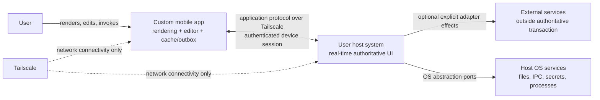
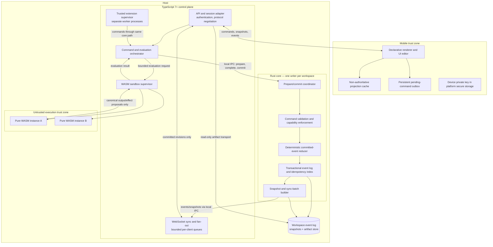

# 01 — System Architecture

**Status:** Proposed greenfield blueprint; no implementation or test result is asserted.  
**Scope:** OS-agnostic, real-time stateful UI that a user reprograms from a custom mobile client connected to a host over Tailscale.  
**Companion:** `04-runtime-boundaries.md` defines process isolation, execution contracts, capability checks, queues, and failure containment.

## 1. Conventions and assumptions

### 1.1 Normative conventions

The key words **MUST**, **MUST NOT**, **SHOULD**, **SHOULD NOT**, and **MAY** are normative. “Recommended” identifies a default design choice rather than a claim that a particular library is required. Identifiers such as `INV-03`, `IF-02`, and `AC-04` are stable requirement, interface, and acceptance identifiers and MUST NOT be reused for different meanings.

### 1.2 Assumptions

- `ASM-01` Tailscale connectivity between the mobile app and host already works. Tailscale supplies network reachability and an encrypted network path; it does **not** supply this application's authorization decision.
- `ASM-02` The initial product has one active Rust writer per workspace. A host MAY serve multiple workspaces, each with an independent writer and revision sequence.
- `ASM-03` A user can install a host extension only through an explicit trusted-administrator flow. UI-authored WASM is untrusted even when the current user authored it.
- `ASM-04` The mobile app can persist a small encrypted cache and command outbox. It is not assumed to be online, continuously foregrounded, or trustworthy beyond its authenticated device identity.
- `ASM-05` A trusted local provisioning step can enroll a device key. Recovery of a lost host or all enrolled keys is an administrative operation outside the real-time protocol.
- `ASM-06` TypeScript 7+ is the control-plane source language. Its runtime, bundler, and target platforms remain implementation choices and MUST be pinned for a release.
- `ASM-07` Reference hardware, mobile OS versions, and network conditions for performance work are not yet defined. Every number in this document is a target or initial limit, never a measured result.

## 2. Context

The system stores the authoritative definition and state of a UI on the user's host. The mobile app renders that definition, emits intents, and offers editing surfaces that change the UI through the same command path as every other mutation. A change can therefore alter layout, available actions, and deterministic UI behavior without replacing the host process.

The architecture separates four concerns:

1. **Rust core:** durable truth, transactional event storage, command authorization and validation, deterministic committed-state reduction, snapshots, and sync-selection primitives.
2. **TypeScript control plane:** mobile-facing API, WebSocket fan-out, local adapters, orchestration, trusted host-extension lifecycle, and sandbox supervision.
3. **Pure WASM:** untrusted, deterministic UI logic and reducer evaluation with content-addressed modules and no ambient OS authority.
4. **Mobile app:** rendering, editing, interaction capture, secure device credentials, local cache, and offline outbox.

### 2.1 Goals

- `G-01` One authoritative, durable host state with a gapless revision history.
- `G-02` Atomic UI reprogramming from the UI, with immediate propagation to connected clients.
- `G-03` Deterministic recovery and replay without network access, wall-clock dependence, or re-execution of untrusted code.
- `G-04` Safe execution of user UI logic with bounded CPU, memory, output, and capabilities.
- `G-05` Useful offline behavior and explicit, non-destructive reconciliation after reconnect.
- `G-06` OS-specific behavior confined to narrow ports and adapters.
- `G-07` Reproducible, schema-versioned artifacts and protocols.
- `G-08` Bounded queues, explicit overload behavior, and no silent loss of committed events.

### 2.2 Non-goals

- `NG-01` Multi-master writes, CRDT-based automatic conflict resolution, or offline consensus.
- `NG-02` Treating the mobile cache, TypeScript memory, or a WASM instance as authoritative state.
- `NG-03` Arbitrary native code execution from a UI definition or WASM module.
- `NG-04` Making Tailscale membership, source IP, or tailnet identity sufficient for application access.
- `NG-05` A public plugin marketplace, automatic extension installation, or a sandbox escape remediation guide.
- `NG-06` Exactly-once side effects in third-party systems. External adapter effects are at-least-once unless the external system supplies idempotency.
- `NG-07` Guaranteeing the performance targets below before benchmarks exist.
- `NG-08` Embedding a general-purpose web browser or web server in the Rust core.

## 3. Architecture decisions

| ID | Decision | Consequence |
|---|---|---|
| `AD-01` | Use a single Rust writer per workspace and an effect-event-sourced durable model. | Total order, auditable changes, deterministic replay; stale UI edits require explicit rebase. |
| `AD-02` | Store normalized mutation effects in committed events, not only command intents. | Recovery never needs a historical WASM module or a trusted TypeScript extension. |
| `AD-03` | Keep Rust as the only authority and writer; keep network transports and fan-out in TypeScript. | TypeScript compromise or restart cannot create an alternate committed history. |
| `AD-04` | Execute untrusted WASM in separately supervised sandbox processes, not in the Rust writer or TypeScript gateway process. | A trap or resource failure does not take down persistence or network service. |
| `AD-05` | Split commands into prepare/evaluate/commit so WASM evaluation does not block the single writer. | Concurrent bounded evaluation; commit rechecks revision and authorization. |
| `AD-06` | Make UI definitions immutable, schema-versioned revisions referencing modules and assets by hash. | Atomic activation, reproducible evaluation, and rollback as a new revision. |
| `AD-07` | Treat mobile offline work as pending intent, never accepted host state. | No false success or hidden server conflict resolution. |
| `AD-08` | Authenticate at the application layer and authorize every command in Rust. | Tailscale remains connectivity only; device revocation is enforceable. |
| `AD-09` | Run trusted hot-loaded TypeScript extensions outside the gateway process and route their mutations through Rust. | Trusted code gets flexibility without bypassing core invariants. |
| `AD-10` | Use deterministic, language-neutral schemas and content-addressed build artifacts. | Cross-language contracts and reproducible releases. |

## 4. C4-style views

### 4.1 System context



### 4.2 Host components



### 4.3 Dataflow: command to observable revision

```mermaid
flowchart LR
    A["Mobile intent\ncommand_id + base_revision"] --> B["TS transport limits\nsession authentication"]
    B --> C["Rust prepare\nschema, idempotency, capabilities"]
    C -->|"built-in mutation"| F["Normalized effect"]
    C -->|"user reducer needed"| D["Pinned evaluation request\nmodule_hash + immutable input"]
    D --> E["Pure WASM\ncanonical output"]
    E --> F
    F --> G["Rust serialized commit\nrecheck base revision + grants"]
    G --> H["Atomic durable transaction\nevent + projection + idempotency"]
    H --> I["Commit result\nworkspace_revision"]
    H --> J["Ordered event stream"]
    I --> K["Mobile command acknowledgment"]
    J --> L["TS WebSocket fan-out"]
    L --> M["Mobile deduplicate and project"]
```



No arrow from TypeScript, WASM, or the mobile cache bypasses the Rust commit transaction. The commit acknowledgment and subscribed event MAY arrive in either order; both carry `command_id` and `workspace_revision`, and clients MUST deduplicate them.

## 5. Identity, ordering, and invariants

### 5.1 Stable identities

- `workspace_id`: random or otherwise globally unique opaque identifier; namespaces all state and authorization.
- `actor_id`: stable application identity provisioned independently of Tailscale identity.
- `device_id`: stable enrolled key identity belonging to an actor.
- `session_id`: ephemeral TypeScript-authenticated session; not a durable authorization grant.
- `command_id`: client-generated 128-bit or larger unique identifier, scoped by `(workspace_id, actor_id, device_id)`.
- `workspace_revision`: gapless unsigned 64-bit sequence beginning at 1 for each workspace.
- `event_id`: recommended SHA-256 over a domain separator and the complete canonical event bytes.
- `definition_id`: stable identity of a UI definition across revisions.
- `definition_revision`: gapless sequence local to a definition; distinct from `workspace_revision`.
- `module_hash` / `artifact_hash`: cryptographic digest of exact artifact bytes; recommended SHA-256.
- `preparation_id` / `evaluation_id`: opaque Rust-generated identifiers for in-flight work; never durable ordering keys.

Wall-clock timestamps are diagnostic metadata only. Logical revisions, not timestamps, determine order.

### 5.2 System invariants

- `INV-01` A mutation is authoritative if and only if its effect event is durably committed by the Rust writer for that workspace.
- `INV-02` Each workspace has exactly one active writer and one gapless `workspace_revision` sequence. A crashed writer MUST be fenced before a replacement opens the workspace.
- `INV-03` Event append, committed-state projection update, command-idempotency result, and revision advance MUST succeed or fail as one transaction.
- `INV-04` Replaying the same snapshot prefix and canonical events MUST produce the same canonical state hash without TypeScript, WASM, network, environment variables, randomness, or wall-clock input.
- `INV-05` A successful command acknowledgment MUST NOT be emitted before the required durable commit has completed. A timeout is ambiguous, not proof of failure; retry uses the same `command_id`.
- `INV-06` Active UI content is immutable by revision. Every update and rollback creates a new revision; historical events are never edited in place.
- `INV-07` Event delivery is at-least-once and ordered by revision. A consumer MUST detect duplicates and MUST NOT silently accept a gap.
- `INV-08` Tailscale reachability MUST NOT be treated as application authentication or authorization.
- `INV-09` Mobile, TypeScript, and WASM projections are derived and disposable. None MAY independently advance authoritative state.
- `INV-10` A WASM module receives no ambient clock, random source, network, filesystem, environment, thread, or native UI capability. Every host import is declared and cannot grant those facilities.
- `INV-11` Device status and required capabilities MUST be checked during preparation and again at commit. TypeScript MUST cancel in-flight work for revoked sessions.
- `INV-12` Snapshot compaction MUST preserve the ability to resume correctly and MUST NOT discard the durable command-idempotency index in the initial design.
- `INV-13` No queue overflow MAY silently drop a command or committed event. Only explicitly ephemeral data such as presence or pointer previews MAY be coalesced.

## 6. Authoritative state and event model

### 6.1 Why single-writer effect event sourcing

A single-writer log is recommended instead of distributed consensus because the workspace belongs to one host and offline mobile edits are not independently authoritative. It gives a simple audit trail, deterministic recovery, natural sync cursors, and explicit optimistic concurrency.

This is **effect event sourcing**, not intent-only event sourcing. A command MAY require untrusted or hot-updated logic during preparation. Once accepted, its event records the normalized state mutation and provenance hashes. Replay applies that mutation using versioned Rust reducers; it does not rerun the command's original WASM or TypeScript logic. This avoids historical-code availability and nondeterminism problems.

The cost is that events can be larger and every effect schema needs a versioned Rust projector. That cost is accepted for recovery assurance.

### 6.2 Logical records

The following shapes are normative in meaning; encoding-specific field names MAY differ only through a versioned schema.

```text
CommandEnvelope
  protocol_version
  workspace_id
  command_id
  command_schema_version
  kind
  payload
  payload_hash
  base_revision | conflict_rule
  client_metadata                  # never used by deterministic reduction

AuthenticatedCommand               # constructed on trusted local IPC
  command: CommandEnvelope
  actor_id                         # derived from authenticated session
  device_id                        # derived from authenticated session
  session_id
  granted_capability_snapshot      # advisory; Rust rechecks persistent grants

EventRecord
  event_schema_version
  workspace_id
  workspace_revision
  event_id
  previous_event_hash
  caused_by: { actor_id, device_id, command_id }
  effect_schema_version
  effect                           # normalized committed mutation(s)
  provenance                       # built-in or module/input/output hashes
  recorded_at                      # diagnostic only; excluded from reduction
```

A WASM-caused event MUST include `module_hash`, `abi_version`, canonical `input_hash`, and canonical `output_hash` in `provenance`. These fields provide auditability; replay still applies `effect` directly.

### 6.3 Command lifecycle

- `STATE-01` TypeScript authenticates the device session, applies transport limits, and constructs an `AuthenticatedCommand`. Actor and device fields supplied by the mobile body MUST be ignored.
- `STATE-02` Rust `PrepareCommand` validates envelope schemas, command size, persistent device status, actor capabilities, conflict rules, and idempotency. UI edits MUST require exact `base_revision` equality.
- `STATE-03` A built-in command produces a normalized effect directly. A user-reducer command returns an evaluation request pinned to the active `module_hash`, immutable state at `base_revision`, and deterministic resource budget.
- `STATE-04` TypeScript executes that request through the sandbox supervisor. A wall-clock timeout, process crash, or allocation failure is an infrastructure failure and MUST NOT be converted into a successful domain result.
- `STATE-05` Rust validates the returned canonical output and retains only an allowed normalized effect. Declared capabilities are not proof of authorization.
- `STATE-06` The serialized writer rechecks revision, idempotency, device status, session preparation validity, and capabilities, then commits the event transaction.
- `STATE-07` TypeScript acknowledges the returned commit result and separately fans out the committed event.

Pending preparation state MAY be memory-only. After a crash, the client retries the identical command with the identical ID and bytes. If the command committed before the crash, the durable idempotency index returns the original result; otherwise it is prepared again.

### 6.4 Idempotency and conflicts

- `IDEM-01` The durable key is `(workspace_id, actor_id, device_id, command_id)` and maps to `payload_hash`, resulting `event_id`, `workspace_revision`, and canonical command result.
- `IDEM-02` Repeating an ID with identical canonical command bytes MUST return the original result without appending an event.
- `IDEM-03` Reusing an ID with different bytes MUST fail with `COMMAND_ID_REUSE`.
- `IDEM-04` The initial implementation MUST retain idempotency records in the log-derived state and every snapshot indefinitely. This deliberate storage cost prevents delayed offline retries from executing twice.
- `IDEM-05` A transport retry uses the same ID. A user-approved rebase after `REVISION_CONFLICT` is a new semantic command and MUST receive a new ID.

### 6.5 Durable storage and snapshots

- `STORE-01` Rust MUST acquire an exclusive OS-backed workspace lock and use writer fencing before accepting commands.
- `STORE-02` Event segments and snapshot manifests MUST be checksummed. A partial tail write MAY be truncated only to the last verified complete transaction; a gap or mid-log corruption MUST stop that workspace rather than skip data.
- `STORE-03` The commit durability policy MUST be explicit. The recommended default flushes the event transaction before success is returned; a relaxed buffered mode, if ever offered, MUST be visibly named and MUST NOT claim the same guarantee.
- `STORE-04` A snapshot MUST contain snapshot schema version, included `workspace_revision`, canonical state, state hash, idempotency index, active UI revisions, artifact manifests, and previous snapshot identity.
- `STORE-05` Snapshot publication MUST use write-temp, flush, atomic-rename, and directory-flush semantics where supported. An incomplete snapshot is never selected.
- `STORE-06` Snapshot creation SHOULD occur after 2,000 events or 64 MiB of appended event data, whichever comes first. These are configurable initial thresholds, not benchmarks.
- `STORE-07` A snapshot failure SHOULD raise health degradation while event commits continue if storage remains safe. Event-log write failure MUST stop acceptance with `STORAGE_UNAVAILABLE`.
- `STORE-08` Recovery uses the newest valid snapshot plus later verified events. Rust MUST verify the resulting state hash before opening the writer.

### 6.6 Sync primitives

Rust owns selection and construction of authoritative sync data; TypeScript owns transport.

- `SYNC-01` `ReadEvents(workspace, from_revision, limit)` returns the next ordered events beginning at `from_revision + 1`, or an explicit snapshot-required response if the requested prefix is unavailable.
- `SYNC-02` `ReadSnapshot(workspace, at_or_before_revision)` returns an immutable snapshot identity and a streamable byte manifest. Snapshots are never mutated while clients read them.
- `SYNC-03` A sync batch carries `from_revision`, `to_revision`, `has_more`, and optional `state_hash`. The client acknowledges a durable local cursor only after atomically storing the batch and projection.
- `SYNC-04` The recommended initial batch limit is 256 events or 2 MiB, whichever is reached first.
- `SYNC-05` TypeScript MUST re-establish its own Rust event cursor after restart. It MUST NOT publish an event as committed based on a prepare or evaluation message.

## 7. Schema-versioned UI definitions

### 7.1 Definition contract

A UI definition is declarative data, not executable native markup. Its envelope MUST contain at least:

```text
UIDefinition
  schema_version                   # integer format version
  definition_id
  definition_revision
  created_at_workspace_revision
  min_client_protocol_version
  required_client_features[]
  root_node_id
  nodes[]                          # stable node IDs; bounded declarative tree
  actions[]                        # semantic intents, not native callbacks
  modules[]                        # module_id, module_hash, abi_version, entrypoint
  artifacts[]                      # asset hashes, media kinds, sizes
  requested_capabilities[]         # declarations only, not grants
  metadata                         # non-authoritative display information
```

- `UI-01` Node IDs, action IDs, and module IDs MUST be stable within a definition lineage so patches, diagnostics, and client projection can refer to them unambiguously.
- `UI-02` The recommended initial limits are 10,000 nodes, depth 64, 1 MiB canonical definition bytes, and 2 MiB per WASM module. Exceeding a limit fails validation explicitly.
- `UI-03` Actions emit versioned command intents or local presentation messages. They MUST NOT contain file paths, shell commands, arbitrary URLs fetched by the host, native selectors, or memory addresses.
- `UI-04` Authoritative layout numbers SHOULD use integers or fixed-point values. The initial authoritative WASM profile MUST NOT depend on floating-point instructions.
- `UI-05` Module and asset references are content hashes. A revision never silently resolves “latest.”
- `UI-06` Required unsupported features cause an explicit incompatible-client state and disable editing. Clients MUST NOT guess at semantics or silently execute an unknown node/action.
- `UI-07` Readers MUST retain support for every live schema version. Writers SHOULD emit only the newest supported schema. Migration writes a new revision; historical bytes remain unchanged.
- `UI-08` Unknown required fields or invalid canonical encodings MUST be rejected. Optional additive behavior requires a schema/version negotiation rule, not accidental parser tolerance.

### 7.2 Hot UI update sequence

```mermaid
sequenceDiagram
    autonumber
    participant M as Mobile editor
    participant T as TypeScript control plane
    participant R as Rust workspace writer
    participant S as WASM sandbox
    participant C as Other connected clients

    M->>T: SubmitCommand(command_id, base_revision, UI edit)
    T->>T: Authenticate session; apply transport limits
    T->>R: PrepareCommand(authenticated envelope)
    R->>R: Validate schema, grants, idempotency, base_revision
    alt Deterministic user reducer is required
        R-->>T: EvaluationRequest(module_hash, input, fuel, memory)
        T->>S: Run pinned pure module
        S-->>T: Canonical output or deterministic failure
        T->>R: CompleteEvaluation(evaluation_id, output, hashes)
        R->>R: Validate output and normalize effect
    else Built-in definition edit
        R-->>T: Prepared normalized effect
    end
    T->>R: CommitPrepared(preparation_id)
    R->>R: Recheck revision and grants; atomic durable append
    R-->>T: CommitResult(event_id, workspace_revision)
    R-->>T: Ordered committed event
    T-->>M: Accepted result with revision
    T-->>C: Publish event at new revision
    M->>M: Deduplicate by command_id/revision and project
    C->>C: Apply if next revision; otherwise resume/sync
```

- `HOT-01` A candidate UI MUST pass schema validation, artifact/hash resolution, static capability checks, and any required deterministic evaluation before activation.
- `HOT-02` Activation is the atomic commit of the new definition revision. Clients apply it at a workspace revision boundary, not piecemeal.
- `HOT-03` Clients already evaluating an older revision MAY finish that evaluation, but its commit still requires the original base revision and will otherwise return `REVISION_CONFLICT`.
- `HOT-04` A rollback creates a new definition revision whose content references the selected old definition/artifact hashes. It MUST NOT decrement or rewrite history.
- `HOT-05` Referenced artifacts MUST remain available while any live definition or pinned evaluation references them. Garbage collection uses Rust-owned reference manifests, not TypeScript cache eviction alone.
- `HOT-06` Host-extension hot updates follow the separate trusted lifecycle in `04-runtime-boundaries.md`; UI content MUST NOT be able to install or activate a TypeScript extension without `extension.manage` authorization.

## 8. Interface and data ownership

### 8.1 Interface inventory

Detailed envelopes and error behavior are specified in `04-runtime-boundaries.md`.

| ID | Boundary | Required operations | Owner |
|---|---|---|---|
| `IF-01` | Mobile ↔ TypeScript | `Hello`, `Authenticate`, `OpenWorkspace`, `SubmitCommand`, `GetSnapshot`, `Subscribe`, `Resume`, `FetchArtifact` | TypeScript transport; Rust authoritative data |
| `IF-02` | TypeScript ↔ Rust | `PrepareCommand`, `CompleteEvaluation`, `CommitPrepared`, `CancelPrepared`, `ReadEvents`, `ReadSnapshot`, `ReadState`, `Compact`, `Health` | Rust |
| `IF-03` | TypeScript supervisor ↔ WASM process | `Run(EvaluationRequest)`, `Cancel(evaluation_id)`, `Reset(instance)`, `Terminate(instance)` | TypeScript supervisor; deterministic ABI |
| `IF-04` | Trusted extension ↔ control plane | typed command submission, event subscription, explicitly granted host ports | TypeScript; Rust authorizes mutations |
| `IF-05` | Rust ↔ host OS | transactional workspace storage, artifact storage, locks, clocks, entropy, process identity | Rust OS ports |
| `IF-06` | Mobile ↔ mobile OS | secure keys, outbox/cache persistence, lifecycle, connectivity hints | Mobile adapters |

The recommended external encoding is a restrictive canonical CBOR profile: definite lengths, sorted map keys, shortest integers, no tags, no undefined values, and no floating-point values in authoritative records. JSON MAY be used for diagnostics and human inspection but MUST NOT define persisted hashes. A different encoding MAY replace CBOR only if it provides equivalent canonicalization and cross-language schemas.

### 8.2 Data ownership matrix

| Data | Authoritative owner | Derived/copy owners | Mutation rule |
|---|---|---|---|
| Workspace event log, revision, projection, idempotency index | Rust | TypeScript/mobile read models | Rust transaction only |
| UI definitions and active revision | Rust | TypeScript and mobile caches | Validated effect event |
| Device enrollment, actor roles, durable capability grants | Rust | TypeScript session view | Administrative command; checked at prepare and commit |
| Module/asset manifests and reference counts | Rust | TypeScript/mobile artifact caches | Content-addressed command and retention transaction |
| Module and asset bytes required by live state | Rust artifact store | Read-only TypeScript/mobile caches | Atomic content-addressed write; no mutable “latest” |
| Sessions, token hashes in memory, socket state, rate counters | TypeScript | None authoritative | Create/destroy without changing workspace history |
| Trusted extension desired revision and capability grant | Rust | TypeScript supervisor | Trusted administrative event |
| Loaded extension process and health | TypeScript | Telemetry | Start/stop/restart; cannot directly mutate Rust state |
| WASM linear memory and diagnostics | Sandbox process | Bounded TypeScript diagnostic sink | Reset/destroy; never durable authority |
| Mobile projection, gestures, drafts, pending outbox | Mobile | None | Rebuildable; pending intents are not accepted state |
| External-service attempt state | TypeScript adapter | External service | At-least-once; never part of Rust atomic transaction |

## 9. Offline, reconnect, and conflict behavior

### 9.1 Offline behavior

- `OFF-01` The mobile app MAY render its last verified snapshot and MAY allow local drafts and queued commands. Every queued item MUST be visibly **pending**, never “accepted” or “committed.”
- `OFF-02` Commands are created with durable IDs before their first send and persisted in the outbox. The outbox survives process restart and network changes.
- `OFF-03` The recommended outbox limit is 1,000 commands or 8 MiB. At the limit the app MUST block additional queued mutations and request user action; it MUST NOT silently discard or overwrite old commands.
- `OFF-04` Pure presentation previews MAY run locally, but their output MUST NOT be represented as host-validated state.
- `OFF-05` Presence, cursor movement, and ephemeral previews SHOULD use separate non-durable messages and MAY be coalesced or dropped.

### 9.2 Reconnect sequence

```mermaid
sequenceDiagram
    autonumber
    participant M as Mobile app
    participant T as TypeScript API/sync
    participant R as Rust core

    M->>T: Hello(protocol, schema range, device key challenge response)
    T->>T: Verify application authentication; Tailscale is not sufficient
    M->>T: Resume(workspace, last_revision, outbox heads)
    T->>R: ReadEvents or ReadSnapshot
    alt Revision range is available
        R-->>T: Ordered event batches
    else Prefix unavailable or client too old
        R-->>T: Snapshot at revision S plus later events
    end
    T-->>M: Snapshot/delta sync with state hash
    M->>M: Atomically replace/extend cache; verify revision continuity
    loop Pending commands in original order
        M->>T: Retry exact command bytes and command_id
        T->>R: Prepare/commit or idempotent lookup
        R-->>T: Original result, new commit, or explicit conflict/denial
        T-->>M: Result plus current sync revision
        M->>M: Remove only acknowledged/conflicted item after user-visible handling
    end
```

- `OFF-06` A reconnecting client MUST apply snapshot/deltas before treating newly submitted commands as based on current state.
- `OFF-07` Duplicate accepted commands resolve through `IDEM-02`. A timeout never causes automatic creation of a new command ID.
- `OFF-08` An offline UI edit based on an old revision returns `REVISION_CONFLICT`. The client MUST preserve the user's draft and show the current definition.
- `OFF-09` Automatic merge MAY be offered only for explicitly disjoint, schema-defined fields with a deterministic merge rule. Otherwise the client MUST require a user-reviewed three-way rebase. It MUST NOT silently last-write-wins the whole definition.
- `OFF-10` A rebased command gets a new ID and new base revision. The original conflict remains inspectable in client history.
- `OFF-11` If authorization changed while offline, queued commands fail with `PERMISSION_DENIED` or `AUTH_REQUIRED`; the app MUST NOT keep retrying them indefinitely.
- `OFF-12` Session resumption tokens are credentials, not sync cursors. Sync cursors cannot substitute for reauthentication.

## 10. Security and trust posture

- `SEC-01` The mobile service MUST authenticate an enrolled device using proof of its private key or an equivalently explicit application credential, then issue a bounded session. Initial enrollment SHOULD require a short-lived, single-use code approved through a trusted local administrator surface.
- `SEC-02` Rust MUST authorize actor/device capabilities for every mutation. TypeScript schema checks and mobile checks are usability controls, never final authorization.
- `SEC-03` Device disablement, actor role reduction, and capability revocation are durable Rust state. TypeScript MUST terminate associated sessions and cancel prepared work when they change.
- `SEC-04` The mobile listener SHOULD bind only to the intended Tailscale interface/address and MUST NOT bind a public interface by default. This reduces exposure but does not replace `SEC-01` or `SEC-02`.
- `SEC-05` Rust and TypeScript local IPC MUST authenticate peer process identity and restrict filesystem/socket access. The Rust core MUST NOT expose its writer protocol directly to the network.
- `SEC-06` Host processes SHOULD run without administrator/root privileges and with only required workspace and adapter permissions. Secrets MUST NOT enter UI definitions, events, WASM input/output, logs, or mobile snapshots.
- `SEC-07` Capability declarations in a module are requests only. Effective authority is the intersection of actor grant, active workspace policy, and command-specific validation; untrusted modules never receive direct OS capabilities.
- `SEC-08` Trusted TypeScript extensions SHOULD have signed provenance where a distribution system exists and MUST have an exact hash plus explicit administrator grant before activation.
- `SEC-09` Security diagnostics MUST use stable event/error IDs and redaction. Raw command payloads, tokens, device keys, and personal content MUST NOT be logged by default.

The full trust-zone and capability-enforcement design is normative in `04-runtime-boundaries.md`.

## 11. OS abstraction ports

No authoritative schema contains an OS path, native handle, window pointer, or platform-specific identifier.

### 11.1 Rust host ports

| Port | Required semantics | Forbidden leakage into core logic |
|---|---|---|
| `WorkspaceStore` | Locking; transactional append; verified reads; flush; atomic snapshot replacement | Path syntax, file descriptors, platform error strings |
| `ArtifactStore` | Content-addressed write/read, hash verification, atomic publication, reference retention | Native paths in UI/events |
| `ClockPort` | Wall time for diagnostics and monotonic time for deadlines | Timestamps as reduction inputs or ordering keys |
| `EntropyPort` | OS randomness for opaque preparation/session-related identifiers where needed | Random values inside deterministic reduction |
| `ProcessIdentityPort` | Local peer credentials and workspace-lock ownership | Assuming peer identity is an application actor |

### 11.2 TypeScript host ports

| Port | Required semantics |
|---|---|
| `NetworkListenerPort` | Bind configuration, connection backpressure, clean shutdown; no assumption that Tailscale grants app identity |
| `LocalIpcPort` | Authenticated local transport with bounded frames and reconnect |
| `SecretStorePort` | OS-backed protection for host-side private/session material where persistence is required |
| `SandboxProcessPort` | Low-privilege launch, resource limits, cancellation, kill, and output bounds |
| `ExtensionProcessPort` | Isolated trusted-worker lifecycle, health checks, and capability-scoped adapter handles |
| `TelemetryPort` | Bounded structured metrics/traces with redaction and no reduction feedback |

### 11.3 Mobile ports

The mobile app MUST abstract secure key storage, atomic cache/outbox persistence, application lifecycle, network connectivity hints, and native rendering. Connectivity hints MAY trigger reconnect but MUST NOT decide that a command was accepted. Native actions exposed to declarative UI MUST be an allowlisted semantic set and MUST still produce host commands when authoritative.

All port errors MUST map to stable system errors while retaining platform details only in redacted diagnostics.

## 12. Packaging and deterministic builds

### 12.1 Release units

Recommended release artifacts are:

- `host-core-<os>-<arch>`: Rust core and OS storage adapters.
- `host-control-<os>-<arch>`: TypeScript 7+ control plane, pinned runtime or runtime requirement, sandbox supervisor, and extension supervisor.
- `runtime-schemas-<version>`: language-neutral protocol, event, UI, and WASM ABI schemas.
- `mobile-<platform>`: custom client using the same generated protocol definitions.
- Content-addressed WASM modules and trusted extension packages with independent manifests.

A host bundle MUST declare compatible core/control protocol ranges, UI schema range, WASM ABI range, target OS/architecture, and artifact hashes. Mobile and host negotiate capabilities at `Hello`; version skew MUST produce an explicit compatibility error rather than undefined behavior.

### 12.2 Reproducibility requirements

- `PKG-01` Rust, TypeScript, WASM compilers, runtime, and mobile toolchains MUST be pinned per release. Lockfiles and resolved dependency hashes MUST be retained.
- `PKG-02` Builds MUST use declared inputs, locale/timezone-independent settings, stable ordering, normalized paths, and a fixed build epoch where metadata requires time.
- `PKG-03` WASM and host artifacts MUST NOT embed timestamps, random build IDs, absolute workspace paths, hostnames, or network-fetched unpinned content.
- `PKG-04` Schema-generated source MUST be reproducible from schema version and generator version. Generated diffs are reviewable release inputs.
- `PKG-05` Each release SHOULD include an SBOM, hashes, licenses, provenance, and a manifest linking source revision to artifacts.
- `PKG-06` Two clean builds with identical inputs on the same supported build platform MUST produce identical unsigned bytes. Cross-platform byte identity and store-signed mobile packages MAY be excluded where platform tooling makes it impossible; the exclusion MUST be documented rather than hidden.
- `PKG-07` Artifact signing is a separate, reproducible-input step. Signing MUST NOT change the content hash used to pin a WASM module's exact executable bytes unless the signed container itself is the explicitly defined artifact.
- `PKG-08` Runtime updates MUST be atomic at a manifest/revision boundary and retain the prior working release for rollback. Rollback never rewrites workspace history.

## 13. Performance budgets — targets only

The following are **engineering targets and initial budgets, not measured claims**. A release MUST report actual environment, dataset, concurrency, p50/p95/p99, failure rate, and whether each target was met. “Reference host” and “reference mobile device” MUST be named in that report.

| ID | Target under stated test conditions | Initial target |
|---|---|---|
| `PERF-01` | Rust built-in command, payload ≤32 KiB, no WASM, durable commit, one workspace, moderate load | p95 ≤40 ms host-side prepare-to-committed; p99 recorded |
| `PERF-02` | Interactive WASM evaluation within default fuel/memory budget | p95 ≤25 ms and p99 ≤50 ms host-side, excluding queue saturation |
| `PERF-03` | Mobile-to-accepted acknowledgment for built-in command, network RTT ≤50 ms | p95 ≤300 ms excluding offline/outbox time |
| `PERF-04` | Committed event to TypeScript WebSocket emission under non-saturated load | p95 ≤50 ms |
| `PERF-05` | Reconnect catch-up of 10,000 small events without snapshot transfer | p95 ≤5 s on reference host/client and RTT ≤50 ms |
| `PERF-06` | UI update client projection after a complete compatible revision arrives | p95 ≤100 ms on reference mobile device |
| `PERF-07` | Sustained overload | No unbounded queue growth; stable explicit rejection/disconnect behavior |

Initial evaluation limits are 5,000,000 deterministic fuel units, 64 MiB linear memory per instance, 1 MiB canonical input, and 1 MiB canonical output. A 50 ms wall deadline is a safety cutoff only: wall-timeout outcomes are not committed as deterministic domain results. These values SHOULD be tuned from evidence while remaining versioned policy.

## 14. Failure and backpressure summary

`04-runtime-boundaries.md` provides the complete runtime matrix. System-level requirements are:

- `FAIL-01` Storage full, flush failure, or log corruption MUST prevent false success. Rust stops affected writes and reports `STORAGE_UNAVAILABLE` or `WORKSPACE_CORRUPT`.
- `FAIL-02` TypeScript failure MUST NOT trigger a fallback writer. Mobile reconnects after restart; Rust remains authoritative.
- `FAIL-03` Rust failure makes commands unavailable. TypeScript MAY serve clearly marked cached reads but MUST NOT accept authoritative mutations.
- `FAIL-04` A slow client is disconnected with `SLOW_CONSUMER` after its bounded committed-event queue fills; it resumes by revision or snapshot. Events are not dropped into an undetectable gap.
- `FAIL-05` Command overload returns `QUEUE_FULL` with retry guidance. Retries preserve command IDs and use bounded exponential backoff with jitter at the transport edge.
- `FAIL-06` A WASM trap, invalid output, fuel exhaustion, or resource timeout cannot partially commit state. The instance is reset or destroyed.
- `FAIL-07` A trusted extension crash is circuit-broken and does not stop unrelated workspace commits. External effects MAY be retried and MUST use stable effect IDs where supported.
- `FAIL-08` Clock changes affect neither revision ordering nor deterministic replay. Deadlines use monotonic time.
- `FAIL-09` Snapshot failure, telemetry failure, and artifact-cache eviction MUST NOT corrupt committed state. Loss of required live artifact bytes is a degraded workspace requiring restoration from verified content.
- `FAIL-10` Mobile app death leaves only durable local outbox items for retry. Ambiguous sends are reconciled by idempotency before any user prompt to create a new command.

## 15. Acceptance criteria

These are required design verification cases, not assertions that tests have run.

- `AC-01` **Single writer:** Race two UI commands against the same base revision. At most one exact-base UI edit commits; every committed revision is gapless, and the loser receives `REVISION_CONFLICT`.
- `AC-02` **Atomic crash recovery:** Inject failure before append, after append/before projection, and after durable commit/before acknowledgment. Recovery yields either the complete transaction or no transaction, matches state hashes, and never converts an ambiguous acknowledgment into a duplicate effect.
- `AC-03` **Deterministic replay:** From each supported snapshot schema and from an empty workspace prefix, replay without TypeScript, WASM, network, or clock access. Canonical final state and idempotency results are identical across supported host platforms.
- `AC-04` **UI hot update and rollback:** Reprogram from the mobile editor, observe one atomic active revision on clients, then roll back. The rollback has a new workspace/definition revision and identical referenced content to the selected old revision.
- `AC-05` **Schema negotiation:** Connect clients inside and outside the required schema/feature range. Unsupported clients receive an explicit incompatible state and cannot edit; no unknown action is executed.
- `AC-06` **Offline idempotency:** Queue offline edits, reconnect, duplicate frames, and force acknowledgment loss. Each accepted command produces at most one event and repeated identical retries return the original result.
- `AC-07` **Conflict preservation:** Commit a competing host revision while a mobile edit is offline. Reconnect preserves the local draft, returns `REVISION_CONFLICT`, and requires explicit merge/rebase rather than silent overwrite.
- `AC-08` **Sync continuity:** Disconnect a slow consumer, compact snapshots, and resume old/new cursors. The client receives either a continuous ordered delta or a snapshot-plus-delta; every gap is detected.
- `AC-09` **Application security:** Reach the host over Tailscale without valid application credentials, with a disabled device, and with reduced capabilities. All unauthorized mutations are denied, including already-prepared work at commit.
- `AC-10` **WASM containment:** Attempt undeclared imports, clock/random/network/filesystem access, excess memory, excess fuel, invalid canonical output, and module swap by hash. Loading or commit fails closed without host state mutation.
- `AC-11` **Overload:** Saturate command, evaluation, sync, and mobile outbox queues. Limits remain bounded, only ephemeral messages coalesce, and stable overload errors/resume paths appear.
- `AC-12` **Extension isolation:** Crash and hot-swap a trusted extension. Gateway and core remain available, activation changes only at an authorized configuration revision, and extension-originated mutations pass Rust validation.
- `AC-13` **Reproducibility:** Build identical pinned unsigned host and WASM inputs twice on a supported platform and compare hashes. Manifests identify any documented non-reproducible signed/mobile step.
- `AC-14` **Performance evidence:** Execute the benchmark scenarios in `PERF-01` through `PERF-07` and publish measured percentiles and limits. A target miss is reported as a miss, not rewritten as a claim.
