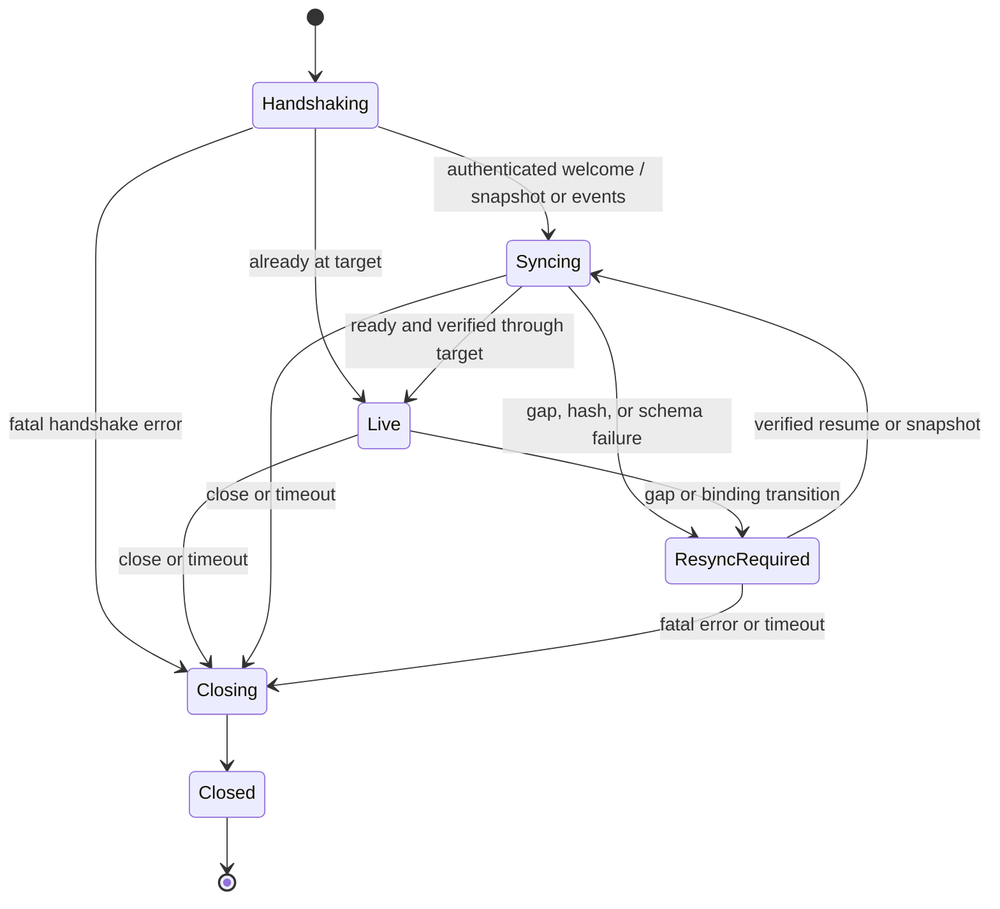

# Real-Time State Protocol and Synchronization Specification

**Status:** Greenfield, implementation-ready v1 specification  
**Scope:** OS-agnostic stateful UI that can be reprogrammed through its own editor UI  
**Architecture boundary:** Rust authoritative state and transactions; TypeScript 7+ control plane and transport adapters; deterministic sandboxed WASM UI logic; native mobile renderer/editor  
**Network assumption:** A working private Tailscale path already exists. Tailscale supplies network reachability and wire encryption, not application authentication or authorization.

## 1. Normative language and non-negotiable invariants

The words **MUST**, **MUST NOT**, **SHOULD**, **SHOULD NOT**, and **MAY** are normative. **Target** denotes a measurable goal, not a guarantee.

1. Rust is the only authority that can mutate authoritative workspace state, assign a revision, or declare a command committed.
2. TypeScript adapters authenticate transport sessions, validate envelopes, enforce limits, and forward messages. They MUST NOT independently apply authoritative mutations or invent revisions.
3. Each workspace has one totally ordered sequence of committed transaction batches. A revision increments by exactly one per committed batch and is never reused.
4. Command effects are committed exactly once under an idempotency key. Event and state-delta delivery is at least once. No exactly-once network-delivery claim is made.
5. A client applies a delta only at its declared base revision. It MUST NOT reorder, skip, or partially apply a transaction batch.
6. A `command.accepted` receipt is a durable-commit statement, not an event-delivery statement. A delta received before its receipt is valid.
7. Snapshots and deltas are verified by schema, revision, and hash before becoming visible to the native renderer.
8. WASM logic is deterministic and sandboxed. It has no ambient clock, randomness, filesystem, network, environment, or host-memory access.
9. Drafts and previews cannot mutate authoritative state, consume a workspace revision, emit authoritative events, or cause external effects.
10. A UI-program change uses the same authenticated command/transaction path as every other mutation. There is no privileged editor side channel that bypasses validation.
11. Tailscale membership alone does not authorize a command. The host MUST authenticate the actor and authorize the actor/workspace/command tuple.
12. Transport and serialization are replaceable without changing transaction, revision, idempotency, or recovery semantics.

## 2. Component responsibilities

### 2.1 Rust authoritative core

Rust MUST own:

- workspace admission and the single-writer transaction order;
- command idempotency lookup and precondition checks;
- deterministic reducer invocation and output validation;
- authoritative state, immutable event batches, snapshots, and idempotency receipts;
- revision assignment, state hashes, batch hashes, and schema/artifact binding;
- durable commit, crash recovery, retention, and compaction;
- per-session authoritative acknowledgement cursors.

A single-writer implementation is RECOMMENDED for v1. Equivalent serializable behavior is permitted, but externally visible revisions must still form one gap-free sequence.

### 2.2 TypeScript 7+ control plane and adapters

TypeScript MAY terminate WebSocket and HTTPS, enforce message-size/rate limits, validate authentication tokens, and route validated requests to Rust. It MUST treat Rust receipts as authoritative. It MUST NOT acknowledge a mutation before Rust reports durable commit.

### 2.3 WASM user UI logic

A WASM invocation receives an explicit, immutable input containing the prior state, command or preview input, actor, workspace, fixed execution context, and declared schema/artifact versions. It returns candidate events and candidate state or a candidate patch. Rust validates the complete output before commit.

WASM execution MUST have deterministic fuel/instruction limits and bounded memory. Wall-clock timeouts MAY abort an invocation for availability, but MUST NOT be used to choose a successful result. Nondeterministic output, invalid schemas, unauthorized host calls, and resource-limit exhaustion abort the transaction with no revision consumed.

### 2.4 Native mobile renderer/editor

The native client:

- renders only a completely installed snapshot or a completely applied delta;
- keeps authoritative state separate from editor/draft state;
- creates and durably retains pending command IDs until their outcome is known;
- retains its session ID, resume token, last applied revision, and state hash across process restarts;
- never calculates a new authoritative revision locally;
- may discard duplicate deliveries but must detect conflicting duplicates and gaps.

The protocol does not require the mobile client to execute WASM. Host-derived state and declarative view data are sufficient for a native renderer.

## 3. Canonical data, serialization, and hashing

### 3.1 Canonical JSON model

v1 wire messages are UTF-8 JSON. The authoritative state and all hashed structures use the JSON data model with these restrictions:

- objects MUST have unique keys;
- numbers MUST be finite IEEE-754 values; NaN and infinities are invalid;
- negative zero MUST be rejected on input or normalized to zero before any processing;
- integers outside the exact JSON interoperability range `-(2^53-1)` through `+(2^53-1)` MUST be represented as decimal strings;
- revisions, byte counts, credits, and cursors are decimal strings without leading zeros, except `"0"`;
- strings are not implicitly Unicode-normalized; different byte representations remain different values;
- timestamps never participate in authoritative ordering.

Canonical serialization is JSON Canonicalization Scheme (JCS), RFC 8785, encoded as UTF-8. Parsers MUST reject duplicate object keys. A received noncanonical but otherwise valid envelope MAY be parsed and recanonicalized for hashing; hashed state and stored command fingerprints always use the canonical value, not the original wire bytes.

Canonical example:

```json
{"a":"x","b":1}
```

is the only canonical encoding of an object semantically equal to `{ "b": 1, "a": "x" }`.

### 3.2 Hash algorithm and domain separation

All v1 hashes are SHA-256, rendered as lowercase `sha256:` followed by 64 hexadecimal characters. Hash input is domain-separated as follows:

```text
HASH(domain, bytes) = "sha256:" || lowercaseHex(SHA256("RSUI1\0" || domain || "\0" || bytes))
```

The following hashes are required:

- `protocolSchemaHash`: hash domain `protocol-schema`, over JCS of the canonical core-schema manifest.
- `workspaceSchemaHash`: hash domain `workspace-schema`, over JCS of a manifest containing the state schema and every command/event schema, keyed and sorted by schema ID.
- `logicArtifactHash`: hash domain `wasm-artifact`, over the exact accepted WASM artifact bytes.
- `stateHash`: hash domain `state`, over JCS of the complete authoritative state value.
- `batchHash`: hash domain `batch`, over JCS of the committed batch body defined in section 8.
- Command fingerprint: hash domain `command`, over JCS of the idempotency body defined in section 6.

A schema manifest MUST contain schema IDs and explicit schema versions. A hash change occurs for any semantic or syntactic manifest change, even if a human considers it compatible. Hashes provide integrity and compatibility checks; they are not message authentication codes.

### 3.3 Protocol versioning

`protocolVersion` has the form `"MAJOR.MINOR"`. v1 starts at `"1.0"`.

- A different major version is incompatible.
- A server selects the highest mutually supported minor within a supported major.
- A negotiated version is bound to exactly one `protocolSchemaHash` for the life of a connection.
- A session is also bound to one `workspaceSchemaHash` and one `logicArtifactHash` for live delta application.
- Unknown envelope fields MAY be ignored only when the negotiated minor schema explicitly permits extension fields. Unknown command types, event types, patch operations, and command-payload fields MUST be rejected according to their schema.
- A workspace schema or logic-artifact transition requires full resynchronization as specified in section 11.4; a client MUST NOT apply a delta using a different schema/artifact binding.

## 4. Message envelope

Every protocol message, on every transport, uses this envelope:

```json
{
  "protocolVersion": "1.0",
  "type": "command.submit",
  "messageId": "msg_7f4d8e68e4a54f92a4a680d227ca5f01",
  "sessionId": "ses_7d0c97f06f0a4b4a8f14ce51f18fc201",
  "workspaceId": "ws_demo",
  "actorId": "actor_alice",
  "correlationId": "corr_ui_request_9",
  "causationId": "msg_93471c3b4a134e529a2a94c82bb501c2",
  "sentAt": "2026-11-03T12:00:00.000Z",
  "payload": {}
}
```

Rules:

- `protocolVersion`, `type`, `messageId`, `correlationId`, `causationId`, `sentAt`, and `payload` are always present. Nullable fields MUST be encoded as `null`, not omitted.
- `messageId` is a fresh, cryptographically random, at-least-128-bit opaque ID for each physical message emission. It is for tracing and duplicate-frame detection only; it is not the command idempotency key.
- `sessionId`, `workspaceId`, and `actorId` are required after welcome. The server MUST verify that they match the authenticated session binding.
- On the initial `session.hello`, `sessionId` MAY be null or contain the session being resumed, `workspaceId` MAY be null, and `actorId` MUST be `"unauthenticated"`. The requested workspace is in the hello payload.
- `correlationId` links all messages in one logical request flow. If the originator supplies none, it is null; a responder copies the request correlation ID or uses the request message ID when creating a new flow.
- `causationId` identifies the directly causing message when one exists; otherwise it is null. It is diagnostic metadata, not a concurrency primitive.
- `sentAt` is RFC 3339 UTC and is **informational only**. Receivers MUST NOT use it for revision order, idempotency, conflict resolution, expiry, replay acceptance, or timeout arithmetic.
- IDs are bounded opaque strings. The negotiated schema MUST define maximum lengths; v1 RECOMMENDS 128 bytes for envelope IDs and 256 bytes for application command/event types.

The core v1 message types are:

```text
session.hello       session.welcome     session.ping        session.pong
session.close       sync.ready          sync.ack            sync.credit
sync.gap            state.snapshot      snapshot.begin      snapshot.chunk
snapshot.end        state.delta         command.submit      command.accepted
command.rejected    command.status      command.status.result
preview.start       preview.result      preview.cancel      error
```

An adapter MAY map transport-native ping/pong to `session.ping`/`session.pong`, but the observable session behavior MUST remain equivalent.

## 5. Transport profile

### 5.1 Recommended initial profile

Use one WebSocket per actor/workspace session over the existing Tailscale route:

- one complete JSON envelope per WebSocket message;
- text messages containing UTF-8 JSON in v1;
- ordered delivery within a connection, while still enforcing revision/gap checks;
- TLS (`wss`) when the host endpoint has an appropriate certificate; otherwise `ws` is acceptable only inside the protected tailnet and still requires application authentication;
- no dependence on WebSocket URL query tokens, because URLs are commonly logged.

WebSocket is recommended because it provides a persistent ordered bidirectional channel with straightforward mobile and TypeScript support. It is an adapter choice, not part of Rust state semantics.

### 5.2 Optional HTTPS control endpoints

HTTPS control endpoints are justified for large snapshot transfer and outcome recovery without holding a WebSocket event loop hostage:

```text
GET /v1/workspaces/{workspaceId}/snapshots/{snapshotId}
GET /v1/workspaces/{workspaceId}/actors/{actorId}/commands/{commandId}
```

The first returns the same canonical snapshot document that `snapshot.begin`/`chunk`/`end` would produce. The second returns the equivalent of `command.status.result`. Both require the same application authentication and workspace authorization as WebSocket messages. Actors can query only their own commands unless explicitly granted administrative read access.

HTTP status codes are adapter metadata. The Rust receipt and protocol payload remain authoritative. Snapshot IDs are unguessable and short-lived, but possession of a snapshot ID does not replace authorization. Credentials MUST NOT appear in URLs.

### 5.3 Transport independence requirements

Every transport adapter MUST preserve:

- the complete envelope and authenticated actor binding;
- one-workspace-per-session scope;
- command fingerprint and idempotency behavior;
- ordered batch delivery within a syncing session;
- explicit gap detection even if the transport is ordered;
- flow-control credit and heartbeat behavior;
- equivalent error and recovery semantics.

### 5.4 Binary encoding gate

v1 does not enable binary application messages. CBOR, Protocol Buffers, FlatBuffers, or another binary encoding MAY be added only after profiles show that JSON serialization, payload size, bandwidth, or mobile energy prevents an agreed target from being met.

A binary profile MUST preserve the canonical semantic value, hashes, size/depth limits, version negotiation, and all state-machine behavior. It MUST use explicit little-endian or network-order fields where applicable, length-delimited frames, and versioned schemas. Negotiation MUST be capability-based with automatic JSON fallback. Profiling MUST compare CPU, bytes on wire, latency, memory, and battery; binary is not assumed to be faster.

## 6. Connection and session handshake

### 6.1 Session identity

A session is bound to exactly one `(workspaceId, actorId)` pair. A client wanting two workspaces opens two sessions. This makes per-session cursors unambiguous.

The server stores:

- session ID and hash of the resume token;
- authenticated actor and workspace bindings;
- negotiated protocol/schema/artifact hashes;
- current connection generation and connection state;
- durable `ackRevision`, the highest contiguous revision acknowledged by the client;
- transient highest-delivered revision and outstanding flow-control accounting;
- session state and server-side expiry;
- snapshot/catch-up target for the active synchronization.

The server stores only a cryptographic hash of the resume token. The client stores the token in OS-protected credential storage.

### 6.2 Hello

The first application message on a connection MUST be `session.hello` and MUST arrive within the configured handshake timeout.

```json
{
  "protocolVersion": "1.0",
  "type": "session.hello",
  "messageId": "msg_7a6a092ab4c04472a764f8ac92440001",
  "sessionId": null,
  "workspaceId": null,
  "actorId": "unauthenticated",
  "correlationId": null,
  "causationId": null,
  "sentAt": "2026-11-03T12:00:00.000Z",
  "payload": {
    "supportedProtocols": ["1.0"],
    "protocolSchemaHash": "sha256:0123456789abcdef0123456789abcdef0123456789abcdef0123456789abcdef",
    "requestedWorkspaceId": "ws_demo",
    "clientNonce": "q5Jt4Wv9Yp2s7Nf1Lm8Qx3Zc6Vb0Hr4K",
    "auth": {
      "scheme": "bearer",
      "token": "<credential; redact from all logs>"
    },
    "resume": null,
    "capabilities": {
      "encodings": ["jcs-json"],
      "inlineSnapshots": true,
      "chunkedSnapshots": true,
      "maxMessageBytes": "1048576",
      "initialBatchCredit": "8",
      "initialByteCredit": "4194304"
    },
    "acceptedWorkspaceSchemaHash": "sha256:aaaaaaaaaaaaaaaaaaaaaaaaaaaaaaaaaaaaaaaaaaaaaaaaaaaaaaaaaaaaaaaa",
    "acceptedLogicArtifactHash": "sha256:bbbbbbbbbbbbbbbbbbbbbbbbbbbbbbbbbbbbbbbbbbbbbbbbbbbbbbbbbbbbbbbb"
  }
}
```

For resume, `resume` is:

```json
{
  "sessionId": "ses_7d0c97f06f0a4b4a8f14ce51f18fc201",
  "resumeToken": "<session resume credential; redact from all logs>",
  "lastAppliedRevision": "41",
  "lastStateHash": "sha256:cccccccccccccccccccccccccccccccccccccccccccccccccccccccccccccccc",
  "lastBatchHash": "sha256:dddddddddddddddddddddddddddddddddddddddddddddddddddddddddddddddd"
}
```

The client nonce MUST contain at least 128 bits of entropy and MUST NOT be reused for a new connection. It prevents accidental connection-response confusion; it does not replace authentication.

### 6.3 Welcome and synchronization decision

After authenticating and authorizing the session, the server responds with `session.welcome`:

```json
{
  "protocolVersion": "1.0",
  "type": "session.welcome",
  "messageId": "msg_9f6f0ddc6a25442b8120b2c3a52e1002",
  "sessionId": "ses_7d0c97f06f0a4b4a8f14ce51f18fc201",
  "workspaceId": "ws_demo",
  "actorId": "actor_alice",
  "correlationId": "msg_7a6a092ab4c04472a764f8ac92440001",
  "causationId": "msg_7a6a092ab4c04472a764f8ac92440001",
  "sentAt": "2026-11-03T12:00:01.000Z",
  "payload": {
    "connectionGeneration": "3",
    "serverNonce": "Z8v2Lq7Nf4Cx1Pm6Qs9Ta3Wb5Ry0Hk2J",
    "resumeToken": "<new session token, or null when resuming>",
    "protocolSchemaHash": "sha256:0123456789abcdef0123456789abcdef0123456789abcdef0123456789abcdef",
    "workspaceSchemaHash": "sha256:aaaaaaaaaaaaaaaaaaaaaaaaaaaaaaaaaaaaaaaaaaaaaaaaaaaaaaaaaaaaaaaa",
    "logicArtifactHash": "sha256:bbbbbbbbbbbbbbbbbbbbbbbbbbbbbbbbbbbbbbbbbbbbbbbbbbbbbbbbbbbbbbbb",
    "sync": {
      "mode": "EVENTS",
      "resumeRevision": "41",
      "catchupTargetRevision": "47",
      "currentRevision": "47",
      "oldestRetainedRevision": "20"
    },
    "heartbeatIntervalMs": "15000",
    "heartbeatTimeoutMs": "45000",
    "maxServerMessageBytes": "1048576"
  }
}
```

`sync.mode` is one of:

- `LIVE`: the client's revision equals the catch-up target and its hashes match; no state transfer is needed.
- `EVENTS`: the complete retained event stream from `resumeRevision + 1` through the target can be sent.
- `SNAPSHOT`: a full replacement is required, followed by deltas after the snapshot revision.

The server chooses the effective resume point as no greater than both the server acknowledgement cursor and the client's proven last-applied cursor. It MUST NOT skip batches merely because the server previously sent them. A higher client cursor is accepted only when revision, state hash, and batch hash match authoritative records; otherwise a snapshot is required.

A session has at most one active connection generation. A valid resume increments the generation and replaces any older connection. The older connection is closed with `SESSION_REPLACED`; messages from an older generation MUST NOT advance cursors or submit commands.

### 6.4 Becoming live

Welcome fixes `catchupTargetRevision = C`. The server transfers state through `C`, buffering newer committed batches in revision order. After installing/applying everything through `C`, the client sends `sync.ready` with its revision and state hash.

The server marks the connection LIVE only if the client has a contiguous verified state through at least `C`. It then continues sending newer batches in order. Normal mutation commands are accepted only in LIVE state. `command.status`, heartbeat, flow-control, gap handling, and close messages are valid during synchronization.

Authentication failure, incompatible protocol/schema, invalid resume credentials, or authorization failure closes handshake without creating a live connection. Error payloads MUST NOT reveal whether an unauthorized workspace or actor exists beyond what the actor is permitted to know.

## 7. Commands, idempotency, and atomic acceptance

### 7.1 Command identity

A mutation uses `command.submit`. Its payload contains:

- `commandId`: cryptographically random, at least 128 bits, generated once per logical user intent;
- `commandType`: schema-governed application operation;
- `arguments`: command-specific JSON value;
- `expectedRevision`: optimistic-concurrency precondition;
- `workspaceSchemaHash` and `logicArtifactHash`: exact logic against which the intent was constructed.

The idempotency key is `(workspaceId, actorId, commandId)`. The client MUST persist the key and complete command body before the first send. Retrying after a timeout, reconnect, process restart, or new session uses the same key and body but a fresh envelope `messageId` and `sentAt`.

The server computes the command fingerprint over JCS of:

```json
{
  "workspaceId": "ws_demo",
  "actorId": "actor_alice",
  "commandId": "cmd_46e80df5d5dd4fe38c18c9d5664e5001",
  "commandType": "todo.setTitle",
  "arguments": {"todoId": "t1", "title": "Write protocol"},
  "expectedRevision": "41",
  "workspaceSchemaHash": "sha256:aaaaaaaaaaaaaaaaaaaaaaaaaaaaaaaaaaaaaaaaaaaaaaaaaaaaaaaaaaaaaaaa",
  "logicArtifactHash": "sha256:bbbbbbbbbbbbbbbbbbbbbbbbbbbbbbbbbbbbbbbbbbbbbbbbbbbbbbbbbbbbbbbb"
}
```

Envelope fields, connection ID, correlation/causation IDs, and sent time are excluded.

### 7.2 Concurrency precondition

`expectedRevision` is REQUIRED by default. The server compares it with the workspace head inside the commit transaction. A mismatch produces `REVISION_CONFLICT`, no event, and no new revision.

A command schema MAY explicitly declare an unconditional/commutative operation, in which case `expectedRevision` MAY be null. This is an application-level concurrency decision, not a transport convenience. The server never silently rebases a stale command.

One command mutates exactly one workspace. Cross-workspace atomic commands are outside v1.

### 7.3 Commit procedure

For each command, Rust MUST perform the following in order:

1. Verify LIVE session state, authenticated actor binding, workspace authorization, schema/artifact hashes, message limits, and command schema.
2. Enter the workspace's serializable commit critical section.
3. Look up the idempotency key.
   - If found with the same fingerprint, return the original durable receipt without re-execution.
   - If found with a different fingerprint, reject with `IDEMPOTENCY_CONFLICT` without re-execution.
4. Check `expectedRevision` and any command-specific preconditions against current authoritative state.
5. Execute the deterministic reducer/WASM logic with bounded resources. Validate output events, state, patch, schemas, size limits, and artifact binding.
6. Assign `revision = currentRevision + 1`. A valid no-op still creates a batch with empty events and patch, so accepted revisions never have holes.
7. Compute the state hash, event IDs, and batch hash.
8. Atomically durably persist the immutable batch, materialized-state update, idempotency record, and original receipt.
9. Only after durable commit, emit `command.accepted` to the submitter and make the batch available for delivery to all sessions.

If any step before commit fails, no partial state, event, dedup record, or revision is visible. If the server cannot determine whether commit completed, it returns `OUTCOME_UNKNOWN` or drops the connection; it MUST NOT return a definitive rejection. The client retries or queries the same command ID.

Pure v1 state effects have no external I/O. Any future email, payment, device, or network effect requires a separate transactional-outbox specification and MUST NOT be inferred from command acceptance.

### 7.4 Acceptance and rejection

`command.accepted` contains at least:

```json
{
  "commandId": "cmd_46e80df5d5dd4fe38c18c9d5664e5001",
  "revision": "42",
  "stateHash": "sha256:eeeeeeeeeeeeeeeeeeeeeeeeeeeeeeeeeeeeeeeeeeeeeeeeeeeeeeeeeeeeeeee",
  "batchHash": "sha256:ffffffffffffffffffffffffffffffffffffffffffffffffffffffffffffffff",
  "receipt": "DURABLY_COMMITTED"
}
```

The receipt is stable across retries. It does not mean that the submitting client or any other client has received or applied revision 42.

`command.rejected` means definitively no commit occurred for that attempt. It contains the command ID, structured error, and normally `currentRevision` for conflict recovery. A rejected command consumes no revision. A client changing arguments or precondition after rejection MUST use a new command ID, except when retrying an identical transiently failed submission whose outcome is not definitively rejected.

### 7.5 Outcome query

`command.status` uses the same idempotency key. `command.status.result` returns:

- `COMMITTED` plus the original receipt; or
- `NOT_SEEN_AS_OF` plus a current workspace revision, meaning no commit for that key is visible at that revision.

`NOT_SEEN_AS_OF` is not proof that a concurrently executing request will never commit. The safe recovery remains retrying the unchanged command with the same command ID.

## 8. Revisions, event batches, and hashes

A committed batch is the atomic unit of event delivery and state synchronization. Its payload contains:

- `revision` and `previousRevision`;
- transaction metadata (`command`, `system`, or `migration`; command ID and actor when applicable);
- ordered domain events;
- canonical state patch;
- `stateHash` after the complete batch;
- `previousBatchHash` and `batchHash`;
- `workspaceSchemaHash` and `logicArtifactHash` active after the batch.

Event index starts at zero within a batch. `eventId` is deterministically `"r" || revision || "e" || decimalIndex`; uniqueness is `(workspaceId, eventId)`. Consumers performing local side effects MUST deduplicate by that full key.

The canonical batch-hash body is:

```json
{
  "workspaceId": "ws_demo",
  "revision": "42",
  "previousRevision": "41",
  "transaction": {
    "kind": "command",
    "commandId": "cmd_46e80df5d5dd4fe38c18c9d5664e5001",
    "actorId": "actor_alice"
  },
  "events": [],
  "patch": [],
  "stateHash": "sha256:eeeeeeeeeeeeeeeeeeeeeeeeeeeeeeeeeeeeeeeeeeeeeeeeeeeeeeeeeeeeeeee",
  "previousBatchHash": "sha256:dddddddddddddddddddddddddddddddddddddddddddddddddddddddddddddddd",
  "workspaceSchemaHash": "sha256:aaaaaaaaaaaaaaaaaaaaaaaaaaaaaaaaaaaaaaaaaaaaaaaaaaaaaaaaaaaaaaaa",
  "logicArtifactHash": "sha256:bbbbbbbbbbbbbbbbbbbbbbbbbbbbbbbbbbbbbbbbbbbbbbbbbbbbbbbbbbbbbbbb"
}
```

At workspace genesis, revision is `"0"` and `previousBatchHash` is the sentinel `sha256:` followed by 64 zero characters. The first committed batch has revision `"1"`. Workspace reset is a normal later batch, not a return to revision zero. Workspace IDs MUST NOT be reused after deletion.

Example `state.delta`:

```json
{
  "protocolVersion": "1.0",
  "type": "state.delta",
  "messageId": "msg_48e2ca77d36e4f15a2e7ce58df101003",
  "sessionId": "ses_7d0c97f06f0a4b4a8f14ce51f18fc201",
  "workspaceId": "ws_demo",
  "actorId": "actor_alice",
  "correlationId": "corr_ui_request_9",
  "causationId": null,
  "sentAt": "2026-11-03T12:00:02.000Z",
  "payload": {
    "revision": "42",
    "previousRevision": "41",
    "transaction": {
      "kind": "command",
      "commandId": "cmd_46e80df5d5dd4fe38c18c9d5664e5001",
      "actorId": "actor_alice"
    },
    "events": [
      {
        "eventId": "r42e0",
        "eventType": "todo.titleChanged",
        "schemaVersion": "1",
        "data": {"todoId": "t1", "title": "Write protocol"}
      }
    ],
    "patch": [
      {"op": "replace", "path": "/todos/t1/title", "value": "Write protocol"}
    ],
    "stateHash": "sha256:eeeeeeeeeeeeeeeeeeeeeeeeeeeeeeeeeeeeeeeeeeeeeeeeeeeeeeeeeeeeeeee",
    "previousBatchHash": "sha256:dddddddddddddddddddddddddddddddddddddddddddddddddddddddddddddddd",
    "batchHash": "sha256:ffffffffffffffffffffffffffffffffffffffffffffffffffffffffffffffff",
    "workspaceSchemaHash": "sha256:aaaaaaaaaaaaaaaaaaaaaaaaaaaaaaaaaaaaaaaaaaaaaaaaaaaaaaaaaaaaaaaa",
    "logicArtifactHash": "sha256:bbbbbbbbbbbbbbbbbbbbbbbbbbbbbbbbbbbbbbbbbbbbbbbbbbbbbbbbbbbbbbbb"
  }
}
```

Domain events describe why state changed; the patch describes how to materialize it. Both are committed together. A renderer that only applies patches need not interpret domain events, but MUST still verify the batch.

## 9. Snapshot and event-stream resume

### 9.1 Resume eligibility

Let `R` be the verified client resume revision, `H` the current head, and `O` the oldest retained batch revision.

- If `R = H` and hashes match, no transfer is required.
- If `R < H`, `R >= O - 1`, and the client's state/batch hashes at `R` match, the server MAY send batches `R+1 ... H`.
- Otherwise the server MUST send a snapshot. `RESUME_EXPIRED` is a recovery outcome, not silent data loss.

A snapshot is a consistent Rust materialization at revision `S`. It includes `S`, complete state, state hash, last batch hash, schema/artifact hashes, and the oldest retained revision. The server guarantees availability of batches after `S` through the welcome catch-up target, either by retaining them or by buffering them for that session.

### 9.2 Inline and chunked snapshots

A small snapshot MAY be sent as `state.snapshot` with `payload.state` embedded. A large snapshot uses:

1. `snapshot.begin`: snapshot ID, revision, encoding `jcs-json`, canonical byte length, chunk count, state hash, last batch hash, and schema/artifact hashes.
2. `snapshot.chunk`: snapshot ID, zero-based chunk index, and base64url-encoded byte chunk.
3. `snapshot.end`: snapshot ID and final chunk count.

Chunks are fragments of the canonical JCS byte stream, not independently parsed JSON values. The client:

- accepts each chunk index once within the active snapshot;
- checks count and total byte length;
- concatenates chunks in index order;
- verifies the SHA-256 state hash before parsing or installation;
- parses with duplicate-key and depth/size checks;
- recomputes the canonical state hash;
- atomically replaces authoritative state only after every check passes.

An HTTPS snapshot returns the canonical bytes directly with equivalent metadata. A failed or interrupted snapshot leaves the previously installed authoritative state intact and is retried from a fresh snapshot ID.

### 9.3 Full replacement versus delta

Full replacement is mandatory for initial sync, missing retention, base/hash mismatch, schema/artifact transition, or any failed patch validation. It MAY be chosen when a delta chain is larger or more expensive than a snapshot. That threshold is operational and does not alter correctness.

After installing snapshot `S`, the client applies only buffered batches `S+1` and later. It MUST NOT render a partially received snapshot. Existing drafts remain isolated and are marked stale; they are never automatically merged into the replacement.

## 10. Canonical patch semantics

### 10.1 Patch model

v1 uses a restricted JSON-Patch-like operation list with JSON Pointer paths (RFC 6901 syntax):

```json
{"op": "add", "path": "/settings/theme", "value": "dark"}
{"op": "replace", "path": "/settings/theme", "value": "light"}
{"op": "remove", "path": "/settings/legacy"}
```

Only `add`, `replace`, and `remove` are valid. `move`, `copy`, `test`, and arbitrary code expressions are invalid.

- The patch applies sequentially to the exact `previousRevision` state.
- Object `add` requires a missing member and an existing parent.
- `replace` and `remove` require an existing target.
- Arrays are atomic values: any array change replaces the complete array at its path. Array element add/remove and the special `-` index are not supported in v1.
- Root replacement uses path `""` and MUST be the only operation.
- A pointer that escapes the root, has an invalid escape, or traverses a scalar is invalid.
- Operations are all-or-nothing. Clients SHOULD apply to an isolated candidate value and swap it in only after hash verification.

### 10.2 Deterministic generation

When both old and new values at a path are objects, the canonical generator:

1. emits `remove` operations for keys absent from the new object, sorted by JCS object-key order;
2. visits keys present only in the new object and common keys, sorted by JCS object-key order;
3. emits `add` for new keys and recursively compares common keys.

When values are not both objects and differ according to canonical JSON equality, the generator emits one `replace` for the whole value. Consequently, arrays and scalar/object type changes are replaced atomically. Equal subtrees produce no operation. An empty patch is canonical when state is unchanged.

This algorithm avoids array-index drift and yields one canonical patch for a given old/new state pair. Rust MUST verify that applying the generated patch to the old state produces the candidate state and declared state hash before commit.

### 10.3 Client verification

For each new batch at applied revision `A`, the client verifies:

1. schema/artifact binding matches the session;
2. `previousRevision = A` and `revision = A + 1`;
3. `previousBatchHash` equals the stored batch hash at `A` (except when the protocol explicitly supplies a verified genesis/snapshot anchor);
4. patch applies completely;
5. recomputed state hash equals `payload.stateHash`;
6. recomputed batch hash equals `payload.batchHash`.

Only then does it persist the new revision/state/batch hashes, render the state, and acknowledge it.

## 11. Gap detection, duplicates, reconnection, and concurrency

### 11.1 Per-session cursors and acknowledgement

For each session the server distinguishes:

- `ackRevision`: highest contiguous revision the client durably applied and acknowledged;
- `deliveredRevision`: highest revision sent on the current connection;
- outstanding batches/bytes: sent data not yet released by acknowledgement/credit.

A `sync.ack` contains `revision`, `stateHash`, and `batchHash`. The client sends it only after complete application and local persistence. Acks MAY advance across multiple contiguous batches, but MUST NOT skip an unapplied batch.

The server accepts an ack only if it advances the session cursor, does not exceed delivered/committed data, and matches authoritative hashes. Duplicate or older acks are ignored. A hash mismatch triggers full resynchronization. Server acknowledgement state may be persisted lazily only if crash recovery chooses an older cursor; it MUST never recover to a cursor newer than one proven durable.

### 11.2 Duplicate and gap rules

At client applied revision `A`:

- A duplicate batch with revision `<= A` is not reapplied. If its stored identity/hash conflicts with the original, the client enters `RESYNC_REQUIRED` and reports `STATE_HASH_MISMATCH`.
- The only applicable next batch has revision `A+1` and previous revision `A`.
- A batch with revision `> A+1`, or an inconsistent previous revision/hash, is a gap. The client stops applying subsequent batches, does not ack the gap, and sends `sync.gap` with `expectedRevision`, `receivedRevision`, and its last state/batch hash.
- The server responds by resending from the verified client cursor or by requiring a snapshot. It MUST NOT silently omit the missing range.

Transport ordering reduces gaps but does not replace these checks.

### 11.3 Reconnection

On transport loss, the server marks the session SUSPENDED; its workspace command deduplication records remain independent of the session. The client:

1. stops rendering unverified queued data and marks pending command outcomes unknown unless already received;
2. reconnects with full jitter exponential backoff, RECOMMENDED initial delay 250 ms, maximum delay 15 s, and no fixed retry count while the failure is transient;
3. resumes with the same session/token and last locally durable revision/state/batch hashes;
4. retries unknown commands with the same command ID, or queries status;
5. completes snapshot/catch-up and `sync.ready` before sending new mutations.

Authentication, authorization, schema, and permanent conflict errors are not blindly retried. Backoff timing uses local monotonic time, never `sentAt`.

### 11.4 Multi-client concurrency and UI reprogramming

All clients observe one per-workspace revision order. Two commands with the same expected revision can both be submitted; the first valid committed command advances the revision and the other receives `REVISION_CONFLICT` unless it is a duplicate of the first. There is no last-writer-wins merge and no fairness guarantee based on `sentAt`.

Read-your-writes is provided by the accepted receipt's revision plus normal delta synchronization. A receipt and its delta may arrive in either order; both refer to the same revision and command ID.

Publishing replacement UI logic is an authorized command with a normal expected revision. On commit:

- the new `logicArtifactHash` and any new `workspaceSchemaHash` are recorded in that batch;
- clients cannot apply that batch under an old binding;
- the server moves affected connections to `RESYNC_REQUIRED` and supplies the required hashes;
- after client capability/artifact validation, full replacement and a new bound synchronization are required;
- rollback is another command and another revision, never revision reuse.

WASM artifacts fetched by clients or host workers MUST be fetched by hash and verified before execution. Previewing a proposed artifact remains isolated until its publish command commits.

## 12. Flow control, backpressure, and heartbeat

### 12.1 Credit-based state delivery

The client advertises initial `batchCredit` and `byteCredit` in hello and returns additional credit with `sync.credit` as memory/processing capacity becomes available.

- Each `state.delta` consumes one batch credit and its encoded message byte count.
- Snapshot messages consume byte credit; snapshot policy MAY also consume one batch credit for the complete snapshot.
- The server MUST NOT send data that exceeds either available credit.
- Credits are additive decimal counters with negotiated maxima. Invalid, overflowing, or duplicate-credit manipulation closes the session with `FLOW_CONTROL_ERROR`.
- `sync.ack` reports durable application; `sync.credit` reports capacity. They are separate concepts and MAY be sent together by an adapter only if both retain independent semantics.
- Heartbeats, errors, close, command receipts, and gap control are control messages and are not starved by state-data credit, but remain subject to strict size/rate limits.

A slow client therefore causes the server to stop sending, not to drop revisions. If retention cannot cover the eventual resume, that client receives a snapshot requirement.

### 12.2 Command backpressure

The server sets per-session, per-actor, and per-workspace pending-command limits. Before execution it MAY reject excess work with retryable `COMMAND_BACKPRESSURE` or `RATE_LIMITED`, including `retryAfterMs` as advisory metadata. Such a rejection consumes no revision.

Once execution has committed, the server MUST return the committed receipt on retry rather than converting the result to a backpressure error. A full outbound queue MUST NOT cause committed batches to be silently discarded.

### 12.3 Heartbeat and timeout

The default negotiated profile uses a 15,000 ms heartbeat interval and 45,000 ms liveness timeout; deployments MAY negotiate bounded values.

`session.ping` carries a random nonce and local sequence metadata; `session.pong` echoes the nonce. Either side MAY ping. Liveness uses arrival on a local monotonic clock. Any valid protocol message MAY count as liveness, but only a matching pong proves the reverse application path.

When no valid message arrives within the timeout, the peer closes the transport and the server suspends the session. Timers do not order state, expire commands, or resolve conflicts. WebSocket ping/pong MAY be used as an optimization, but adapters must preserve the same timeout behavior.

## 13. Draft and preview isolation

A preview executes against an explicit base revision and an ephemeral draft overlay. `preview.start` includes a client-generated `draftId`, `baseRevision`, proposed command or editor operations, and the exact schema/artifact hashes.

`preview.result` includes:

- `draftId` and `baseRevision`;
- `currentRevision` and `stale` boolean;
- candidate preview state or canonical preview patch;
- `previewHash` over the canonical preview result;
- deterministic diagnostics safe to expose to the actor;
- consumed resource-metering metadata for observability only.

Preview execution MUST NOT:

- append an event or idempotency record;
- advance the authoritative revision;
- alter another client's state;
- publish artifacts or send external effects;
- become authoritative merely because execution succeeded.

Server-held drafts are scoped by `(workspaceId, actorId, sessionId, draftId)`, bounded by quota and expiry, and inaccessible to other actors. Client-only drafts follow the same conceptual separation.

Committing a draft uses a new normal `command.submit` with `expectedRevision` and, optionally, the draft ID as diagnostic input. Rust recomputes the operation against authoritative state; it never trusts the preview output. If the base is stale and the command is not explicitly rebaseable, the result is `REVISION_CONFLICT`. Automatic three-way merge is outside v1.

## 14. Persistence, recovery, and compaction

### 14.1 Durable records

Rust persists, atomically per committed batch:

- immutable batch header, events, canonical patch, and hashes;
- materialized authoritative state update or sufficient information to derive it;
- idempotency key, fingerprint, and stable receipt;
- revision head.

Session ack cursors MAY be persisted separately with conservative crash behavior. Snapshots contain materialized state but not private session tokens, authentication credentials, or transport queues.

`command.accepted` requires the configured durable commit to have completed. A memory-only acknowledgement does not satisfy this specification. Storage-full or durability failure before commit produces no revision and a retryable or fatal error according to the failure.

### 14.2 Crash recovery

On restart, Rust verifies the newest snapshot and subsequent batch chain, restores the last completely durable revision, and discards/ignores any incomplete trailing transaction according to the storage format. It never exposes a partially committed batch. Materialized state is checked against its state hash and rebuilt from snapshot plus batches if necessary.

### 14.3 Compaction

A verified immutable snapshot at revision `S` MAY become a compaction base only after it and its metadata are durable. Batches below the new oldest-retained revision can then be removed when:

- no active catch-up reader still requires them; and
- retention policy allows disconnected sessions to be told to resnapshot.

Compaction MUST preserve:

- the workspace head revision and batch-hash ancestry metadata needed for validation;
- every idempotency record in v1, including no-op receipts;
- a verified snapshot and enough following batches for advertised resume;
- deletion tombstones and monotonic revision information.

v1 keeps command idempotency records for workspace lifetime, making exactly-once command effects independent of event-log compaction. If a future profile expires dedup tombstones, it MUST explicitly weaken the guarantee and reject old keys with `COMMAND_REPLAY_EXPIRED`; it MUST NOT execute an old key as new. That profile is not v1.

A session abandoned beyond retention is expired or asked to snapshot. Compaction MUST NOT silently create a sequence gap.

## 15. Error taxonomy and recovery

Errors use `error` for connection/control failures or `command.rejected` for definitive command failure. The payload contains:

```json
{
  "code": "REVISION_CONFLICT",
  "category": "CONFLICT",
  "retryable": false,
  "fatal": false,
  "recovery": "NEW_COMMAND",
  "message": "Expected revision is not the workspace head.",
  "details": {"expectedRevision": "40", "currentRevision": "42"},
  "retryAfterMs": null
}
```

`message` is human-readable and non-authoritative. Clients act on `code`, `recovery`, and structured details. Error details MUST NOT contain credentials, tokens, secrets, internal paths, or unauthorized state.

| Code | Category | Retry same message/command | Required recovery |
|---|---|---:|---|
| `MALFORMED_MESSAGE` | PROTOCOL | No, unless corrected as new message | Fix encoding/schema; close if repeated |
| `UNKNOWN_MESSAGE_TYPE` | PROTOCOL | No | Use negotiated schema |
| `UNSUPPORTED_PROTOCOL_VERSION` | UPGRADE | No | `UPGRADE` or negotiate supported version |
| `SCHEMA_HASH_MISMATCH` | UPGRADE | No | Obtain required schema/artifact and resync |
| `AUTH_FAILED` | AUTH | Only after new credentials | `REAUTH` |
| `AUTHZ_DENIED` | AUTH | No | Stop; request permission outside protocol |
| `SESSION_NOT_FOUND` | SESSION | No | New session and snapshot |
| `SESSION_EXPIRED` | SESSION | No | New session; retain pending command IDs |
| `SESSION_REPLACED` | SESSION | On newest connection only | Close stale transport |
| `INVALID_SESSION_STATE` | PROTOCOL | Only after required state | Complete sync or become LIVE |
| `WORKSPACE_NOT_FOUND` | PERMANENT | No | Close or select authorized workspace |
| `INVALID_COMMAND` | PERMANENT | No | New corrected command ID |
| `IDEMPOTENCY_CONFLICT` | CONFLICT | No | Fetch original outcome; never reuse key |
| `REVISION_CONFLICT` | CONFLICT | No | Refresh state, recreate intent with new command ID |
| `STATE_HASH_MISMATCH` | SYNC | Not applicable | `RESNAPSHOT` |
| `SEQUENCE_GAP` | SYNC | Not applicable | Resume from verified cursor or snapshot |
| `RESUME_EXPIRED` | SYNC | Not applicable | `RESNAPSHOT` |
| `SNAPSHOT_INVALID` | SYNC | Retry fresh snapshot | Discard partial data; never install it |
| `FLOW_CONTROL_ERROR` | PROTOCOL | No | Close and reconnect with valid credit |
| `COMMAND_BACKPRESSURE` | CAPACITY | Yes, unchanged | Bounded backoff; same command ID |
| `RATE_LIMITED` | CAPACITY | Yes, unchanged | Honor advisory delay; same command ID |
| `PAYLOAD_TOO_LARGE` | CAPACITY | No with same body | New smaller request or snapshot transport |
| `WASM_RESOURCE_LIMIT` | CAPACITY/PERMANENT | No blindly | Simplify logic/input; no revision consumed |
| `REDUCER_DETERMINISM_ERROR` | PERMANENT | No | Quarantine artifact; no revision consumed |
| `OUTCOME_UNKNOWN` | TRANSIENT | Yes, unchanged | Query/retry same command ID |
| `INTERNAL_UNAVAILABLE` | TRANSIENT | Yes, unchanged | Reconnect/backoff; same command ID |
| `SHUTTING_DOWN` | TRANSIENT | Yes, unchanged | Reconnect; same command ID |
| `COMMAND_REPLAY_EXPIRED` | PERMANENT | No | Not valid in v1; future profile only |

A definitive `command.rejected` is emitted only when no commit happened. Internal ambiguity uses `OUTCOME_UNKNOWN`, not rejection.

## 16. Normative state machines

### 16.1 Connection synchronization states

```text
HANDSHAKING
  valid hello/welcome -> SYNCING or LIVE
  fatal failure       -> CLOSING

SYNCING
  valid snapshot/deltas + ready through catch-up target -> LIVE
  gap/hash/schema failure                              -> RESYNC_REQUIRED
  transport loss/timeout                               -> CLOSED

LIVE
  sequence gap or hash failure -> RESYNC_REQUIRED
  schema/artifact transition   -> RESYNC_REQUIRED
  transport loss/timeout       -> CLOSED
  deliberate close             -> CLOSING

RESYNC_REQUIRED
  commands suspended; resume or snapshot begins -> SYNCING
  fatal failure                                -> CLOSING

CLOSING -> CLOSED
```

Zero data credit pauses outbound state delivery but does not itself leave LIVE. Commands are valid only in LIVE. Control messages and heartbeat remain valid in SYNCING, LIVE, and RESYNC_REQUIRED where applicable.



### 16.2 Server session states

- `ACTIVE`: one current connection generation is handshaking, syncing, or live.
- `SUSPENDED`: transport is absent; session identity and conservative ack cursor remain. Valid resume returns it to ACTIVE.
- `CLOSED`: explicitly closed or administratively revoked; it cannot be resumed.
- `EXPIRED`: server retention expired; client creates a new session. Global command idempotency remains effective.

### 16.3 Client command states

```text
CREATED -> PERSISTED -> SUBMITTED -> COMMITTED
                         |  |
                         |  +-> DEFINITIVELY_REJECTED
                         +----> OUTCOME_UNKNOWN
OUTCOME_UNKNOWN -> SUBMITTED (same command ID/body)
OUTCOME_UNKNOWN -> COMMITTED (status query or duplicate receipt)
```

A lost response is always `OUTCOME_UNKNOWN`, never failure and never proof of success. The UI MAY show an optimistic pending indicator, but it MUST NOT represent that indicator as authoritative committed state.

## 17. Normative command and synchronization sequence

```mermaid
sequenceDiagram
    autonumber
    participant C as Native client
    participant T as TS transport adapter
    participant R as Rust authority
    participant W as Sandboxed WASM
    participant D as Durable log/state

    C->>T: WebSocket connect + session.hello(auth, schemas, resume R)
    T->>R: Authenticated binding and resume request
    R->>R: Select LIVE, EVENTS, or SNAPSHOT; fix catch-up target C
    T-->>C: session.welcome(session, generation, hashes, target C)
    alt snapshot required
        T-->>C: snapshot at revision S
        C->>C: Verify complete canonical state and hashes
    end
    T-->>C: state.delta batches through C (at least once)
    C->>C: Apply contiguous batches; verify state/batch hashes
    C->>T: sync.ready + sync.ack(C) + credit
    T->>R: Conservative session cursor update

    C->>T: command.submit(commandId, expectedRevision, body)
    T->>R: Validated command and authenticated actor
    R->>R: Begin serializable transaction; check dedup and precondition
    R->>W: Deterministic reduce(prior state, command, fixed input)
    W-->>R: Candidate events and state/patch
    R->>R: Validate output; assign next revision; compute hashes
    R->>D: Atomic durable batch + state + idempotency receipt
    D-->>R: Durable commit complete
    R-->>T: command.accepted(revision, receipt)
    T-->>C: command.accepted
    R-->>T: committed state.delta for every session
    T-->>C: state.delta (may precede or follow receipt)
    C->>T: sync.ack after apply and local persistence

    Note over C,D: Loss of accepted receipt = OUTCOME_UNKNOWN. Retry same command ID; Rust returns the stored receipt without re-execution.
```

## 18. Security and hostile-input requirements

1. Authenticate every session with an application credential independent of Tailscale reachability. Authorize workspace access and every command type.
2. Derive actor identity from the authenticated session, never from a client-claimed actor field. Replays under another session retain the original actor-scoped dedup key only when authenticated as that same actor.
3. A replayed identical command returns its original receipt and has no new effect. Reuse with altered arguments, schema, artifact, or precondition yields `IDEMPOTENCY_CONFLICT`.
4. Message IDs, nonces, hashes, and command IDs are not authorization secrets. Possession of another actor's command ID does not permit querying or executing under that actor.
5. Enforce maximum envelope bytes, canonical-state bytes, snapshot bytes, object depth, array length, event count, patch count, command rate, preview quota, WASM memory, and deterministic fuel before resource exhaustion.
6. Validate all reducer/WASM output as hostile. Reject unknown event types, invalid patch paths, oversized state, schema drift, nondeterministic host access, and artifact-hash mismatch before commit.
7. Never execute UI-provided native code, shell commands, filesystem paths, URLs, or template expressions embedded in state. Native rendering uses a closed component/property schema.
8. Redact bearer tokens, resume tokens, authorization headers, and sensitive command arguments from logs. `stateHash` and `batchHash` do not make sensitive state safe to publish.
9. Revocation closes affected sessions. Permission changes take effect before subsequent commands; an old connection generation cannot continue after replacement.
10. Rate-limit handshake and resume attempts. Tailscale protects transport but does not prevent an authorized malicious client from flooding the host.
11. There is no custom command-signature scheme in v1. The authenticated protected channel plus actor-scoped durable idempotency provides the replay behavior above. If messages later cross untrusted intermediaries, add a separately reviewed authenticated-message profile rather than treating hashes as MACs.

## 19. Concrete acceptance tests

The following are release gates for a v1 implementation. Test failures are not waived because a transport is ordered or a network is private.

| ID | Procedure | Required pass condition |
|---|---|---|
| `AT-01 Handshake negotiation` | Offer supported/unsupported protocol combinations and correct/incorrect schema hashes. | Highest compatible minor is selected; incompatible major/hash is rejected before state transfer; welcome binding matches all later messages. |
| `AT-02 Canonical cross-runtime vectors` | Serialize and hash nested objects, Unicode, escaped keys, arrays, `1.0`, exponents, large integer strings, and negative zero in Rust, TypeScript, and WASM hosts. Include JCS `{"b":1,"a":"x"}`. | Canonical bytes and hashes match independently generated fixtures; duplicate keys, NaN, infinities, and invalid negative zero are rejected/normalized exactly as specified. |
| `AT-03 Durable command acceptance` | Submit one valid mutation and one valid no-op; kill the host after each durable receipt; restart. | Each consumes exactly one revision, including no-op; batches and receipts survive; no partial state exists. |
| `AT-04 Lost-receipt idempotency` | Commit a command, suppress its receipt, retry 20 times across two connections and a new session with unchanged body. | Exactly one batch/effect; every retry returns the original revision/receipt. |
| `AT-05 Idempotency conflict` | Reuse an accepted `(actor, commandId)` with one changed argument, then with only a new envelope message ID/time. | Changed body gets `IDEMPOTENCY_CONFLICT`; envelope-only retry returns original receipt. |
| `AT-06 Acceptance versus delivery` | Delay the accepted frame while allowing the delta, then reverse the ordering in another run. | Client handles both; receipt never implies other clients have applied; final revision/hash agrees. |
| `AT-07 Duplicate and gap delivery` | Duplicate batches, reorder 44 before 43, drop 43, then restore the stream. | Duplicates are not reapplied; missing/out-of-order successor stops application and triggers gap recovery; no ack crosses the gap. |
| `AT-08 Conflicting duplicate` | Deliver revision N with a different batch/state hash after valid N was applied. | Client enters `RESYNC_REQUIRED`, reports mismatch, and requires authoritative snapshot/recovery; never renders the conflicting value. |
| `AT-09 Snapshot plus concurrent events` | Create snapshot S while commands commit S+1 through S+5; interrupt one chunk and retry. | Partial snapshot is invisible; complete snapshot verifies; buffered batches apply exactly once in order through the target. |
| `AT-10 Patch differential/fuzz` | Generate at least 10,000 random old/new JSON state pairs, including arrays, root changes, Unicode pointer keys, and empty patches. | Canonical generation is repeatable; applying patch to old yields new and matching state hash; arrays are whole-value replacements; invalid patches are all-or-nothing. |
| `AT-11 Compaction during slow resume` | Hold one client behind oldest retention, compact from a durable snapshot, then resume both current and stale clients. | Current client resumes events; stale client gets explicit snapshot mode/error; no silent hole or revision reset; dedup retries still return original receipts. |
| `AT-12 Multi-client conflict` | From 20 clients submit 100 distinct commands with the same expected revision, plus unconditional commands in another run. | At most one preconditioned command commits at that revision; others conflict; committed revisions are contiguous and all clients converge to identical hashes. |
| `AT-13 Read-your-writes race` | Submit commands while receipts and deltas are randomly delayed across three clients. | Submitter can associate command ID/receipt/delta; no rollback or duplicate application; final states converge. |
| `AT-14 Credit backpressure` | Set batch credit to one and tiny byte credit; commit more batches than credit and keep client paused. | Server never exceeds credit or drops committed batches; heartbeat/control continues; resumed credit delivers every batch or an explicit snapshot. |
| `AT-15 Heartbeat and reconnect` | Stop application messages without closing TCP, then restore connectivity after the negotiated timeout. | Session suspends within timeout tolerance; resume reuses verified cursor; pending commands retry idempotently; no new duplicate effects. |
| `AT-16 Preview isolation` | Run valid, failing, resource-exhausting, and stale-base previews while other clients commit. | No preview revision/event/dedup record/external effect appears; stale status is explicit; draft commit is recomputed and precondition-checked. |
| `AT-17 UI logic publish` | Preview and publish a new WASM artifact, then attempt deltas to old clients and retry with a tampered artifact. | Publish is one authorized transaction; old bindings resync; tampered hash is rejected; clients install only verified compatible snapshots; rollback gets a new revision. |
| `AT-18 Hostile command/replay` | Attempt actor spoofing, unauthorized workspace/command, stale connection generation, oversized/deep payloads, replayed identical commands, and altered replays. | Spoofing/unauthorized/stale-generation attempts fail; resource limits hold; identical replay has no effect; altered replay conflicts; logs contain no credentials. |
| `AT-19 Crash recovery` | Fault-inject before log write, between state/dedup write, before receipt, during snapshot creation, and during compaction. | Recovery exposes only complete durable batches; ambiguous client outcomes recover by same-ID retry; snapshots/compaction never lose committed state. |
| `AT-20 HTTPS equivalence` | Execute status queries and snapshot downloads via WebSocket and HTTPS, including unauthorized calls and interrupted transfers. | Semantic results/hashes match; HTTP status is not authoritative; authorization and atomic snapshot installation hold. |
| `AT-21 Binary gate` | Inspect negotiated capabilities under default v1 and under any experimental profile. | Default remains JSON; binary is never silently selected; any experiment preserves vectors, state hashes, gap/idempotency behavior, and JSON fallback. |
| `AT-22 Latency/throughput` | Run the workload defined in section 20 for at least 1,000 commands and 20 reconnect cycles, recording host and end-to-end histograms. | Report p50/p95/p99, failures, RTT, payload sizes, CPU, and bytes; targets are assessed with no correctness-test relaxation. |

## 20. Target latency budgets

All values below are **targets, not guarantees**. They apply to a non-saturated host, a direct Tailscale path with measured application RTT at or below 50 ms, batches no larger than 64 KiB, a 1 MiB canonical snapshot, 20 connected clients, and one workspace. Artifact compilation/upload, cold mobile process startup, and user think time are excluded and measured separately.

| Operation | Target |
|---|---:|
| Rust validation + deterministic reducer, excluding durable storage wait | p95 <= 20 ms; p99 <= 50 ms |
| Durable command commit critical section, including storage | p95 <= 75 ms; p99 <= 200 ms |
| End-to-end `command.submit` send to `command.accepted` receive | p95 <= 150 ms; p99 <= 400 ms |
| Durable commit to delta delivered to an already-live client | p95 <= 100 ms; p99 <= 300 ms |
| Durable commit to verified native render on the reference mobile device | p95 <= 250 ms; p99 <= 750 ms |
| Preview start to preview result for the bounded reference UI | p95 <= 200 ms; p99 <= 500 ms |
| Warm reconnect with at most 100 retained batches to LIVE | p95 <= 1.5 s; p99 <= 3 s |
| 1 MiB snapshot to LIVE over at least 10 Mbit/s usable throughput | p95 <= 2.5 s; p99 <= 5 s |
| Heartbeat-based detection of an unresponsive peer with default settings | <= 45 s plus scheduling tolerance |

Measurements MUST include queueing and synchronization, not only reducer execution. If these targets are missed, profile transport RTT, durable storage, JSON work, reducer/WASM work, snapshot size, and renderer work before selecting a binary encoding or changing concurrency semantics.

## 21. v1 exclusions and implementation defaults

- No cross-workspace transaction or global revision order.
- No automatic stale-command rebase or three-way draft merge.
- No client-authoritative offline mutation log. Offline editor drafts may persist, but commit still requires host validation.
- No external side-effect exactly-once claim beyond transactional host state.
- No binary application profile until profiling justifies it.
- No dedup-tombstone expiry in v1.
- No array-element patch operations in v1.

Recommended initial deployment: WebSocket JSON over Tailscale, actor/workspace-scoped sessions, Rust single-writer transaction queue, synchronous durable commit, retained event batches plus periodic verified snapshots, restricted canonical patches, credit-based flow control, and HTTPS only for large snapshots and command-outcome recovery.