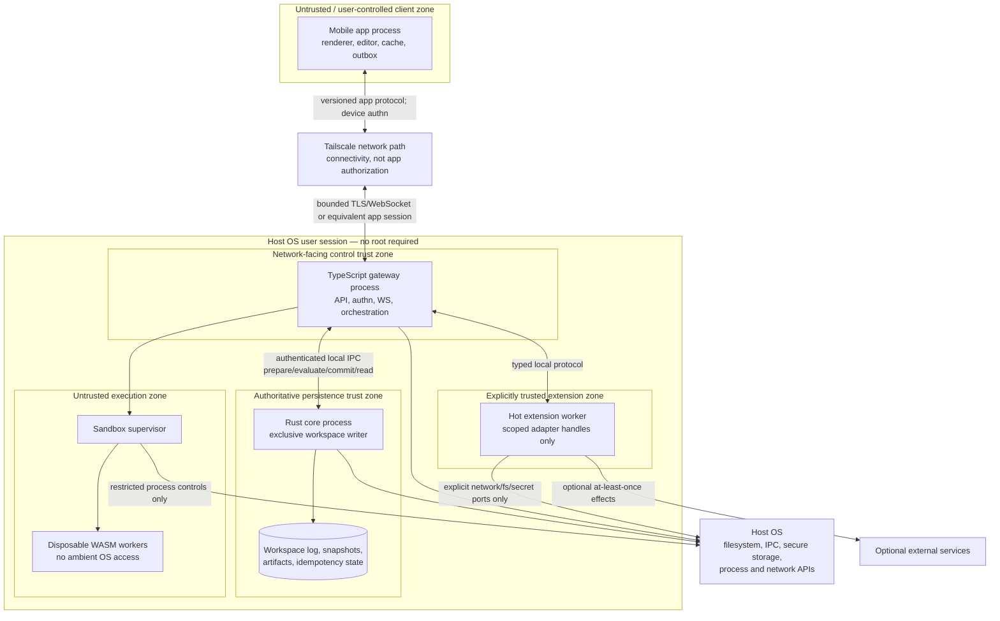

# 04 — Runtime Boundaries

**Status:** Proposed greenfield blueprint; no implementation or test result is asserted.  
**Companion:** `01-system-architecture.md` owns system goals, durable state, UI schemas, sync, packaging, and global acceptance criteria.  
**Purpose:** Define executable ownership, process/trust boundaries, deterministic interfaces, sandboxing, concurrency, overload, and failure containment.

## 1. Normative model and boundary decisions

The key words **MUST**, **MUST NOT**, **SHOULD**, **SHOULD NOT**, and **MAY** are normative. Identifiers are stable. Initial queue and resource values are recommended starting policies, not observed performance or immutable protocol constants.

- `RB-01` The Rust core MUST run as a separately failure-contained local core component with an exclusive writer per workspace. A separate core process is the recommended deployment; an embedded library MAY be used only if the same IPC semantics, writer fencing, crash boundary, and denial of direct database access are preserved.
- `RB-02` The TypeScript gateway MUST NOT execute untrusted UI modules in its own process. It supervises separate WASM sandbox processes and bounded evaluation workers.
- `RB-03` The recommended adjustment to “Rust owns reducers” is that Rust owns **committed-event reduction**, while pure WASM owns candidate user-reducer evaluation. Rust validates and commits the resulting effect. Replay never invokes WASM.
- `RB-04` TypeScript owns transport sync, not sync truth. Rust selects authoritative snapshots/event ranges and computes state hashes; TypeScript frames and transmits them.
- `RB-05` Trusted hot-loaded TypeScript host extensions SHOULD run in separate extension worker processes. “Trusted” permits explicitly granted host adapters; it does not permit direct event-log writes or bypass of Rust command authorization.
- `RB-06` The mobile app is a controlled client but not a trusted authority. Its local validation improves UX and cannot substitute for host validation.
- `RB-07` Every cross-boundary message MUST have a protocol/schema version, bounded size, explicit identity context, and defined timeout/cancellation behavior.
- `RB-08` No boundary MAY convert an infrastructure timeout into a deterministic user-reducer result or a committed event.

## 2. Deployment and trust zones



### 2.1 Trust-boundary rules

| Boundary | Threat controlled | Mandatory controls |
|---|---|---|
| `TB-01` Mobile ↔ TypeScript | Malformed/unauthorized client, replay, flooding, version skew | Application device authentication, per-connection limits, canonical validation, session expiry, capability recheck in Rust |
| `TB-02` TypeScript ↔ Rust | Forged actor context, direct writer exposure, partial frames | OS-authenticated local peer, private IPC endpoint, Rust-derived actor/device context binding, bounded versioned frames |
| `TB-03` TypeScript ↔ WASM | Sandbox abuse, resource exhaustion, nondeterministic output | Process isolation, import allowlist, module verification, fuel/memory/output limits, canonical ABI, reset/kill |
| `TB-04` Extension ↔ TypeScript | Trusted-code fault, excess adapter privilege, state bypass | Separate worker, explicit grant manifest, health/circuit breaker, typed broker, all mutations through Rust |
| `TB-05` Processes ↔ OS | Path traversal, secret leakage, excessive privilege | Scoped ports, no admin requirement, path/symlink defenses, redacted diagnostics, minimum OS permissions |
| `TB-06` TypeScript adapters ↔ external services | Duplicate effects, credential exposure, ambiguous outcomes | Stable effect IDs, idempotency where supported, bounded retries, secrets never in events/UI/WASM |

Tailscale MAY provide an additional identity signal for provisioning or policy, but a tailnet identity, peer IP, or reachable socket MUST NOT alone authorize an application command.

## 3. Rust versus TypeScript versus WASM versus mobile

### 3.1 Decision matrix

| Concern | Recommended owner | Why | What MUST NOT be placed there |
|---|---|---|---|
| Persistent event log and atomic snapshot metadata | **Rust core** | High-assurance transactions and one durability policy | TypeScript SQL/file writes; mobile “shadow authority”; WASM persistence |
| Workspace writer fencing and revision allocation | **Rust core** | Single total order and crash recovery | TypeScript sequence allocation; timestamps as sequence numbers |
| Command schema validation and final authorization | **Rust core** | Security decision beside committed state | Mobile-only validation; trust in TypeScript actor fields; module self-grants |
| Deterministic reduction of committed effects | **Rust core** | Replay without historical executable logic | Re-running WASM/TypeScript during replay; clocks/network/randomness |
| Idempotency and conflict checks | **Rust core** | Must be atomic with commit | In-memory-only TypeScript dedupe; mobile assumption that send equals acceptance |
| Snapshot state hash and authoritative sync-range selection | **Rust core** | Same canonical state and revision source | TypeScript-invented snapshots or skipped event ranges |
| Candidate user UI reducers | **Pure WASM** | Portable, hot-updatable, deterministic untrusted logic | Direct event-log access; nondeterministic host functions; final capability decisions |
| Mobile HTTP/WebSocket API and connection lifecycle | **TypeScript control plane** | Network adapters and orchestration fit a managed control layer | Durable business truth only in memory; final authorization |
| Sandbox process supervision and worker scheduling | **TypeScript control plane** | Crash isolation and backpressure without blocking Rust | Untrusted modules in gateway process; unbounded worker creation |
| Trusted host adapters and hot extensions | **TypeScript extension workers** | OS/service integration and trusted operational evolution | Direct core-store mutation; user-authored TypeScript loaded as “trusted” without admin flow |
| Native declarative rendering and editor interactions | **Mobile app** | Platform UX, accessibility, gestures, offline drafts | Authoritative conflict decisions; hidden privileged commands; embedded arbitrary native code from UI |
| Device private key and local outbox | **Mobile OS adapter/app** | Protect credentials and preserve ambiguous sends | Hard-coded shared keys; treating outbox items as committed |
| OS clocks, entropy, filesystem, network | **Edge ports only** | Keep deterministic cores platform-neutral | Any of these in pure WASM or committed reduction |

### 3.2 Rust core exclusions

Rust SHOULD NOT own mobile rendering, WebSocket fan-out, Tailscale configuration, arbitrary third-party SDK orchestration, or hot-loaded TypeScript. The recommended deployment also keeps the WASM runtime outside the Rust core process: an untrusted trap or runtime defect must not corrupt or stall the writer. Rust MAY perform inexpensive static validation of module bytes but MUST NOT depend on a successful historical execution for replay.

Rust core logic MUST NOT read environment variables, local locale, wall time, random values, network responses, or filesystem paths while reducing an already committed effect. Such values, if legitimately part of a command, MUST be captured and validated in the event before reduction.

### 3.3 TypeScript control-plane exclusions

TypeScript MUST NOT:

- open the workspace store for mutation or allocate revisions;
- accept actor/capability assertions from the mobile request body;
- treat a Tailscale peer as an authenticated application actor;
- publish prepare/evaluation messages as committed events;
- run CPU-heavy WASM evaluation or native extension work on its network event loop;
- store the only copy of a durable grant, outbox intent, UI definition, or command result in process memory;
- silently turn a failed Rust commit into success;
- execute untrusted user TypeScript or dynamically relax sandbox policy from UI content.

### 3.4 WASM exclusions

WASM MUST NOT contain authoritative snapshot/log replay, device enrollment, session verification, secret storage, network clients, filesystem adapters, native mobile rendering calls, wall-clock scheduling, random ID generation, or OS capability enforcement. A module proposes typed effects; Rust disposes.

### 3.5 Mobile exclusions

The mobile app MUST NOT resolve concurrent authoritative edits by silent last-write-wins, mint durable capabilities, choose a workspace revision, or use native UI APIs not present in the negotiated declarative action contract. It MAY reject obviously invalid input locally but MUST display the host result as the final authority.

## 4. Communication contracts

### 4.1 Common transport rules

- `COM-01` The recommended persisted/evaluation encoding is the restrictive canonical CBOR profile defined in `01-system-architecture.md`. WebSocket data frames SHOULD use that encoding; human-facing diagnostics MAY use JSON.
- `COM-02` All numeric revision and sequence fields are unsigned 64-bit values. Encoders MUST reject values that cannot round-trip in every supported client; JavaScript-facing code MUST use safe big-integer handling rather than lossy numbers.
- `COM-03` Maximum routine command payload is 1 MiB and maximum protocol frame is 2 MiB. Streaming artifact APIs MAY use separately bounded chunks and content hashes.
- `COM-04` Every request carries `request_id`; every evaluation also carries Rust-issued `preparation_id` and `evaluation_id`. These correlate work but do not order state.
- `COM-05` Timeouts use monotonic clocks. Cancellation is advisory until the receiver acknowledges it or the preparation is closed; a late duplicate result cannot commit after closure.
- `COM-06` Protocol errors are stable machine codes with safe human messages. Internal stack traces, tokens, local paths, and secrets MUST NOT cross to mobile or WASM.

### 4.2 Mobile–control API (`IF-01`)

| Operation | Semantics |
|---|---|
| `Hello` | Negotiate protocol version, canonical encoding, schema/feature ranges, and client capabilities. No state access is granted by `Hello` alone. |
| `Authenticate` | Prove enrolled device key or present valid session credential; return bounded `session_id`, expiry, and server challenge policy. |
| `OpenWorkspace` | Bind an authenticated actor/device to a workspace after Rust verifies durable access. |
| `SubmitCommand` | Submit exact canonical command bytes, ID, base revision/conflict rule. Returns accepted commit, deterministic rejection, or explicit transient failure. |
| `GetSnapshot` | Authorize and stream an immutable Rust snapshot identity; response includes revision and state hash. |
| `Subscribe` | Start at current revision or request `Resume` semantics; only committed events are sent. |
| `Resume` | Request events after a client cursor; return ordered deltas or `SNAPSHOT_REQUIRED`. |
| `FetchArtifact` | Authorize read of a content-addressed artifact and verify bytes against hash. |

A WebSocket or equivalent bidirectional channel is recommended for live sync. Command submission MAY also use a request/response HTTP endpoint, but both paths MUST enter the same `IF-02` pipeline and share authentication, limits, and idempotency.

### 4.3 Control–core IPC (`IF-02`)

```text
PrepareCommand
  input: AuthenticatedCommand
  output:
    Ready { preparation_id, normalized_effect_hash }
    Evaluate { EvaluationRequest }
    Duplicate { original CommitResult }
    Rejected { stable_error, current_revision? }

CompleteEvaluation
  input: {
    preparation_id,
    evaluation_id,
    outcome: CanonicalOutput | DeterministicFailure | ResourceFailure,
    input_hash,
    output_hash?
  }
  output: ReadyToCommit { normalized_effect_hash } | Rejected

CommitPrepared
  input: { preparation_id, expected_normalized_effect_hash }
  output: Committed { CommitResult } | Rejected

CancelPrepared
  input: { preparation_id, reason }
  output: Cancelled | AlreadyClosed

ReadEvents
  input: { workspace_id, from_revision, max_events, max_bytes }
  output: ordered batch | SnapshotRequired | RevisionOutOfRange

ReadSnapshot / ReadState
  input: { workspace_id, requested_revision? }
  output: immutable snapshot/state manifest and authorized stream descriptor

Compact
  input: { workspace_id, requested_policy }
  output: new snapshot identity and retained revision information

Health
  output: writer status, current revision, storage health, queue depth,
          snapshot status, schema/protocol compatibility
```

- `IPC-01` Rust MUST bind `preparation_id` to the authenticated actor/device/session, canonical command hash, base revision, and—where applicable—module/input hash. TypeScript cannot substitute any of them later.
- `IPC-02` A `ResourceFailure` (wall timeout, trap caused by runtime failure, allocation failure, worker death) closes preparation without an event. A module's deterministic, schema-valid domain rejection MAY be returned as a rejected command; neither advances revision.
- `IPC-03` `CommitPrepared` runs on the serialized writer and repeats every security/concurrency check. `ReadyToCommit` is not authority to bypass that check.
- `IPC-04` Only TypeScript's authenticated local core client can use this API. The core listener MUST NOT be exposed to Tailscale or another network interface.
- `IPC-05` After core restart all uncommitted preparations are invalid. Clients retry exact commands; the durable idempotency index resolves any already committed case.

### 4.4 Evaluation supervisor API (`IF-03`)

`Run` accepts exactly one Rust-generated `EvaluationRequest` and returns one bounded result. `Cancel` prevents further scheduling and requests termination; it cannot undo an already committed command. `Reset` clears all linear memory and instance diagnostics before reuse. `Terminate` destroys a poisoned, timed-out, crashed, or policy-violating worker.

The supervisor MUST verify the returned `evaluation_id`, input hash, canonical output size/hash, and module hash before forwarding. Verification is defense in depth; Rust repeats authoritative validation.

### 4.5 Trusted extension API (`IF-04`)

Extensions receive only versioned broker handles declared in their activated grant. They MAY subscribe to committed events and submit commands. They MUST NOT receive raw workspace-store handles, the core writer socket, other extensions' secrets, or unrestricted WASM supervisor control.

## 5. Non-blocking prepare/evaluate/commit protocol

```mermaid
sequenceDiagram
    autonumber
    participant T as TypeScript orchestrator
    participant R as Rust prepare + single writer
    participant Q as Bounded evaluation scheduler
    participant W as WASM worker

    T->>R: PrepareCommand(authenticated command)
    R->>R: Validate, dedupe, bind preparation to base revision
    R-->>T: EvaluationRequest(pinned module/input/budget)
    T->>Q: Enqueue within global/workspace/client limits
    Q->>W: Run exactly one evaluation
    Note over R: Writer remains available for other prepares/commits
    W-->>Q: Canonical output / deterministic failure
    Q-->>T: Verified bounded result
    T->>R: CompleteEvaluation(result and hashes)
    R->>R: Validate output and normalize effect
    T->>R: CommitPrepared(preparation_id, effect hash)
    R->>R: Serialize; recheck base, grants, session, idempotency
    alt Still valid
        R->>R: Atomically append effect event and projection
        R-->>T: Committed(revision, event_id)
    else Stale, revoked, duplicate, or invalid
        R-->>T: Explicit rejection or original duplicate result
    end
```

- `EXEC-01` No revision is reserved during evaluation. Therefore failed/cancelled evaluations cannot leave sequence holes.
- `EXEC-02` Exact-base commands commit only if their input revision is still current at commit. Command kinds with a different conflict rule MUST define it explicitly in their versioned Rust validator; UI edits always use exact base.
- `EXEC-03` Evaluation concurrency MAY exceed one, but durable commit order remains the Rust writer's order. Evaluation completion order is not authoritative order.
- `EXEC-04` A pending registry MUST bound lifetime, count, and retained input bytes. Duplicate in-flight IDs with identical bytes join the same preparation; different bytes fail `COMMAND_ID_REUSE`.
- `EXEC-05` Session revocation, device disablement, workspace close, or module policy change MUST cancel matching pending preparations. Commit still independently checks durable grants.
- `EXEC-06` TypeScript MUST NOT synchronously wait for WASM on its network event loop. Rust MUST NOT synchronously wait for evaluation inside its single-writer critical section.

## 6. Pure WASM determinism and ABI

### 6.1 Module manifest and verification

```text
ModuleManifest
  manifest_schema_version
  module_id
  module_hash
  wasm_abi_version
  deterministic_profile_version
  entrypoint
  declared_imports[]
  required_wasm_features[]
  maximum_memory
  maximum_input_bytes
  maximum_output_bytes
  declared_effect_schemas[]
  requested_capabilities[]           # requests, never grants
```

- `DET-01` The loader MUST hash exact bytes and match the Rust-pinned `module_hash`. A name, version label, URL, or “latest” alias is insufficient.
- `DET-02` The loader MUST reject any import not in the ABI allowlist, any unsupported feature, malformed canonical metadata, or resource declaration above workspace policy.
- `DET-03` The initial deterministic profile SHOULD disable threads, shared memory, relaxed SIMD, exception propagation across the ABI, WASI, and noncanonical floating-point behavior. Authoritative reducer modules MUST NOT use floating-point instructions in the initial profile.
- `DET-04` The same module bytes, ABI/profile version, canonical input, and deterministic fuel limit MUST yield the same canonical success/output or deterministic fuel-exhaustion result on every supported evaluator.
- `DET-05` Wall time, available memory, OS scheduling, host load, and worker identity MUST NOT be module inputs and MUST NOT affect a committed result.
- `DET-06` A wall deadline or host out-of-memory condition produces `ResourceFailure`, never a domain output. A deterministic fuel limit produces `EVAL_FUEL_EXHAUSTED`; no event is committed in either case.
- `DET-07` Canonical output MUST reject duplicate map keys, non-shortest numeric forms, invalid UTF-8 where strings are required, unspecified map ordering, trailing bytes, and values outside schema bounds.
- `DET-08` Module diagnostics MUST NOT affect output hash, state reduction, control flow outside the module, or subsequent evaluations.

### 6.2 Exports, memory, and host imports

The recommended ABI exports linear `memory`, a versioned allocator pair, and `evaluate`. The host writes one canonical `EvaluationInput`, invokes one entrypoint, and reads one canonical `EvaluationResult`. Pointer/length pairs MUST be checked for overflow and bounds before every access. The ABI MUST NOT expose host pointers.

```text
EvaluationInput
  evaluation_schema_version
  workspace_public_context           # minimum necessary; no secrets
  actor_public_context               # stable public IDs, not credentials
  base_revision
  command_kind
  canonical_command_payload
  immutable_ui_state                 # only declared required state
  deterministic_policy               # fuel/output/schema parameters

EvaluationResult
  status                             # success or deterministic user rejection
  ui_effect?                         # schema-valid candidate definition mutation
  effect_proposals[]                 # typed commands, not executed side effects
  diagnostics[]                      # bounded, excluded from authoritative effect
```

The only recommended host imports are:

1. `trace(level, bytes)`: bounded, rate-limited diagnostics; return value carries no data and cannot influence evaluation. Tracing MAY be disabled without changing the canonical result.
2. `abort(code)`: deterministically terminates the current evaluation with no committed effect.

There are **no** clock, monotonic clock, random, sleep, socket, DNS, HTTP, filesystem, environment, process, thread, native UI, keychain, or general logging imports. If future pure functionality needs a host primitive, it MUST be referentially transparent, canonical, versioned, resource-bounded, and added through a new deterministic profile rather than quietly extending an old one.

### 6.3 Effects and replay

- `DET-09` A module cannot perform an authoritative effect during evaluation. It returns candidate data; Rust validates actor, workspace, schema, and effect-specific rules.
- `DET-10` The event stores the normalized effect and provenance hashes. Rust's replay reducer consumes only that effect and event metadata explicitly marked deterministic.
- `DET-11` A new module revision is selected only by a new committed UI definition. Existing evaluations remain pinned to their original hash and cannot observe a hot swap mid-run.
- `DET-12` Workers MAY be pooled only after complete memory reset and policy verification. Cross-evaluation mutable state, caching visible to module behavior, and reentrant evaluation are forbidden.
- `DET-13` Two semantically identical inputs under the same deterministic profile SHOULD produce byte-identical canonical output. Any optimizer or compiler used for modules MUST preserve this property.

### 6.4 Resource policy

Recommended initial values, aligned with `01-system-architecture.md`:

| Resource | Initial limit | Overflow behavior |
|---|---:|---|
| Fuel per evaluation | 5,000,000 units | `EVAL_FUEL_EXHAUSTED`; no commit |
| Wall safety deadline | 50 ms | `EVAL_RESOURCE_FAILED`; kill/reset; no deterministic domain claim |
| Linear memory | 64 MiB per instance | Trap/resource failure; no commit |
| Canonical input | 1 MiB | Reject before scheduling |
| Canonical output | 1 MiB | Reject output; destroy/reset instance |
| Diagnostics | 64 KiB per evaluation | Truncate diagnostics only with explicit flag; never truncate authoritative output |
| Module bytes | 2 MiB | `MODULE_INVALID` or `MODULE_TOO_LARGE` |

## 7. Capability enforcement and credential boundaries

### 7.1 Three distinct decisions

1. **Network connectivity:** Tailscale determines whether packets can reach the host listener.
2. **Application authentication:** TypeScript verifies an enrolled device proof/session and binds actor/device/session to the connection.
3. **Command authorization:** Rust verifies durable device/actor/workspace grants and command-specific invariants at preparation and commit.

None implies the others. A reachable peer without application credentials receives `AUTH_REQUIRED`; an authenticated actor without a grant receives `PERMISSION_DENIED`.

### 7.2 Capability model

Recommended namespaced grants include `ui.read`, `ui.edit`, `command.invoke:<kind>`, `artifact.read`, `device.manage`, and `extension.manage`. Adapter grants for trusted extensions MAY include narrowly scoped `net.connect:<destination>` or `fs.read:<workspace-scoped-area>`; they are never inferred from a module's import list.

- `CAP-01` Effective WASM effect authority is `actor grants ∩ workspace policy ∩ active UI/effect policy`. The module's requested capabilities only constrain what it declares; they cannot elevate authority.
- `CAP-02` Pure WASM receives no direct network/filesystem/secret capability even when its effect proposal is authorized. It returns data to Rust; a separately authorized trusted adapter MAY later perform an external effect.
- `CAP-03` Device keys are generated and kept in mobile platform secure storage where available. Hosts store public enrollment records; TypeScript-generated session secrets are random at the edge and never enter deterministic state.
- `CAP-04` Session identifiers and actor/device context on `IF-02` MUST come from the authenticated TypeScript session binding, not command payload. Rust binds this context to preparation and checks durable grants itself.
- `CAP-05` Revocation events invalidate future preparation immediately. TypeScript closes sessions and cancels pending work; Rust's commit-time check is the final backstop.
- `CAP-06` Administrative capability changes SHOULD require a fresh administrator authentication and MUST produce auditable effect events.
- `CAP-07` Secrets needed by a trusted adapter SHOULD be exposed as opaque broker handles. The secret value MUST NOT appear in extension events, UI state, WASM input/output, or mobile protocol messages.
- `CAP-08` Rate limits MUST be applied per device, actor, workspace, and connection as appropriate. Authentication failure responses SHOULD avoid revealing whether a guessed actor/workspace exists.

### 7.3 Sandbox defense in depth

WASM purity is necessary but not the only containment. The sandbox process SHOULD have no inherited environment secrets, no open workspace file descriptors, no network namespace access where the OS port supports it, a restricted working directory, low-privilege identity, and hard process memory/job limits. It MUST NOT run as administrator/root. Module import validation and process isolation are independent layers; neither justifies removing the other.

## 8. TypeScript orchestration and trusted hot extensions

### 8.1 Gateway and scheduler

- `TS-01` The gateway maintains bounded connection state and translates transport failures without changing command semantics.
- `TS-02` The evaluation scheduler applies global, workspace, and per-client concurrency/fairness limits. A noisy workspace MUST NOT monopolize all workers.
- `TS-03` Event fan-out reads only committed Rust events. TypeScript MAY cache immutable snapshots/events for efficiency but MUST validate identity and revision and treat the cache as disposable.
- `TS-04` On reconnect to Rust, TypeScript discards incomplete outbound frames, reopens its event cursor, and resolves gaps before resuming normal publication.
- `TS-05` Telemetry MUST be outside authoritative control flow. Blocking or failing telemetry cannot delay a commit indefinitely or change its result.

### 8.2 Hot extension lifecycle

```mermaid
sequenceDiagram
    autonumber
    participant A as Trusted administrator
    participant T as TypeScript extension supervisor
    participant R as Rust core
    participant W as New extension worker

    A->>T: Stage exact package bytes and manifest
    T->>T: Verify hash, schema, compatibility, requested grants
    A->>T: Authorize InstallExtension(hash, explicit grants)
    T->>R: Prepare/Commit administrative command
    R-->>T: Committed desired extension revision (staged/disabled)
    T->>W: Start isolated worker with pinned package and broker handles
    W-->>T: Ready plus schema/health report
    alt Health and compatibility pass
        A->>T: Activate extension revision (or approved automatic policy)
        T->>R: Commit activation configuration revision
        R-->>T: Committed activation
        T->>T: Atomically route new work; drain old worker
    else Failure
        T->>T: Quarantine worker; leave prior active revision unchanged
    end
```

- `EXT-01` Installation, granting, and activation are auditable administrative commands. Staging bytes alone MUST NOT change routing.
- `EXT-02` The running package hash MUST equal the activated desired hash. A file replacement or package label cannot hot-swap a live worker.
- `EXT-03` Switchover occurs at a committed configuration revision. In-flight external attempts MAY drain under a deadline; authoritative mutations still use normal revision/idempotency rules.
- `EXT-04` A failed candidate leaves the previous active extension untouched. Rollback activates a new desired configuration revision referencing the prior package hash.
- `EXT-05` Repeated crash, protocol violation, or grant abuse opens a circuit breaker and disables new work for that extension without stopping the gateway/core.
- `EXT-06` External effects use stable IDs derived from committed intent (recommended `event_id` plus effect index). Adapters SHOULD send idempotency keys when supported and MUST describe effects as at-least-once otherwise.
- `EXT-07` External calls MUST NOT occur inside the Rust commit transaction or pure WASM evaluation. An ambiguous external result is reconciled by adapter status/retry, never by inventing a committed workspace event without validation.

## 9. Mobile runtime boundary

- `MOB-01` The renderer consumes only negotiated declarative nodes/actions and maintains a projection tied to `workspace_revision` and optional state hash.
- `MOB-02` A live event is applied only if it is the next revision or a duplicate already present. Any other gap stops projection advancement and triggers `Resume`.
- `MOB-03` Snapshot replacement and cursor update are one atomic local transaction. Cache corruption is repaired by discarding the cache and fetching a verified snapshot, never by guessing state.
- `MOB-04` The editor uses the same `SubmitCommand` path as other actors and has no special local write privilege.
- `MOB-05` Outbox persistence occurs before first send. An item is removed after a definitive accepted result or a user-handled permanent rejection; a timeout remains pending.
- `MOB-06` Native lifecycle handlers MAY pause network activity and ephemeral presence, but MUST NOT discard pending commands or treat backgrounding as cancellation.
- `MOB-07` Device keys SHOULD use hardware/platform-backed protection where available and MUST NOT be included in backups, logs, analytics, UI state, or crash reports.
- `MOB-08` Local accessibility, focus, animation, and gesture state are ephemeral and MAY use platform clocks; authoritative UI reduction cannot depend on them.

## 10. Concurrency, lifecycle, and cleanup

- `LIFE-01` Startup order is Rust workspace verification/open, then TypeScript core connection, sandbox/extension supervision, then mobile listener readiness. The listener MUST NOT advertise write readiness before the core writer is healthy.
- `LIFE-02` Shutdown stops new mobile admissions, allows a bounded commit drain, cancels evaluations/extensions, closes TypeScript connections, and finally closes the Rust writer. A forced shutdown relies on transaction recovery and idempotency.
- `LIFE-03` Reader requests use immutable snapshots or revision-consistent read views; they MUST NOT block behind an arbitrary user evaluation.
- `LIFE-04` Rust's writer critical section contains validation/rechecks, deterministic effect reduction, and durable transaction work only. Network, extension, and WASM calls are outside it.
- `LIFE-05` Every preparation, evaluation, subscription, artifact stream, and external attempt has an owner and cancellation path. Owners MUST release resources on disconnect, workspace close, revision incompatibility, and process shutdown.
- `LIFE-06` A replacement core process MUST acquire the workspace lock and prove the previous writer is fenced before recovery completes. Two processes MUST NOT both accept commits even briefly.
- `LIFE-07` Artifact cleanup is deferred while references exist from the log-derived state, active snapshots needed for resume, live UI definitions, or pinned evaluations. TypeScript cache eviction alone never deletes authoritative bytes.

## 11. Backpressure and overload contract

### 11.1 Recommended initial limits

All limits MUST be configurable through versioned host policy within safe hard maxima. Changes to limits do not change deterministic state semantics.

| Queue/resource | Initial bound | Saturation behavior |
|---|---:|---|
| Mobile commands awaiting admission per client | 64 | Reject new work `QUEUE_FULL`; include retryability |
| Prepared/pending commands per workspace | 512 | Reject before evaluation; no revision reservation |
| Concurrent evaluations globally / per workspace / per client | 16 / 4 / 1 | Bounded fair queue; reject beyond queue bound |
| Evaluation queue per workspace | 64 requests | `EVAL_QUEUE_FULL`; no worker creation beyond limit |
| Committed events buffered per mobile connection | 1,024 events or 4 MiB | `SLOW_CONSUMER` disconnect; resume/snapshot, never silent skip |
| Rust-to-TypeScript sync batch | 256 events or 2 MiB | Additional bounded batches; apply backpressure |
| Mobile durable outbox | 1,000 commands or 8 MiB | Block new queued edits and request user action; no silent drop |
| Diagnostics per connection/evaluation | 256 KiB / 64 KiB | Coalesce/truncate diagnostics with explicit marker |
| Ephemeral presence/preview queue | 1 latest value per subject | Coalesce allowed because data is non-authoritative |

### 11.2 Retry rules

- `BP-01` `QUEUE_FULL`, `EVAL_QUEUE_FULL`, and explicitly transient `CORE_UNAVAILABLE` MAY be retried with the same command ID after bounded exponential backoff and jitter. Retry guidance SHOULD include a safe delay hint.
- `BP-02` `AUTH_REQUIRED`, `PERMISSION_DENIED`, `COMMAND_ID_REUSE`, `SCHEMA_UNSUPPORTED`, `MODULE_INVALID`, and deterministic validation failures MUST NOT be automatically retried as if transient.
- `BP-03` `REVISION_CONFLICT` requires fetch/current-state review and a new command ID for the rebased semantic change.
- `BP-04` Event subscribers MUST NOT request “drop old events and continue” for authoritative state. They either catch up, receive a snapshot, or remain disconnected.
- `BP-05` Overload responses and health metrics MUST distinguish admission saturation, evaluation saturation, slow consumers, and storage failure; one generic timeout is insufficient for operations.

## 12. Failure modes and containment

| ID | Failure | Required behavior | Forbidden behavior |
|---|---|---|---|
| `FM-01` | Mobile network loss | Keep verified cache read-only/offline and outbox pending; reconnect/reauthenticate/resume | Mark pending command committed; create new ID on every retry |
| `FM-02` | Acknowledgment lost after commit | Same-ID retry returns original event/result | Apply mutation twice or infer failure solely from timeout |
| `FM-03` | TypeScript gateway crash | Core state remains intact; restart, reconnect IPC, rebuild cursors, clients resume | Start fallback TypeScript writer |
| `FM-04` | Rust core crash | Stop write readiness; recover lock/log/snapshot/state hash; retry ambiguous commands | Accept writes from cached TypeScript state |
| `FM-05` | Disk full/flush failure | Fail affected commits `STORAGE_UNAVAILABLE`; preserve verified prefix; alert | Acknowledge before durability; append to another uncoordinated store |
| `FM-06` | Mid-log corruption/checksum mismatch | Stop workspace `WORKSPACE_CORRUPT`; require verified recovery procedure | Skip event, reorder revisions, silently reset to empty |
| `FM-07` | Snapshot write failure | Retain prior valid snapshot; degrade health; continue only if event storage is safe | Publish partial snapshot or delete prior snapshot first |
| `FM-08` | WASM trap/worker death | No commit from that evaluation; destroy worker; bounded retry only if infrastructure-transient | Reuse poisoned memory or commit partial output |
| `FM-09` | Deterministic fuel exhaustion | Return `EVAL_FUEL_EXHAUSTED`; no revision change | Increase fuel silently until output differs or bypass limits |
| `FM-10` | Wall timeout | `EVAL_RESOURCE_FAILED`; kill/reset; client MAY retry exact command under policy | Record timeout as timeless user-domain result |
| `FM-11` | Invalid module/import/hash/output | Fail closed before or during preparation; no effect | Auto-fetch “latest,” add imports, or sanitize into different semantics |
| `FM-12` | Slow event consumer | Disconnect at queue bound; preserve cursor/resume path | Drop committed events and present stream as continuous |
| `FM-13` | Evaluation flood | Fair bounded queues and per-client/workspace rejection | Unbounded process spawn or writer blocking |
| `FM-14` | Session/device revoked | Close session, cancel pending, deny prepare and commit | Allow already-prepared command because it passed earlier |
| `FM-15` | Hot extension crash | Circuit-break extension; retain core/gateway; prior/new active config remains explicit | Restart with unapproved package or bypass Rust mutations |
| `FM-16` | External service timeout | Keep effect outcome ambiguous; bounded retry with stable effect ID/idempotency where possible | Claim exactly-once external effect or block core commit on network |
| `FM-17` | System clock jump | Continue revision ordering and monotonic deadlines; record diagnostic anomaly if useful | Use wall time for event order, idempotency, or reduction |
| `FM-18` | Schema/version skew | Negotiate and reject unsupported required behavior explicitly | Lossy numeric conversion or guessed unknown semantics |
| `FM-19` | Required artifact missing | Verify hashes, attempt authorized restoration, mark affected evaluation/UI degraded | Substitute different bytes under same logical name |
| `FM-20` | Mobile local cache corruption | Discard derived cache, retain secure outbox/keys, fetch verified snapshot | Treat corrupt local projection as a command source of truth |

## 13. Runtime acceptance criteria

These complement `AC-01` through `AC-14` in `01-system-architecture.md`; they are verification requirements, not test results.

- `RAC-01` **Writer non-blocking:** Stall one WASM evaluation until its wall deadline while submitting built-in commands. Other prepares/commits continue within their admitted capacity, and the stalled evaluation reserves no revision.
- `RAC-02` **Commit recheck:** Revoke a capability and change the base revision after evaluation but before commit. Commit fails with the appropriate denial/conflict and no event is appended.
- `RAC-03` **Preparation binding:** Attempt to alter actor, device, base revision, module hash, input hash, effect hash, or evaluation ID between prepare and commit. Rust detects every mismatch.
- `RAC-04` **Deterministic profile:** Repeat the same module/input under different host load, worker identities, wall clocks, tracing settings, and supported evaluator platforms. Successful canonical outputs and deterministic fuel outcomes match; wall resource failures never commit.
- `RAC-05` **Import closedness:** Load modules requesting every forbidden class—clock, random, network, filesystem, environment, threads, native UI, secrets, and unknown imports. All are rejected before execution.
- `RAC-06` **Memory hygiene:** Reuse a worker after two evaluations and after a trap. No prior bytes, diagnostics, module state, or behavior are observable by the next evaluation.
- `RAC-07` **Replay independence:** Remove all WASM workers and TypeScript extensions after commits. Rust replay and snapshot verification still reproduce identical state hashes from effect events.
- `RAC-08` **Session boundary:** Reach the API through Tailscale with invalid application credentials, replay an expired session, and forge actor fields. Authentication/authorization fails and no durable mutation occurs.
- `RAC-09` **Backpressure continuity:** Fill each queue in section 11. Stable errors remain bounded and retryable where specified; after a slow-consumer disconnect, resume exposes no undetected revision gap.
- `RAC-10` **Crash ownership:** Kill gateway, sandbox worker, extension worker, and core independently. Only the affected boundary becomes unavailable; recovery never creates a second writer or loses a durable idempotency result.
- `RAC-11` **Extension atomicity:** Fail staging, health check, activation, and drain at separate points. Routing always names one authorized active package hash or an explicitly disabled state, and rollback creates a new configuration revision.
- `RAC-12` **External ambiguity:** Drop an external adapter response and retry. Workspace history remains valid, the stable effect ID is reused, and status is reported as at-least-once/ambiguous unless the external system confirms idempotent acceptance.
- `RAC-13` **Numeric/canonical safety:** Send oversized revisions, duplicate keys, noncanonical integers, invalid UTF-8, trailing bytes, floats in authoritative records, and pointer overflow inputs. The relevant boundary rejects them without memory access outside bounds or state mutation.
- `RAC-14` **Resource cleanup:** Repeatedly disconnect and cancel preparations, subscriptions, artifact streams, and external attempts. Workers, memory, handles, and pinned artifacts return to expected bounded levels after retention rules are satisfied.
