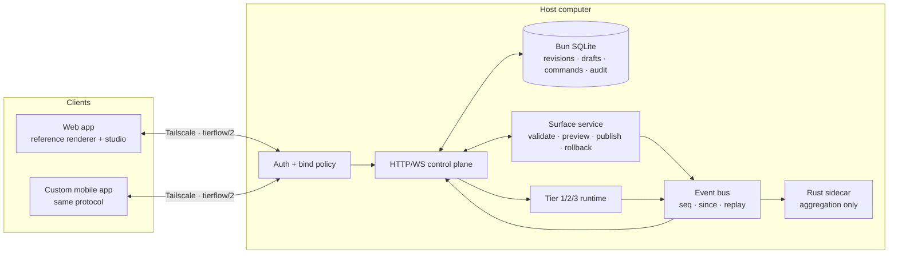

# Current implementation assessment and target decision

**Decision owner:** repository takeover, 2026-11-03  
**Status:** accepted as the implementation baseline for this repo  
**Supersedes for implementation:** the Rust-authority model in `README.md` and `02-ui-reprogramming-studio.md`. Those files remain design reference only.

## 1. Verdict

**Evolve TierFlow. Do not replace it.**

The greenfield blueprint in this folder describes a defensible large system, but it is not the best next step for this repository. The repository already has a working three-tier runtime, a tested event bus, a real WebSocket/HTTP server, a Rust sidecar with a zero-allocation steady-state ingest test, and a declarative surface schema that is weakly constrained and not consumed by the client.

The Rust throughput claim does not carry this decision. The only repository-committed measurement is `bench/README.md` together with `bench/baseline.json` in git history: rust 98 043 events/s, ts 246 336 events/s, ratio 0.398 (Rust slower), 200 000 events. The working tree currently holds a later, **uncommitted** `bench/baseline.json` produced by a post-rewrite benchmark run: rust 616 411, ts 168 244, ratio 3.664, 200 000 events, `at` 2026-11-02T22:37:13.360Z. Both are single measurements on one Windows host, not guarantees. The decision below holds under either reading because Rust stays aggregation-only.

The selected approach is **evolutionary convergence**:

| Layer | Decision |
|---|---|
| Durable user state (UI revisions, drafts, idempotency, audit) | **TypeScript/Bun owns it**, in a transactional SQLite store behind a narrow store interface |
| Realtime control plane, protocol, WebSocket fan-out, auth | **TypeScript/Bun owns it** |
| High-frequency aggregation and frame production | **Rust keeps it**, unchanged scope |
| User-authored UI logic | **Deferred**: trusted TypeScript programs remain the developer extension path; pure deterministic WASM is introduced only if untrusted user logic becomes a real requirement |
| Mobile client | **Protocol-compatible client of the same server**; the shipped web app doubles as the reference renderer and in-UI studio |

This keeps one authoritative process, one transaction boundary, one protocol surface, and one OS-agnostic deployment unit. It satisfies the owner requirement — a user reprograms the UI from the UI, over an existing Tailscale link, from a custom mobile app — without inverting the working runtime or paying for a second state machine.

### 1.1 The UI core is a new subsystem, not an extension of the legacy tiers

Owner directive (2026-11-03): build the best possible reprogrammable real-time stateful UI, without inheriting any external host's constraints, and without chat, VIVIM, or any provider concept leaking into the core.

The UI core therefore lives in its own directory and depends on nothing but its own modules:

```
src/ui/          core: types, document, hash, store, commands, realtime
src/surfaces/    interaction surfaces that wrap the core (http, websocket, later chat)
src/adapters/    external provider adapters (HQ/VIVIM coordination) — independent of the core
```

Dependency direction is one-way: surfaces → core. Providers are reached only through surfaces. The core imports no tier, no provider module, no transport, and knows nothing about chat. `tests/architecture-boundary.test.ts` makes that rule executable.

The legacy three-tier agent (`src/tier1|tier2|tier3`) remains a working chat-driven surface over the existing event bus. It is **not** the UI core. When the core is exposed over HTTP and WebSocket, a chat turn is just another command source — one adapter among many — rather than the system's only way to express intent.

The existing `runtime/surface.json` surface and the legacy `SurfaceSpec` remain the legacy tier's layout. The UI core's document model (`src/ui/types.ts`) is a separate, versioned document with stable node identity, state bindings, and a command port. The two are not merged: the legacy surface is what the legacy webapp renders today; the UI core is what a new mobile client and a new renderer will consume.

## 2. Code facts behind the decision

Verified directly against the working tree on 2026-11-03:

- One server process owns HTTP, WebSocket fan-out, and static delivery: `src/server.ts:206-413`. `AGENTS.md` states `src/server.ts` is the only process.
- The Rust core is a stateless NDJSON aggregator with three modes (`stream`, `bench`, `replay`): `core/src/main.rs:803-856`. It writes no state and accepts no command.
- TypeScript is the sole writer of every persisted artifact: surface `src/surface.ts:117-124`, programs `src/registry.ts:204-211`, config `src/config.ts:146-176`.
- The declarative surface contract already exists and is versioned: `SurfaceSpec` in `src/protocol.ts:213-221`, closed panel vocabulary in `src/surface.ts:19`, parsing rules in `src/surface.ts:42-75`.
- The server already broadcasts the surface (`src/server.ts:151`, `src/server.ts:345`), but the browser client ignores it: `web/app.js:431-511` handles only `event`, `run`, `plan`, `note`, `frame`, `hello`. The renderer is fixed markup in `web/index.html:46-118`.
- The event bus already has the exact primitive the blueprint needs: monotonic `seq` and `since(cursor)` replay, `src/bus.ts:67-140`, tested in `tests/bus.test.ts:35-53`. It is simply not exposed on the wire; the client sets `state.lastSeq` but never sends it (`web/app.js:379`).
- There is no authentication, no capability model, and no host binding: `Bun.serve` sets only `port` (`src/server.ts:206-208`), and every HTTP and WebSocket route is open (`src/server.ts:209-412`). `PUT /api/programs/:name` executes arbitrary in-process TypeScript (`src/registry.ts:204-211`).
- There is no WASM in the tree. The repository's own WASM idea is different: compile the aggregator to `wasm32` for a browser frame path (`PLAN.md:97`), not user-supplied sandboxed logic.
- `runtime/surface.json` is overwritten non-atomically, the surface revision counter is process-local and resets on restart (`src/surface.ts:84`, `src/surface.ts:126-129`), and the file watcher double-bumps revisions after API writes (`src/surface.ts:104-124`, `src/surface.ts:149-162`).

Measured baseline:

- `bun test tests/bus.test.ts` → **9 pass, 0 fail**.
- `bun run core:test` → **10 passed, 0 failed, 1 ignored**.
- `bun run typecheck` → **fails** in the uncommitted `src/bus.ts` edit: `#window` returns `(BusEvent | undefined)[]` where `BusEvent[]` is required (`src/bus.ts:118-119`).
- Working tree is dirty with uncommitted work in `src/bus.ts`, `src/registry.ts`, `runtime/config.json`, `runtime/surface.json`, `bench/baseline.json`, plus untracked `src/coordination/`, `src/adapters/`, `scripts/tierflow-bus.ts`, `tests/fixtures/`, and `docs/BASELINE-2026-11-02.md`. This takeover must not discard or overwrite that work.

## 3. Why the greenfield blueprint is not the target

The blueprint places the authoritative event log, revisions, transactions, capability checks, and WASM execution in Rust, and forbids TypeScript from owning state (`realtime-stateful-ui-blueprint/README.md:60`, `:112-119`). Against this repository that is wrong for four reasons:

1. **It inverts the working authority model.** TypeScript already owns all state. Moving authority to Rust requires a second process, a new versioned IPC, a storage rewrite, a fallback rewrite, and a new crash-recovery story before the product gains anything.
2. **It does not target the measured bottleneck.** The measured constraint is the TypeScript-to-WebSocket event firehose and process-spawn cost, not durability. The blueprint invests in transactions and WASM while leaving the actual fan-out path unmeasured in end-to-end terms.
3. **It duplicates state machines.** A Rust authority plus a TypeScript control plane plus a WASM runtime means three reduction implementations to keep in agreement.
4. **It risks the currently working runtime.** The Rust sidecar is proven on its own path (10 Rust tests pass; measured ingest is allocation-free). Rewriting it into a transaction authority puts the proven part at risk for an unmeasured requirement.

What the blueprint gets right and this repository genuinely needs: stable node identity, schema-versioned UI documents, draft isolation, compare-and-swap publication, idempotent commands, explicit reconnect cursors, transport-independent authorization, and the rule that Tailscale is not authentication. Those are adopted below — in TypeScript, where the state already is.

## 4. Target architecture



### 4.1 Authoritative state

A single Bun SQLite database (`runtime/state.db`, gitignored) becomes the authority for user-authored UI state:

| Table | Purpose |
|---|---|
| `ui_revisions` | Immutable published surface revisions: `revision`, `content_hash`, `document_json`, `actor`, `created_at`, `source` |
| `ui_current` | Single-row pointer to the published revision |
| `ui_drafts` | Draft documents with `draft_id`, `base_revision`, `draft_revision`, `content_json`, `content_hash` |
| `commands` | Idempotency records: `command_id`, `payload_hash`, `result_json`, `created_at` |
| `audit` | Append-only publication, rollback, and authorization-failure records |

`runtime/surface.json` remains a human-readable **projection** written atomically (temp file plus rename) after each successful publish, so existing tooling keeps working while the database owns truth.

### 4.2 UI document

`SurfaceSpec` evolves to a versioned document that the client actually renders:

- stable opaque `id` per panel, preserved across reorder and edit; generated by the server when missing, never derived from array position;
- `schemaVersion` independent of the wire protocol version;
- optional `bind` expressions over a named, explicitly exposed state projection (constrained JSON Pointer-style paths, not arbitrary expressions);
- optional `action` binding naming a known server command, not an arbitrary method or shell string;
- `collapsed`, `span`, and responsive span rules already present;
- registry: the closed `PANEL_KINDS` vocabulary remains the registry. Unknown kinds are rejected with a diagnostic rather than silently dropped.

### 4.3 Draft, preview, publish, rollback

- `POST /api/surface/drafts` creates a draft from the current published revision.
- `PATCH /api/surface/drafts/:id` applies typed edits with `expectedDraftRevision`; conflicting or stale edits get `409` plus current draft revision.
- `POST /api/surface/drafts/:id/preview` returns the validated candidate and rendered-state projection without touching published state.
- `POST /api/surface/publish` commits with `baseRevision`, `draftId`, `contentHash`, and `commandId`; stale `baseRevision` returns `409` with the current revision.
- `POST /api/surface/rollback` publishes a prior revision as a **new** revision; history is never rewritten.
- A repeated `commandId` with the same payload returns the original result; the same ID with a different payload returns `409`.

### 4.4 Realtime protocol

Protocol becomes `tierflow/2` while remaining backward compatible for `tierflow/1` clients during rollout.

- The client sends its last applied `seq` when reconnecting.
- The server replies with `resync` carrying `from`, `to`, `events`, and `gap: boolean`; if the requested cursor predates the ring, the server sends a fresh snapshot and sets `gap: true`.
- Server-side batch drops stop being silent: the client is told the gap and resynchronizes.
- New wire kinds: `surface.published`, `surface.draft`, `state.patch`, `resync`.
- The UI surface is applied by the client renderer; the surface message is no longer ignored.

### 4.5 Authorization and exposure

- Default bind is `127.0.0.1`; `TIERFLOW_HOST` selects the host interface, including a Tailscale address.
- `TIERFLOW_AUTH_TOKEN` is required whenever the bind address is not loopback. HTTP requests use `Authorization: Bearer`; WebSocket clients authenticate with a `hello`/`auth` frame or an `access_token` query parameter on the upgrade.
- Health and metrics endpoints remain unauthenticated but disclose no secrets.
- `PUT /api/programs/:name` is **trusted-extension authority**. It is disabled by default when the server is not loopback-bound unless `TIERFLOW_ALLOW_PROGRAM_WRITE=1` is set explicitly.
- Tailscale remains transport only. The token is the application credential.

### 4.6 Rust, TypeScript, and WASM boundary

| Concern | Owner | Reason |
|---|---|---|
| Durable UI state, drafts, revisions, idempotency, audit | TypeScript/Bun + SQLite | State already lives in TS; one transaction boundary; no IPC |
| Protocol, HTTP, WebSocket, fan-out, auth | TypeScript/Bun | Only layer that can reach clients |
| Tier 1/2/3 orchestration and process execution | TypeScript/Bun | Existing working design |
| High-frequency aggregation and frame production | Rust | Measured fast path; allocation-free ingest; 10 passing Rust tests |
| Trusted developer extensions | TypeScript programs, explicitly trusted | Existing seam; labeled, admin-gated, not sandboxed |
| Untrusted user-supplied logic | Deferred; pure WASM later if required | No requirement proven yet; WASM adds ABI, sandbox, and determinism cost |

**Rust must not** become the state authority in this codebase. Reconsider only if a measured requirement appears that the TypeScript store cannot meet, such as a sustained ingest rate above the measured envelope or a mandated independent core process.

**WASM must not** be introduced as a speculative framework layer. When required, it must be pure and deterministic: explicit ABI, no network, filesystem, clock, randomness, or ambient host access, with bounded memory, fuel, execution time, and output size.

## 5. Implementation phases and gates

| Phase | Deliverable | Independent validation | Oracle gate question |
|---|---|---|---|
| 1 | Durable surface state: SQLite store, atomic projection, persisted revisions, CAS publish, idempotency, draft isolation | Store and surface unit tests; typecheck | Is the authority boundary single, atomic, and free of a second state machine? |
| 2 | Realtime correctness: `tierflow/2` resume cursor, gap detection, no silent drops, client applies surface | Bus/protocol/server/client tests | Can a reconnecting client prove it lost no committed state? |
| 3 | In-UI studio and declarative renderer: client renders `SurfaceSpec`; user edits panels from the running UI | Browser-level test plus accessibility check | Does the shipped client actually reprogram itself without a code change? |
| 4 | Exposure control and mobile readiness: loopback default, token auth, Tailscale bind, trusted-extension gate, mobile client contract | Auth and bind tests; deployment probe | Can a non-loopback deployment be made safe without a large auth framework? |
| 5 | Optional pure WASM user logic, only on demonstrated need | Determinism vectors, resource-trap tests | Is the ABI deterministic and bounded, and is the cost justified? |

Each phase is independently valid and committed. No phase begins before the previous phase's Oracle gate is reconciled.

## 6. Non-goals for this takeover

- No event-sourced Rust authority rewrite.
- No WASM runtime, ABI, or marketplace in the baseline.
- No multi-host consensus, CRDT merging, or offline-first write queue.
- No native mobile app implementation in this repository; the repository provides the protocol and reference client.
- No replacement of the working tier runtime, registry, executor, or Rust aggregator.

## 7. Explicitly deferred product decisions

- Native mobile framework and minimum OS versions.
- Whether the bearer token becomes a paired-device keypair with short-lived sessions.
- Draft and audit retention periods.
- Whether user-authored logic must ever be untrusted enough to require WASM.
