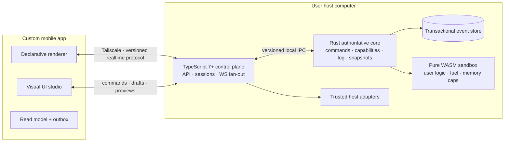
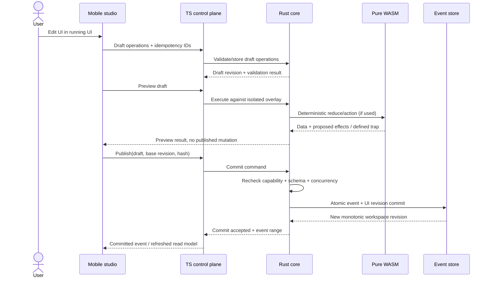

# Real-Time Stateful, Self-Reprogramming UI

> **Implementation authority for this repository:** `07-current-implementation-assessment.md`. It selects an evolutionary target (TypeScript/Bun owns durable UI state; Rust keeps aggregation-only scope; WASM deferred). The Rust-authority design below is retained as reference material only.

**Technical blueprint — greenfield, OS-agnostic, mobile-controlled**

Status: proposed architecture, not an implementation report  
Scope: a user edits and runs their UI from the UI itself. A custom mobile app is the editor and renderer; the user's host computer holds authoritative state. Tailscale connectivity is assumed to work already.

## 1. Recommended shape

Use a **host-authoritative, single-writer, event-sourced core** with a **declarative UI document** and **revisioned draft/preview/publish transactions**.

- **Rust core:** durability, transactions, command validation, authorization at commit time, deterministic reduction, snapshots, event sync, and resource-limited execution of authoritative WebAssembly logic.
- **TypeScript 7+ control plane:** mobile-facing API, WebSocket fan-out, pairing/session adapters, schema orchestration, process lifecycle, observability, and trusted host integrations.
- **Pure WebAssembly:** optional user-supplied deterministic logic — validation, actions, and reducers — behind a tiny versioned ABI. No network, filesystem, wall clock, random source, threads, or ambient host access.
- **Mobile app:** native/cross-platform renderer and visual editor for the declarative UI document. It sends intent, never owns authoritative state and never evaluates arbitrary downloaded native or JavaScript code.

TypeScript 7+ is a language/version choice, not a runtime or security boundary. Pin the actual JavaScript runtime during implementation and keep the Rust/control-plane protocol independent of it.

## 2. Non-negotiable invariants

1. **One authoritative writer per workspace.** All published mutations pass through the Rust transaction boundary.
2. **Published state is monotonic.** Every committed mutation advances a workspace revision; clients resume from snapshots plus later events.
3. **Delivery is at least once; commits are idempotent.** Command IDs and deterministic deduplication provide exactly-once *state effects*, not exactly-once network delivery.
4. **Drafts are isolated.** Preview never mutates published state. Publication is an atomic compare-and-swap on the draft's base revision and content hash.
5. **UI is data.** Layout, components, bindings, and actions live in a schema-versioned declarative document with stable opaque node IDs.
6. **Code is not UI data.** Mobile rendering uses a closed built-in component vocabulary plus explicitly versioned, capability-declared extension points. No arbitrary mobile `eval`.
7. **WASM is deterministic and replaceable.** The same module, input state, action, and ABI version produce the same output or a defined resource-limit error.
8. **Rollback is forward history.** A rollback publishes a new revision referencing older validated content; history is not rewritten.
9. **Tailscale is transport, not application authorization.** Device identity, session authentication, actor identity, and capabilities remain mandatory.
10. **TypeScript cannot bypass the core.** It has no direct writes to the event store and no authority to declare an unvalidated command committed.

## 3. Responsibility matrix

| Concern | Rust core | TypeScript 7+ | Pure WASM | Mobile app |
|---|---|---|---|---|
| Authoritative event log / snapshots | **Owns** | No direct access | Never | Cache only |
| Command transaction + revision allocation | **Owns** | Forwards/orchestrates | Proposes effects only | Sends intent |
| Capability check at mutation boundary | **Owns** | Session/pairing adapter | No authority | Displays available actions |
| UI schema structural validation | **Authoritative validation** | Developer tooling + prevalidation | Optional custom validation | Editor prevalidation |
| Published state reduction | **Owns deterministic reducer** | Non-authoritative projections | Sandboxed custom reducer | Local ephemeral interaction state |
| Realtime transport / WebSocket fan-out | Transport-agnostic | **Owns** | Forbidden | Client |
| Device pairing UX / session lifecycle | Persistent trust records + commit checks | **Coordinates** | Forbidden | Pairing UI + secure key storage |
| User UI logic | Executes authoritative modules | Tooling only; no authoritative execution | **Owns deterministic computation** | Optional non-authoritative preview |
| Files, OS notifications, hardware, external APIs | Narrow privileged ports if required | **Trusted adapters only** | No direct access | Platform adapter behind capability |
| Component registry metadata | Validates/persists published registry | Discovery and tooling | Declares required ABI | Renders supported components |
| Clocks, randomness, network | Injected as explicit command facts | Captures external facts at boundary | Never ambient | Never authoritative |

## 4. Core flow: reprogram the UI from the UI

1. Mobile opens a draft at `workspace_id + ui_id + base_revision`.
2. Studio edits produce semantic operations against stable node IDs, not a stream of cursor-position text edits.
3. Host validates operations, stores the draft separately, and runs preview against a draft overlay.
4. Pure WASM modules, if referenced, run with declared input, explicit capabilities, fuel, memory, output, and wall-time limits. Their output is deterministic data/effects, never direct host access.
5. Publish carries `draft_id`, `draft_hash`, `base_revision`, `expected_schema_hash`, actor/session, and idempotency ID.
6. Rust rechecks authorization, schema invariants, extension compatibility, and concurrency preconditions. It commits the UI revision and domain events in one transaction.
7. TypeScript distributes committed events; it does not invent or reorder core revisions.
8. Clients apply the event, reconcile optimistic previews, and render the new published UI. A rejected optimistic edit is rebased or explicitly returned to the user — never silently lost.

## 5. Technology boundary decisions

### Rust core should do

- Transactional command handling and single-writer serialization per workspace.
- Append-only event persistence, idempotency records, snapshots, projections/read-model checkpoints, and crash recovery.
- Authoritative schema/semantic validation and capability enforcement.
- Deterministic reducers, canonical hashing, revision allocation, sync cursors, and conflict preconditions.
- Sandboxed WASM execution with explicit host ABI and resource accounting.
- OS-neutral ports for storage, clock, randomness, and local IPC; platform implementations stay at the edge.

**Do not put** mobile rendering, WebSocket fan-out, pairing screens, arbitrary third-party API orchestration, or hot-loaded trusted TypeScript plugin behavior in the Rust transaction path.

### TypeScript 7+ should do

- Mobile-facing HTTP/WebSocket adapters, connection lifecycle, subscription routing, backpressure, and protocol codecs.
- Pairing/session coordination and authenticated actor propagation using core-verifiable session grants.
- UI schema editor tooling, manifest tooling, non-authoritative prevalidation, and developer experience.
- Trusted host integrations, where crash/plugin isolation and an explicit permission model are required.
- Operational endpoints, structured logs, metrics, and host process supervision.

**Do not put** authoritative revision assignment, a second state machine, direct database writes, custom business reducers, or unsandboxed user code in TypeScript.

### Pure WebAssembly should do

- Deterministic custom validation, UI action transformation, reducer logic, and pure view-model derivation.
- Small versioned modules with signed or hash-pinned artifacts, declared ABI/schema compatibility, and no ambient imports.
- Pure functions over explicitly supplied bytes/state; return bytes/effects or a stable error code.

**Do not put** durable storage, transport, secrets, device APIs, wall-clock reads, random IDs, network calls, thread coordination, or UI toolkit rendering in WASM. External facts enter as typed inputs through the host.

## 6. State and protocol defaults

- **Persistence default:** Rust-owned embedded transactional store (SQLite-class storage in WAL mode is sufficient for the single-host/single-writer baseline) behind a storage trait. This is a recommendation, not a claim about an existing implementation.
- **Core linkage default:** separate local Rust core process with versioned IPC for crash isolation and JavaScript-runtime independence. An embedded native library is a valid later optimization only after measuring IPC overhead and accepting the tighter runtime coupling.
- **Client transport default:** WebSocket for the realtime session plus ordinary HTTPS/HTTP control operations where useful, bound only to the intended Tailscale interface. Require TLS if exposure extends beyond the protected tailnet path.
- **Wire format default:** versioned JSON envelopes and payloads first; canonical binary encoding only where profiling demonstrates a need. Hashes require canonical serialization regardless of display/wire format.
- **Synchronization:** per-workspace monotonic revisions, per-session cursors, snapshot + ordered event suffix, explicit gap detection, bounded replay, and resnapshot fallback.
- **Patches:** semantic UI operations for editing; committed revisioned events or deterministic patches for subscribers. A client must discard a patch stream and resnapshot when its base revision does not match.
- **Optimism:** ephemeral interaction state may be local; published mutations remain host-confirmed. Any speculative UI must be labeled and reconciled by command ID.

## 7. Security and isolation defaults

- Pair each device using user-confirmed public-key credentials stored in platform secure storage; short-lived sessions are checked again at the Rust commit boundary.
- Separate capabilities such as `ui.read`, `ui.draft`, `ui.preview`, `ui.publish`, `ui.rollback`, `extension.install`, and privileged host-effect capabilities.
- A network location, Tailscale identity, or possession of a socket alone never grants publish/execute rights.
- Treat TypeScript host plugins as trusted native-equivalent code. They are not a substitute for the pure WASM sandbox.
- Pin module hashes, bound module/input/output sizes, and enforce fuel, memory, execution deadline, call-depth, and event-fan-out limits.
- Record actor, command ID, parent/draft hashes, module hashes, schema versions, and commit revision in audit events without logging secrets or sensitive UI values by default.

## 8. Delivery order

1. **Thin vertical slice:** one workspace, one paired mobile client, declarative counter/panel UI, draft edit, preview, publish, reconnect, and crash recovery.
2. **Durable realtime foundation:** idempotency, snapshots, resume cursors, conflict handling, capability checks, audit history, and rollback.
3. **Studio depth:** component registry, responsive/accessibility validation, localization, migrations, multi-client editing, and draft rebasing.
4. **Pure WASM extensions:** versioned ABI, deterministic test vectors, resource limits, signed/hash-pinned distribution, and differential testing.
5. **Trusted integrations and hardening:** isolated host adapters, quotas, soak tests, supply-chain controls, cross-OS/mobile release matrix.

The baseline product does not need WASM to be useful. Declarative UI plus built-in deterministic actions is the safest first release; add user modules only when there is a demonstrated need.

## 9. Success gates

The architecture is validated only when executable tests demonstrate:

- restart/recovery never loses a committed event or reapplies an idempotent command;
- concurrent publishers receive one commit and explicit conflicts for the losers;
- disconnected clients resume exactly from their last acknowledged cursor or perform a safe resnapshot;
- a preview cannot change published state;
- malformed, replayed, unauthorized, or incompatible UI definitions cannot publish;
- deterministic WASM test vectors agree across supported hosts and resource traps cannot stall the core;
- a UI authored on one supported mobile OS renders with equivalent semantics on the others;
- accessibility, localization, and responsive constraints survive every published revision;
- all latency figures are measured and reported separately from the target budgets in these documents.

## 10. Document map

| File | Contents |
|---|---|
| `01-system-architecture.md` | System context, components, data ownership, failure modes, deployment |
| `02-ui-reprogramming-studio.md` | Declarative UI schema, visual editing, preview/publish, accessibility |
| `03-realtime-state-protocol.md` | Commands, events, sessions, revisions, resume, errors, flow control |
| `04-runtime-boundaries.md` | Detailed Rust / TypeScript / WASM ownership and OS ports |
| `05-security-operations.md` | Identity, capabilities, sandboxing, audit, observability, recovery |
| `06-delivery-verification.md` | Milestones, test strategy, acceptance gates, release matrix |

## 11. Explicit non-goals for the baseline

- Multi-host active-active writes, CRDT-based arbitrary code merging, or cross-host consensus.
- Arbitrary native code or JavaScript downloaded and evaluated by the mobile client.
- A general-purpose plugin marketplace or automatic execution of unreviewed extensions.
- Server-authoritative collaborative text editing inside code editors.
- Blockchain-style global ordering or a distributed event log.
- Treating performance targets as benchmark results before measurements exist.

## 12. Product decisions intentionally left open

Safe defaults are specified so implementation can proceed, but these remain product choices:

- mobile framework and minimum mobile OS versions;
- exact JavaScript runtime used to execute TypeScript on the host;
- single-user-only versus multi-user workspaces;
- whether extensions require signatures from a private release root or only user-pinned hashes;
- retention window for drafts, audit events, snapshots, and old UI revisions.
