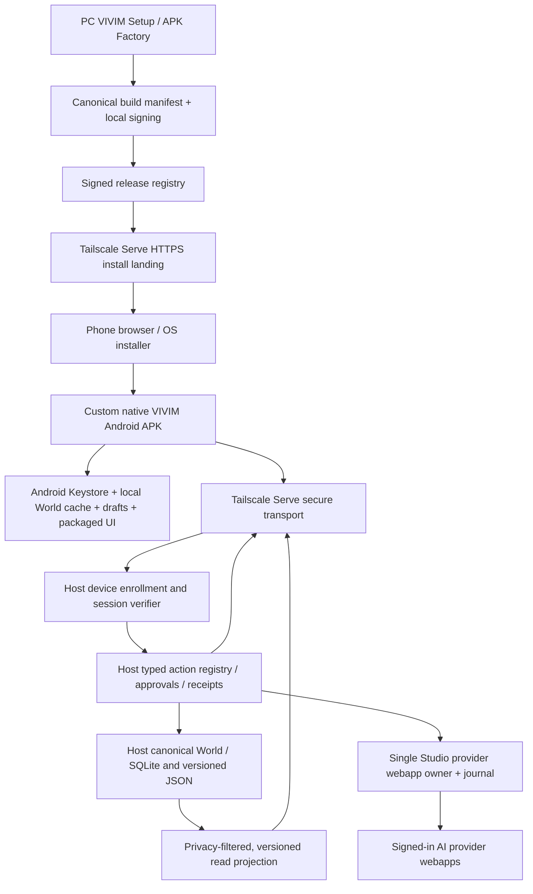

# VIVIM APK07 — Complete research, PRD, designs and local-agent handoff

> Compiled one-file convenience version dated 2026-11-01. Source truth: remote private GitHub main SHA `761266c1437fca9b93fcb0fd800d9a7cdd85c54b`. This is **not a physical-device verification**. Individual docs and current local source win over this compilation.

## Included sections

1. `README.md`
2. `docs/research/APK07-current-state-evidence-2026-11-01.md`
3. `dev/prd/12-android-apk07-day-one.md`
4. `docs/design/APK07-architecture-and-protocols.md`
5. `docs/design/APK07-factory-signing-distribution-updates.md`
6. `docs/design/APK07-security-threat-model.md`
7. `docs/design/APK07-mobile-runtime-world-offline.md`
8. `docs/design/APK07-ux-and-real-device-acceptance.md`
9. `docs/agents/APK07-LOCAL-AGENT-INVESTIGATION-AND-EXECUTION.md`

---


---

# Source document: `README.md`

# VIVIM APK07 — Day-One complete mobile application research, PRD and build-ready handoff

**Date:** 2026-11-01  
**Origin:** ChatGPT remote GitHub source research, verified against `owenservera/vivim-web-harness/main` SHA `761266c1437fca9b93fcb0fd800d9a7cdd85c54b` (2026-10-31 22:22:38 UTC), owner-supplied APK QR research, relevant repository docs and official platform guidance.  
**Scope:** Full APK07 capability from the first release: custom/release-signed APKs, QR delivery, Tailscale Direct, per-device secure enrollment, Android-native interfaces, Personal World/Build, universal natural-language actions, offline ownership/export, update/recovery, physical Android acceptance.  
**Truthfulness:** Documentation and investigation package, **NOT** implemented APK07, NOT a tested physical Android release. Local checkout may be further advanced. No repository was modified by this package.

## Start here — local agent

**First file:** [`docs/agents/APK07-LOCAL-AGENT-INVESTIGATION-AND-EXECUTION.md`](docs/agents/APK07-LOCAL-AGENT-INVESTIGATION-AND-EXECUTION.md). This is a complete, direct instruction to the local agent; it does not rely on this ChatGPT conversation. It directs the agent to compare its current code against the source SHA above, independently investigate 12 known coverage weaknesses, reconcile existing roadmap state, execute the full integrated product and collect truth-graded real-device receipts.

**Primary working checkout:** `C:\0-BlackBoxProject-0\vivim-web-harness`. **GitHub:** https://github.com/owenservera/vivim-web-harness. If the local agent uses Linux, discover its actual location instead of assuming a Windows-mounted path.

Read/reconcile against local `AGENTS.md`, `context.md`, `docs/INDEX.md`, `docs/roadmap.json`, current source and `docs/library/DECISIONS-AND-CONFLICTS.md` before changing live runtime. The local agent **must not downgrade existing more advanced code to match these October 31 snapshots**.

## Documents

| File | Purpose |
|---|---|
| `dev/prd/12-android-apk07-day-one.md` | Full product contract, capabilities FR-A through FR-G, user journeys, evidence-based release definition |
| `docs/research/APK07-current-state-evidence-2026-11-01.md` | Source inspection/current state, evidence levels, known contradictions, official reference links |
| `docs/design/APK07-architecture-and-protocols.md` | Authority diagram, app/device/Host states, release/enrollment/action/sync protocol sketches |
| `docs/design/APK07-factory-signing-distribution-updates.md` | User-built signed APK factory, package/key continuity, QR download and verified update design |
| `docs/design/APK07-security-threat-model.md` | 24 attack scenarios with negative test expectations and trust boundaries |
| `docs/design/APK07-mobile-runtime-world-offline.md` | Android shell, native APIs, on-device data/World privacy, offline, cache and recovery |
| `docs/design/APK07-ux-and-real-device-acceptance.md` | Onboarding screens, error states, 30 physical Android acceptance tests, device matrix |
| `docs/agents/APK07-LOCAL-AGENT-INVESTIGATION-AND-EXECUTION.md` | Mandatory 12-part local investigation + code handoff + acceptance/receipt policy |
| `docs/roadmap/APK07-task-ledger.v1.json` | **59 non-authoritative** atomic execution candidates; source anchors, canonical ID candidates, dependencies and physical tests |
| `docs/roadmap/APK07-capability-matrix.csv` | Inspectable flat capability crosswalk for local reconciliation |
| `docs/roadmap/APK07-decisions.v1.json` | **16 open architecture decisions** to resolve against local source and owner policy |
| `docs/roadmap/APK07-evidence.schema.json` | Strict machine-readable receipt validation contract |
| `docs/roadmap/APK07-evidence-example.json` | Schema-valid illustrative **unverified** source review example |
| `INTEGRATION-MANIFEST.json` | Package metadata, file mapping, absolute local Windows target paths |

`APK07-COMPLETE-RESEARCH-PRD-DESIGN-AND-AGENT-HANDOFF.md` is a convenience single-file concatenation of the narrative docs. Use original individual files as the most inspectable source; don't treat the single-file compilation as a second canonical spec.

## Canonical local-repository integration — **do not duplicate authorities**

- Source PRD 12 is proposed as `dev/prd/12-android-apk07-day-one.md`; the local agent decides its exact filename after checking current numbering.
- Source-oriented design files go into `docs/design/`, research into `docs/research/`, agent task into `docs/agents/`. JSON/CSV candidates in `docs/roadmap/` are **not a second roadmap**.
- Reconcile all candidates **into `docs/roadmap.json`**, deduping existing `P01`, `DIR01`, `PACK01`, `GUI01–07`, `UTC01–07`, `BF00–03`, `W01–04`, `HOST/START`, and other canonical IDs.
- Cross-link relevant docs in `docs/INDEX.md` and repo PRD index. Regenerate actual docs/symbol catalogs with repo tooling rather than manually rewriting generated indexes.
- At each completion, attach timestamped/source-hash/physical-device evidence. A source file alone is not a passed real Android test.
- Preserve one existing Studio/CDP browser owner, send-once uncertain semantics, protected private data and no Vercel requirement.

## Execution order (internal dependency graph, **not** staged user releases)

1. Record local SHA/current services/toolchain/device and resolve policy/signing/Host identity. Map against source, not archived docs.
2. Build release APK factory with stable identity/signing/key recovery and on-device offline shell; create authenticated Direct versioned install/QR.
3. Add short-lived one-time device enrollment backed by Android Keystore proof + Host-scoped grants/revocation.
4. Wire canonical Personal World/GenUI, native Android integrations and UTC Host-typed actions on same app; preserve provider session journal.
5. Implement offline state/sync/export/import and reliable update/failure recovery; run threat/negative tests.
6. Run **all** T01–T30 on actual Android and evidence-grade the single **full APK07 first-release** gate. No claim of complete release without physical receipts.

**Reminder:** `GUI07` (already exists) is the real Android generative UI acceptance task. The broader **APK07** program must extend it; do not accidentally rename/recreate it as a parallel task.


---

# Source document: `docs/research/APK07-current-state-evidence-2026-11-01.md`

# APK07 current-state research and evidence register

**Snapshot:** 2026-11-01 research; remote GitHub `owenservera/vivim-web-harness`, `main` SHA `761266c1437fca9b93fcb0fd800d9a7cdd85c54b` (last repository commit observed 2026-10-31 22:22:38 UTC). **Evidence boundary:** remote source and repository documentation + dated uploaded APK research + Android/Tailscale official public documentation. This is not a local process, Windows desktop, Android device, build, or end-to-end acceptance inspection. Local checkout may be newer; the local agent MUST supersede this snapshot with verifiable local evidence.

## Evidence classes

- `S`: current tracked source inspected on remote SHA (code behavior, not live success).
- `T`: checked-in unit tests or recorded test receipts (do not claim tests rerun here).
- `L`: dated *prior* live receipt reported in repo docs, limited to the explicitly observed direction/device.
- `D`: design/PRD/roadmap claim, not implementation proof.
- `X`: current official external platform documentation.
- `U`: not verified or missing critical evidence. Every APK07 P0 item requires current local verification and a machine-readable receipt.

## Source snapshot

Repository metadata: private; default branch `main`; recursive tree read returned 1,162 tracked blobs, `truncated=false`. Selected categories: `studio/android/` 9 blobs, `apps/vivim-host/` 43 blobs, `apps/mobile-relay/` 44 blobs, `docs/` 95 blobs. Repo size and file count change; do not pin as future truth.

| Domain | Source anchors (GitHub prefix `https://github.com/owenservera/vivim-web-harness/blob/main/`) | Finding | Evidence / residual risk |
|---|---|---|---|
| Android build | `studio/android/{AndroidManifest.xml,build.ps1,build.sh,README.md}` | SDK 34, min 26, target 34; Gradle-free aapt2→javac→d8→package→zipalign→apksigner. Both builds default to local auto-generated debug `.keystore`, hardcoded alias/password and output path. Manifest versionCode=1. | S; 2026-10-29 recorded 20.6 KB signature-verified build (T), not installed. No release factory, version monotonicity or reproducible signing verified. |
| Android WebView | `studio/android/src/inc/vivim/app/MainActivity.java` | ~670 lines. Pairing URL persisted in SharedPreferences; confirmation required on incoming link; text/plain share supported, prefilled via URL fragment; WebView same-origin navigation policy; script enabled, file/content access disabled, mixed content denied; debug inspection only if app debuggable; connection timeout and renderer recovery. | S; no device acceptance. No bundled offline UI, device credential enrollment or persistent synced private store demonstrated. |
| Android security configuration | `studio/android/AndroidManifest.xml` | `usesCleartextTraffic=true` app-wide; `allowBackup=false`; INTERNET and ACCESS_NETWORK_STATE; exported launcher, `vivim://pair` and text share filters. | S; migrate to HTTPS-first and narrow exceptions. Review intent spoofing, source validation, deep-link secrets and minimum required permissions. |
| Android onboarding UX | `studio/android/README.md`, `studio/docs/architecture/ANDROID-APP.md`, MainActivity | README updated with real recovery design; older architecture doc contradicts it about debugging/auto intent handling. Pair screen asks for `http://192.168...` LAN URL and same-WiFi, whereas Direct uses `.ts.net` HTTPS; `looksLikeHomeNetwork()` warns about `.ts.net`. | S; high-priority UX/runtime reconciliation, not necessarily functional connectivity blocker. |
| APK QR distribution | `apps/vivim-host/direct-phone.mjs`, `studio/src/studio/lan-pair.mjs` | Direct handler has closed allowed asset list, and no APK download route; QR module is for LAN URL pairing, not a user APK factory/installer page. | S+U; design work required. QR encodes URL, not APK. Original research's QR version 1–2 estimate for 60–90 bytes was inaccurate; actual version depends on exact length and ECC, verify with encoder. |
| Tailscale Direct | `apps/vivim-host/{server,direct-phone}.mjs`, `apps/mobile-relay/transport.mjs` | `/mobile` routed to Direct handler before local Host guard; requires loopback client, exact Host, forwarded HTTPS and exact `tailscale-user-login`. CSP and closed asset allowlist. Direct front-end intentionally prevents cloud fallback. | S. Identity header identifies Tailscale *user* not exact device; no APK-specific approval, device key binding, revocation or session enrollment. |
| Direct live chat | `docs/ARCHITECTURE-CURRENT-AND-TARGET.md`, `docs/agents/HANDOFF-2026-10-31-DIRECT-PHONE.md` | Prior PC-originated Tailscale HTTPS chat requests were recorded as completed on exact ChatGPT thread; first blocked request correctly protected an unsent draft. | L (historical). **Does not prove** Android paint, direct APK install, current browser session or general provider/model support. |
| Android vs Direct handoff | `apps/mobile-relay/transport.mjs`, MainActivity | WebView can load http(s) URL; Direct PWA origin validator accepts `.ts.net` and loopback. Native pairing still accepts broad http(s) addresses, not app-specific trusted `ts.net` requirement. | S; actual first-launch/transport pairing with installed APK unverified. |
| Phone mobile UI | `apps/mobile-relay/{app.js,index.html,bootstrap-phone.mjs,visual-bootstrap.mjs,control-phone.mjs}` | Talk UI, Build mount, provisional visual bootstrap. `app.js` has `FALLBACK` provider list with `signedIn:true`; localStorage stores some talk state. `control-phone.mjs` is **read/plan-only** and explicitly refuses effects. | S; never advertise false provider readiness; mobile text actions are not yet end-to-end execution. LocalStorage not a canonical offline World store. |
| Host typed actions | `apps/vivim-host/control/{action-catalog.v1.json,intent-planner.mjs}`, `docs/design/UNIVERSAL-TEXT-CONTROL-V1.md` | Shared command invariant is decided. Current five-action catalog is aspirational, mostly `adapter_pending`/unavailable; planner returns preview with `executionPerformed:false`; no Host dispatcher or mobile approvals proven. | S+D; **critical** APK07 integration blocker. |
| Host bootstrap | `apps/vivim-host/bootstrap/{ledger,service,runtime,command-worker,owner-auth}.mjs`, `apps/vivim-host/server.mjs` | Trusted owner-only bootstrap functions, SQLite-based revisions, UI CAS and undo, local/Direct separation. Worker/process supervision exists in source. | S; actual active device, Host and worker process topology must be re-inspected locally. |
| GenUI | `apps/mobile-relay/generative-ui/{catalog,compiler,renderer,bootstrap-adapters,semantic-projection,phone-surface}.mjs` | Strict shared declarative UI, bootstrap adapters, revision/proposal flows. `docs/superpowers/specs/2026-10-31-gui07-android-acceptance-spec.md` explicitly requires a real paired Android and signed-in AI provider; repo says 105 related tests, but real GUI07 not accepted. | S+T+D; do not create duplicate renderer/activation authority. Extend GUI07 acceptance with native APK07 gates. |
| Personal World | `studio/src/studio/{world-service,world-transfer,world-search}.mjs`, `docs/architecture/vaws/*`, `dev/prd/06-personal-world-memory-and-context.md` | Studio World source and import/export tests exist, VAWS registry evolution is designed; on-phone full offline replica/sync/permissions unproven. | S+D+U; investigate canonical writer, privacy projection, asset lifetimes and migration before choosing Android DB schema. |
| Context bundles | `docs/architecture/DYNAMIC-CONTEXT-BUNDLES-REVIEW-2026-10-31.md` | Ten logical layers, profiles and disclosure rules designed; new DCB runtime not accepted. | D; APK must use authorized Host-constructed context, not leak local World. |
| Mobile visual behavior | `docs/ux/MOBILE-INTERACTION-SCHEMA-MAPPING-2026-10-30.md`, `docs/ux/schema/*` | 28 proposed semantic interactions, accessibility and touch requirements; proposed does not imply app UI built. | D; attach real phone screenshots/interaction receipts. |
| Control/roadmap authority | `docs/INDEX.md`, `docs/roadmap.json`, `docs/capabilities/{atomic-registry,source-symbol-index}.json` | One canonical roadmap and atomic feature inventory. Source has many items marked `done` while dated docs explicitly limit native acceptance. Avoid a competing roadmap. | S+D; local agent must map APK07 tasks into existing ledger and update evidence qualifiers rather than overwrite. |
| Existing GUI07 | `docs/superpowers/specs/2026-10-31-gui07-android-acceptance-spec.md` | Ten acceptance steps including paired Direct, verified provider, BF00, F02/F01, D03–D07, selected Build edit, CAS+Undo, reconnect and Talk draft regression; explicitly deferred pending real-device proof. | D; extend, do not replace, and avoid confusing GUI07 with broader APK07 product target. |
| Cross-repo possible reuse | `docs/research/GUI02-PRE-PRD-CANVAS-SEMANTIC-LANGUAGE-2026-10-31.md`, references to `vivim-final` and `VOMEGA` | Legacy InfiniteCanvas, mutation schema, NLCL 17-symbol language and semantic correlation are candidates for reuse. | D/source-archeology; local agent must inspect current sibling checkout, dependency/license and maintain single authority. |
| Historical roadmap | `docs/roadmap.json` | `P01` in progress, `DIR01` source pending live, `PACK01` planned, `GUI07` queued, `UTC01`/`UTC02` in progress, `UTC03`–`UTC07` planned. `START01`–`START03` listed done despite acceptance caveats; inspect latest receipts. | D; statuses are not real-device proof. |

## Important conflicts requiring local adjudication

1. **Distribution policy**: old APK research recommends simple debug APK + QR first. New user decision requires *full custom APK07 on Day One*, including release-safe signing, update continuity and independent local capability. Supersede old sequencing while reusing existing assets.
2. **Global vs user-owned signer**: user-specific package names and keys maximize ownership, but create developer-verification and update burdens. Need dual profile from same codebase; do not silently treat every user-generated key as Android-verified.
3. **Offline truth**: current WebView-only APK with no bundled web assets cannot satisfy a meaningful offline Personal World, even if the PWA caches pages. Audit current service workers and storage, then design explicit local snapshot/version/migration semantics.
4. **Trusted device identity**: `Tailscale-User-Login` plus same-tailnet access is not equivalent to per-device enrollment/approval. Never encode permanent credentials in public QR or compilation variables.
5. **HTTP pairing**: app-wide cleartext and LAN URLs are transitional; Direct-first should use strict HTTPS origins and intentionally isolated LAN compatibility with visible warning.
6. **Browser owner**: do not let custom APK builds, Android UI or independent phone agents instantiate a second browser driver; Studio existing owner remains exclusive.
7. **`done` vs acceptance**: source presence, tests, CI, PC-originated HTTP, actual Android UI and complete user journey are separate evidence levels.
8. **Product full-day-one vs code implementation order**: all APK07 features must pass one release gate; internal dependency steps may still be sequenced. Reuse GUI07, UTC, BF and World tasks instead of duplicating effects.

## External verification (official sources, checked 2026-11-01)

- Android developer verification rollout: https://developer.android.com/developer-verification/guides and https://developer.android.com/developer-verification/guides/faq . Selected participating stores/regions started September 30, 2026; direct sideloading was not universally blocked on that date; broader 2027 rollout requires reassessment. Advanced sideload path and optional limited-distribution account have different requirements.
- Android app signing and update identity: https://developer.android.com/studio/publish/app-signing . Upgrade generally needs compatible package/signing lineage; key loss/rotation and Play distribution paths differ from direct APKs.
- Tailscale Serve identity headers and trusted loopback proxy: https://tailscale.com/docs/features/tailscale-serve . Headers refer to a user, may be absent for tagged devices, and are distinct from VIVIM device keys/grants; Serve is not Funnel.
- Android WebView unsafe file inclusion: https://developer.android.com/privacy-and-security/risks/webview-unsafe-file-inclusion . Restrict JavaScript bridge, file URLs, origin and access; locally packaged pages should use a same-origin-safe HTTPS asset-loader strategy, not `file://` shortcuts.
- Offline packaged web content: https://developer.android.com/develop/ui/views/layout/webapps/load-local-content . Bundled UI needs versioning independent of the Host website.
- Android notification permission: https://developer.android.com/develop/ui/compose/notifications/notification-permission . API 33+ non-exempt notifications need runtime permission.
- Android Storage Access Framework: https://developer.android.com/training/data-storage/shared/documents-files . User-visible archive import/export can use system-owned document pickers.
- Android 16 KB page size: https://developer.android.com/guide/practices/page-sizes . Relevant if APK adds native `.so` dependencies; current Java-only shell may not be affected.

## High-priority source revalidation commands for the local agent

```powershell
Set-Location 'C:\0-BlackBoxProject-0\vivim-web-harness'
git status --short
git rev-parse HEAD
git log -8 --oneline
rg -n "APK|Android|GUI07|UTC0|P01|DIR01|PACK01" docs/roadmap.json docs/INDEX.md docs -g '*.md'
rg -n "WebView|SharedPreferences|usesCleartextTraffic|versionCode|apksigner|keystore" studio/android
rg -n "tailscale-user-login|/mobile|api/control|connection.json" apps/vivim-host apps/mobile-relay
rg -n "signedIn: true|FALLBACK|executionPerformed|apply-proposal|uncertain" apps/mobile-relay apps/vivim-host
```

Read `docs/INDEX.md` and `AGENTS.md` first. Do not execute a live browser send to probe capabilities; prefer existing receipts and safe read-only inspection. Do not print QR secrets, owner tokens, raw messages or personal data into logs.


---

# Source document: `dev/prd/12-android-apk07-day-one.md`

# PRD 12 — VIVIM Android APK07: complete Day-One personal app

**Date:** 2026-11-01  | **Status:** owner target DECIDED; design proposed, implementation not accepted | **Priority:** launch-critical | **Target repository:** `owenservera/vivim-web-harness` | **Canonical roadmap authority:** `docs/roadmap.json` | **Purpose:** an implementable, evidence-aware product contract for the next local agent.

> **Owner decision**: the *first releasable Android APK* must pass the complete APK07 contract. Do **not** substitute a QR-only installer, hosted PWA wrapper, or limited Android MVP and call it finished. Coding may be staged in dependency order; release acceptance is unified. **No Vercel dependency**. Tailscale Direct PC ↔ phone is default. **No parallel Chrome controller, Playwright, Puppeteer or unauthorized provider send**. The PC Host retains canonical authority over PC data, provider actions and browser effects. The Android device must have genuinely useful, private, user-owned local capability without the Host online.

## 1. The product in one paragraph

From a working, owner-controlled VIVIM PC, a person opens **Create My Android App**, chooses an app identity/branding and signing ownership, verifies the build, scans one QR entry-point to install, follows Android's unavoidable installer permissions, launches the app, approves pairing with their PC, and immediately gains Talk, Build, World, natural-language settings and commands, native share/notifications, transparent job receipts and meaningful offline browsing/editing/export. The same codebase also produces a standard VIVIM-signed package. Updates preserve data and identity; the user can revoke devices, restore signing credentials with clear warnings, import/export their data and recover after network or PC loss.

## 2. Decision hierarchy and definitions

- **APK07 product** (this PRD): full personalized/installable/independent Android experience. **Different from existing `GUI07`**, which is a narrower Android bootstrap→Build acceptance suite. Extend GUI07 rather than overwrite it.
- **User-owned**: the user's PC controls generated artifacts, signing choice, personal data and release exports; recovery documented. *No claim that VIVIM can guarantee all future sideloads work without Google's verification or OS prompts.*
- **Personalized APK**: can personalize app label/icon/color/splash, configurable package/application ID, default non-secret Host discovery hints and bundled offline assets. Sensitive memories and irreversible permissions must **not** be compiled into the APK.
- **Independent operation**: install/launch, local browse/edit/search/export and queued **drafts** while PC disconnected. PC-hosted harness/browser execution remains unavailable until Host online and authorized. No fake offline AI send.
- **One scan**: one QR launches the install/enrollment *journey*, not a promise that scanning an APK link automatically transfers installer state/credentials into the installed app. The phone may need a short-lived match code or second explicit PC approval; OS installer confirmation cannot be bypassed.
- **First release**: all requirements in §§4–7 satisfy acceptance across real phone and Windows Host. Optional future experiments (on-device LLM, broad OS automation, cloud relay) are not Day-One gates unless explicitly authorized.

## 3. Personas and entry cases

| Persona/case | Baseline | Outcome |
|---|---|---|
| PC owner, first Android install | VIVIM setup complete; Tailscale on PC and phone | Customizable, release-signed QR installation; device pairing; Talk/Build/World |
| PC owner with no Android SDK configured | Normal non-developer Windows user | Standard prebuilt option; customization build service **on user's PC** only if dependencies can be managed automatically and securely; no command-line keystore ritual |
| Technical owner with custom signer | Wants independent application identity and key | Local key generation/import, export/restore and versioned APK factory; explicit signing/developer-verification consequences |
| Paired phone temporarily offline | No PC/Tailscale/Internet | Open familiar locally cached World and Build, edit local drafts, view job history as stale, export, queue only reversible/explicitly staged changes |
| Owner replacing phone/PC | Compromised/lost/new device | Revoke old credential, enroll replacement, restore verified data; no forged identity or silent send |
| Existing Studio LAN-paired user | Old HTTP URL and Studio cookie | Guided migration to Direct enrollment; preserve drafts, Talk continuity and owner-approved state; no surprise cloud fallback |
| Android install/update edge cases | OEM browser, Android 8–latest, unregistered app | Clear verified installer instructions, signed artifact hash/cert, honest Google verification/advanced flow guidance |

## 4. Requirements — all are first-release gates

### A — Custom APK Factory / Identity

**FR-A01** Single source tree builds standard and fully personalized APKs without source hand-edits. Inputs validated against a strict configuration schema; no injection into manifest, Java or aapt commands.

**FR-A02** User can set display name, icon, splash, theme/accent, app description and generated build profile; preview exactly what is compiled. Minimum acceptable custom identity is label/icon/theme; a custom application ID must also be supported in advanced mode.

**FR-A03** Package ID is unique and stable across subsequent updates; distinguish standard shared app (`inc.vivim.app`) from custom namespace. Changes to package ID create a separate installed app, not an in-place update; require explicit warning and migration plan.

**FR-A04** User chooses standard publisher signing OR user-owned signing. User-owned signer must support local generate/import, certificate display, secure backed-up recovery, no logging of passwords/private key, and clear consequences for lost keys. Never use test `.keystore` for production release.

**FR-A05** Version code monotonic, semantic release channel/version, min/target Android API compatibility, deterministic artifact metadata, signed SHA-256 manifest, signing certificate fingerprint and explicit release provenance. Rebuild equivalence should be defined and tested (byte-for-byte if feasible; otherwise normalized content/hash evidence).

**FR-A06** Windows-first and Linux-compatible build entry points. Capture JDK/SDK detection and controlled installation; do not demand global Android Studio installation from end users unless unavoidable. Build failure produces actionable diagnostics, not a partially released APK.

**FR-A07** SDK/toolchain choice resolved after audit. Retain Gradle-free for simple Java-only shell if it can support all requirements; prefer an Android-standard managed build for dependable AndroidX/notifications/background tasks/assets if evidenced. No needless rewrite.

### B — Distribution / Install / Updates

**FR-B01** PC Host serves an explicit install landing page and versioned APK over authenticated Tailscale Serve HTTPS with correct MIME, Content-Disposition, Content-Length, no-store, restricted path and safe file handling; never serve arbitrary filesystem path.

**FR-B02** Show QR from desktop and optionally terminal; QR encodes canonical short-lived install/enrollment landing URL, not APK bytes or permanent owner credentials. Support phone without camera by copyable HTTPS link.

**FR-B03** Installer landing identifies app, version, package ID, signer fingerprint and SHA-256 checksum, and presents correct Android unknown-app/developer-verification instructions. Must not claim Android can auto-install without OS consent.

**FR-B04** Release manifest supports current/past versions, compatibility bounds, expiration/revocation, immutable digest and measured artifact size; no unsigned/unchecked APK is offered as current.

**FR-B05** Updates are installed with Android's package manager and user consent as required, preserve package/signing lineage and local data. Distinguish UI asset updates from binary APK upgrades and roll back invalid content without replaying Host actions.

**FR-B06** Support download resume/range only if safely implemented and tested; otherwise reliable fresh retry for immutable artifact. Expired install enrollment must not break already-installed valid package or leak a permanent token.

### C — Connectivity / Pairing / Device Trust

**FR-C01** Tailscale Direct HTTPS default, with no Vercel requirement and no silent cloud fallback. Document tailnet setup, HTTPS cert/MagicDNS requirements and Serve configuration ownership; do not use Funnel for private enrollment.

**FR-C02** Secure onboarding: Host issues short-lived single-use challenge; phone creates local device keypair (Android Keystore when appropriate), proves key possession and presents a pairing code; owner explicitly approves device/role/scope on PC or a securely validated reciprocal flow.

**FR-C03** Host stores revocable device ID, public key fingerprint, enrollment status, scope set, created/last-seen, expiry and revocation timestamps; no blanket authority from matching Tailscale user's email.

**FR-C04** Every mutating request has authenticated device proof (mechanism selected and tested: challenge signing/mTLS or proof-of-possession session), replay protection, freshness window, scoped permission, idempotency key and Host receipt. Tailscale identity remains network perimeter, not application authorization.

**FR-C05** Reconnect after Host/Tailscale restart and PC hostname change using an explicitly approved rebinding; never silently accept a different origin due to a deep link or broad `http(s)` parser.

**FR-C06** Per-device revoke, sessions expiry, app lock and reset. Host detects unknown/deleted device and gracefully shows re-enroll without writing. Trusted provisioning must not depend on hidden Android install referrer behavior that direct APK sideloading does not reliably provide.

### D — Native Android Integration

**FR-D01** Safe WebView shell with signed bundled offline pages + remotely served Direct UI; same-origin navigation and strict intent/URL validation. Disable broad WebView file/content access and unsafe JavaScript bridges; use HTTPS asset loading for local static content.

**FR-D02** App lifecycle: cold start, resume, rotate, keyboard, back, process death, WebView renderer crash, screen lock, Android app update, Host outage; no loss of unsent drafts.

**FR-D03** Native share ingress text and attachments; review/edit before sending. Use Android picker/SAF for user-selected files; no ambient storage scanning and no auto-upload of camera/photos/documents.

**FR-D04** Deep link / pairing action requires explicit origin and identity confirmation; disallow arbitrary schemes, redirect to installed untrusted apps or injected owner commands.

**FR-D05** Notifications for consent-needed/completed jobs, opt-in categories and Android 13+ permission flow; locally generated notification from securely delivered events, not an insecure push token. Must still work reasonably without always-on background service.

**FR-D06** Permissions requested at feature use, with graceful no-permission fallback; no accessibility-service, root, device-admin or screen-capture permissions for first release without separate specification.

**FR-D07** Support privacy screen behaviors (sensitive preview, app lock, recent-app thumbnails policy where needed), Android backup/export policy and power/foreground constraints without misleading reliability promises.

### E — Personal World / Generative UI

**FR-E01** Retain one shared Talk/Build/World UX and existing declarative renderer. Respect `vivim.ui-proposal/1`, Host `vivim.ui-revision/1`, stable IDs, preview/CAS/Undo and private-scoped projections.

**FR-E02** BF00 immediate first paint, grounded F02/F01 and optional D03–D07 proposals use the existing validated bootstrap compiler and Studio owner; no second AI send for conversion. Complete prior `GUI07` real-device acceptance.

**FR-E03** User can design/arrange a personal interface on phone via text, tap, accessible gesture alternatives, safe UI component catalog and undo; preserve Talk drafts and protected Personal AI entry.

**FR-E04** World lists/cards/search/inspect/edit show provenance, owner-confirmed vs model-proposed distinctions, privacy scope and current vs cached indicators. No sensitive D06 defaults on phone.

**FR-E05** User-created views and theme updates are versioned; local previews are immediate, trusted Host mutations only after authorized CAS. Local-only changes have explicit owner and reconciliation semantics.

### F — Harness / Natural-Language Control

**FR-F01** Every user-facing action and setting is discoverable and operable by text and GUI through the **same Host action IDs**, per `docs/design/UNIVERSAL-TEXT-CONTROL-V1.md`. `unavailable` shown when no verified executor.

**FR-F02** Deterministic parser for known typed commands; AI interpreter only proposes untrusted `actionId + args` candidates via existing signed-in webapp harness. No model-granted privileges, arbitrary shell/SQL, or duplicate browser owner.

**FR-F03** Risk R0–R3 permissions, previews, scoped approval, freshness and revocation; exact effect owner executes; journal differentiates queued/claimed/applied/verified/failed/**uncertain**. Never auto-resend uncertain provider sends.

**FR-F04** Phone Talk surfaces real provider capabilities/readiness derived from current harness owner—not fallback `signedIn:true`—including model and thinking-level support only when verified executable.

**FR-F05** Phone can initiate/monitor/cancel where safe: approved Studio provider conversation, OpenCode existing session, World edit, UI revision, personal context preview, settings; distinguish a remote plan from an executed effect.

**FR-F06** Every completed phone effect has correlated device ID → request ID → Host action → journal/send-once receipt → provider thread/World revision → phone rendering acknowledgment. Sensitive body stays out of logs/QR/telemetry.

### G — Offline / Independence / Export

**FR-G01** Android includes offline-capable UI assets (not solely WebView to PC). Explicit cache version, migration/version fallbacks; last known-good UI available after PC disappearance.

**FR-G02** Local encrypted or platform-protected data cache/storage scoped to approved phone projections. Device-owned drafts, settings and explicitly offline-editable World subset survive process death. The PC remains canonical for PC-owned data.

**FR-G03** Local reads/search/export and staged edits work without network. Side-effectful PC execution is not queued for automatic replay; offline action requests remain **drafts awaiting fresh authorization**.

**FR-G04** Reconciliation uses versioned object revisions, CAS/conflict states, tombstones and idempotency. No last-write-wins overwrites of canonical memory or owner hard NOs; deletion/revoke honored on reconnect.

**FR-G05** Export JSON-based documented archive with schema/version/manifest/checksums, optional encrypted sensitive payload and explicit file picker; import validates limits, schema, privacy and conflicts. PC/phone data ownership documented.

**FR-G06** Local key loss, app reinstall, signing change, phone theft, backup restore, incompatible schema and expired credential recovery guides. Explain what data is unrecoverable without backup.

## 5. UX acceptance journey (physical Android; required)

1. **Setup PC**: Host/Studio/owner profile/Tailscale Serve healthy. UI shows exact service readiness and no phantom signed-in providers.
2. **Customize**: user chooses profile (publisher-signed or user-owned), icon/name/theme/package, sees estimated download and signing/recovery policy; cannot hide key ownership consequence.
3. **Build**: PC produces signed APK + digest/cert/version manifest, verifies SDK/keystore, forbids debug signing for final release, preserves version lineage.
4. **Scan**: desktop QR opens Tailscale HTTPS landing on phone; Android unknown-app and, where relevant, verification steps are explained; first-time install explicitly approved by OS.
5. **Launch**: offline splash/local UI works before any Host contact; app identity and signed package match expected.
6. **Enroll**: device generates key; Host asks owner to approve *this* phone via match code; scopes and expiry visible. QR alone does not authorize.
7. **Talk**: show verified available provider; send once; exact provider/thread and response displayed on phone. Offline/unavailable/uncertain are distinguishable.
8. **World + Build**: first paint fast; retrieve allowed World claims with evidence; apply approved UI edit, Undo, context-scoped AI design proposal; preserve draft.
9. **Control**: natural-language preview of a setting, approve and execute through same typed action as GUI; verify durable receipt.
10. **Native**: Share from another Android app populates a draft; opt-in notification delivered; revoke device blocks subsequent commands.
11. **Go offline**: airplane mode or Host down; local World/drafts/export remain; no server effect silently executed; reconnect resyncs conflicts honestly.
12. **Upgrade/restore**: signed vN+1 installs over vN, data survives and app still pairs; backup exported/imported into a clean authorized install; incompatible signature updates are refused with explanation.

## 6. Quantified product/service targets (proposed budgets, measure not promises)

- Cold offline launch to usable local UI: p95 <= 1.5 s on selected reference Android device; BF00 local provisional paint < 500 ms when feasible.
- Immediate local tap acknowledgment: p95 < 100 ms; no AI dependence.
- Direct authenticated Host read (warm, healthy local tailnet): p95 <= 1 s; record actual cellular+DERP path separately without invented latency.
- Verified Host-approved UI revision→phone visible: p95 < 500 ms under stable connection, as inherited from GUI07 spec; log assumptions.
- No unconfirmed provider send auto-replayed (zero tolerance), zero unapproved device actions and zero sensitive fields in public/Cloud status (zero tolerance).
- Artifact reproducibility: identical inputs/toolchain yield consistent content and signing evidence; distinguish deterministic unsigned payload vs nondeterministic signing timestamps if needed.
- Compatibility: minSDK remains 26 unless explicitly changed by a documented compatibility study; test at least Android 8/9, 13, 14 and current reference OEM/Android available locally; no untested universal device support claim.
- Availability: Host offline clearly labeled; local World and drafts remain accessible; no fabricated live completion.

## 7. Non-functional security, quality and release constraints

- **Threat model mandatory** for install token capture, intercepted deep links, compromised phone, stolen keystore, Tailscale shared users, forged proxy header, malicious HTML/model output, replay, Host compromise, origin hijack, lost key and cache leakage.
- **Boundary:** phone never gets PC owner-token or unrestricted raw Host filesystem access. Tailscale identity and HTTPS alone do not grant VIVIM mutations. HTML renderer cannot access a powerful JS bridge by default.
- **Privacy:** privacy tiers and D06 restrictions enforced on Host projection and local storage; no blanket sync of user's personal memory to phone or provider.
- **Release:** signed manifest and artifact, deterministic test/verification receipts, install/update/revoke/restore smoke results; archived last-known-good APK and secure signing backup.
- **Observability:** redacted structured receipts, no raw prompts, private notes, QR tokens or owner capability in telemetry. Source SHA and Android version included.
- **Compatibility:** Windows-first with Linux build/Host parity. No deployment prerequisite to Vercel. No separate PC Chrome owner/Playwright/Puppeteer.
- **Regression:** existing Talk, Studio exact-thread, Studio profile ownership, bootstrap, JSON World, GUI07 and UTC invariants unchanged unless intentionally, safely migrated.

## 8. Dependencies and architecture owners

| Area | Canonical source/service | Existing roadmap links | APK07 addition |
|---|---|---|---|
| Build | `studio/android/` | P01/PACK01 | factory, release signer, custom resources, reproducibility, toolchain |
| Distribution | `apps/vivim-host/direct-phone.mjs` | DIR01 | signed artifact registry, installer landing, QR, immutable download |
| Android native | `MainActivity.java` | P01/GUI07 | keystore identity, offline assets, Share/notification, lifecycle |
| Control | `apps/vivim-host/control/*`, `docs/design/UNIVERSAL-TEXT-CONTROL-V1.md` | UTC01–UTC07 | enrolled device ingress, typed execution, mobile text parity |
| Browser actions | Studio/CDP and harness send-once | H02, H07, P05 | exact phone correlation; no additional browser owner |
| Personal World | Studio World/Host/bootstrap | W01–W04, DATA*, DCB* | scoped phone replica, offline rights, export/import |
| UI | `apps/mobile-relay/generative-ui/*` | GUI01–GUI07, BF00–BF03 | Android packaged renderer and native acceptance |
| Runtime/lifecycle | `apps/vivim-host/server.mjs`, startup suite | START01–START03, HOST01–02 | Android onboarding checks, package update, connection recovery |

## 9. Release governance and blockers

**All seven lanes A–G are P0 for first release.** Use `docs/roadmap.json` as **the single authoritative execution ledger**: map the machine-readable APK07 subtask list in this package to those existing rows and add only truly new rows. Do not create a parallel master TODO. The machine-readable task file is a *draft import manifest* and is not another status authority.

A release is **BLOCKED** if any of these are unproven: production signer/update lineage; custom build actually installs; Host-approved per-device enrollment/revocation; natural-language action execution with verified receipt; real Android Talk/Build/World; packaged offline UI/data/edit/export; upgrade and restore; security negative tests; signed-in provider readiness; draft continuity. Missing physical-device access must remain an explicit `awaiting_device_acceptance` rather than be silently waived.

## 10. Decisions to resolve through local investigation

1. Android build toolchain: Gradle-free vs modern Gradle/AndroidX, weighed against native feature requirements and maintenance.
2. Package identities: immutable `inc.vivim.app` standard vs custom application ID namespace; ensure no collision/signature overwrite.
3. Signing choices: publisher-signed standard and user-owned custom, plus optional custom-brand-but-publisher-signed (only when policy permits); account for Android developer verification globally by 2027.
4. Enrollment bootstrap: install landing → launch with non-secret Host hint + short match code vs verified app-link; direct install cannot assume an install referrer.
5. Local data store: Android SQLiteOpenHelper/SQLite or library, keystore/SQLCipher only if dependency+threat tradeoff proven; never store keys as plain SharedPreferences strings.
6. Offline Host UI assets: packaged HTML/JS assets with secure virtual HTTPS origin, and compatibility with remote Direct `apps/mobile-relay` content.
7. Notifications: local polling/periodic reconciliation vs permitted system background work; avoid unsupported always-on assumptions.
8. Scope of external custom branding: package IDs and icons feasible; guarantees of Google registration, trademark or Play approval are *not* included.

## 11. Related documents in this package

- `docs/research/APK07-current-state-evidence-2026-11-01.md` — source audit, evidence grades and contradictions.
- `docs/design/APK07-architecture-and-protocols.md` — component diagram and schema contracts.
- `docs/design/APK07-factory-signing-distribution-updates.md` — custom build, signing and updates.
- `docs/design/APK07-security-threat-model.md` — trust and adversarial test plan.
- `docs/design/APK07-mobile-runtime-world-offline.md` — native, storage, data, local UI.
- `docs/design/APK07-ux-and-real-device-acceptance.md` — user journeys and physical phone test matrices.
- `docs/agents/APK07-LOCAL-AGENT-INVESTIGATION-AND-EXECUTION.md` — **mandatory agent handoff**, precedence, inspection, commands, decisions, receipts.
- `docs/roadmap/APK07-task-ledger.v1.json` — proposed subtask/acceptance import, subordinate to canonical roadmap.

## 12. Definition of success

A real owner can get a uniquely branded, appropriately signed personal Android app from their own PC without operating Android dev tooling, install via Tailscale-hosted QR, explicitly authorize the device, independently access/correct/export a meaningful local Personal World while disconnected, remotely command the PC via typed, scoped natural language when online, safely experience native Android features and user-generated Build UI, and update or recover without broken signer identity or lost data. Every step must have actual-device evidence, not only checked-in source or unit tests.


---

# Source document: `docs/design/APK07-architecture-and-protocols.md`

# APK07 architecture, state machines and interoperable contracts

**Status:** proposed design, not an assertion of implemented endpoints. Must reconcile every contract against source, schema indices and live Host before coding. Existing source: `apps/vivim-host/direct-phone.mjs`, `apps/vivim-host/control/*`, `apps/mobile-relay/*`, `studio/android/*`, `docs/design/UNIVERSAL-TEXT-CONTROL-V1.md`, GUI07.

## 1. Architecture and authority



**No second authority**: Android can own local drafts and local-only view preferences, but not PC browser control or canonical World commits. **No silent Cloud**: direct-only modes never fail over to Vercel. **No unconditional trust** in model output, QR scan, Tailscale username, browser origin, APK branding or local draft.

## 2. Protocol namespaces (proposals)

| Type | Schema ID | Owner | Durable? |
|---|---|---|---|
| Build input | `vivim.apk-build-profile/1` | PC APK Factory | versioned, user-controlled |
| Release manifest | `vivim.apk-release/1` | signed PC publishing service | immutable for a given SHA |
| Enrollment challenge | `vivim.device-enrollment/1` | PC Host | single-use, short lived |
| Device grant | `vivim.device-grant/1` | PC Host auth store | persistent, revocable |
| Device request | `vivim.device-request/1` | Android + Host verified transport | journaled by idempotency key |
| Device receipt | `vivim.device-receipt/1` | PC Host | append-only, redacted |
| Phone replica | `vivim.phone-projection/1` | Host writer / phone local store | revisioned, privacy scoped |
| Offline local change | `vivim.phone-draft/1` | Android only | durable until accepted/rejected |
| Export archive | `vivim.world-portable-archive/1` | owner-approved PC/phone exporter | signed/checksummed if selected |

**Rules:** strictly typed validation; bounded input; precise source IDs; canonical revision; privacy classification and consent; no authority from client-originated `risk`, `approved` or `verified` booleans. Inspect the already-existing `vivim.ui-proposal/1`, `vivim.ui-revision/1`, `vivim.control-*`, bootstrap schema and app status contracts before adding an overlapping model.

## 3. Release manifest sketch (illustrative; not a live route)

```json
{
  "schema": "vivim.apk-release/1",
  "releaseId": "apkrel_opaque",
  "channel": "personal",
  "profileDigest": "sha256:...",
  "applicationId": "inc.vivim.app.useropaque",
  "versionCode": 2,
  "versionName": "1.0.1",
  "minSdk": 26,
  "targetSdk": 34,
  "signing": { "mode": "user-owned", "certSha256": "hex...", "rotationLineage": null },
  "artifact": { "fileName": "vivim-personal-1.0.1.apk", "sha256": "hex...", "bytes": 0 },
  "assetBundleVersion": "mobile-shell-v1",
  "supportedHostProtocol": { "min": 1, "max": 1 },
  "createdAt": "ISO-8601",
  "validUntil": null
}
```

The signer certificate fingerprint alone is **not** a signature over JSON. Bind manifest to APK via a verified signed release metadata mechanism, or serve it over authenticated Host HTTPS and compare on-device APK signing certificate/artifact hash. Local agent must choose a real trust bootstrap; don't falsely call SHA-256 authenticated. Never expose build-time keystore paths/passphrases.

## 4. Enrollment states

```text
UNENROLLED → CHALLENGE_REQUESTED → PHONE_KEY_GENERATED → AWAITING_OWNER_APPROVAL
  → ACTIVE → {SUSPENDED, REVOKED, EXPIRED}
  → (new one-time enrollment; old key cannot reactivate)
```

1. PC validates that installer/paired-device request arrived via expected Tailscale Serve path (network boundary, not authorization).
2. Host emits random one-time challenge with expiry, expected Host ID and non-secret display code; route must be authenticated or purposefully guarded against enumeration/DoS.
3. Android generates long-lived device signing key in Android Keystore, binds public key to challenge/Host instance and proves possession with a signature.
4. PC owner compares short code + device descriptor and approves explicit scopes. If the approval is remote, require separate previously established owner authenticator or active user-presence mechanism.
5. Host commits grant with immutable device ID, key fingerprint, scopes, issue/expiry/revocation, active sessions and exact tailnet user metadata as advisory signal.
6. Android obtains scoped session proof and fetches a bounded initial projection; never receives Host's owner admin token or private browser CDP credentials.

### Enrollment API sketch (not existing)

- `POST /mobile/api/enrollment/start` — returns challenge ID, expiry, server nonce and verification context; rate limited.
- `POST /mobile/api/enrollment/prove` — public key + signed transcript + requested scopes; creates **pending** entry only.
- `GET /mobile/api/enrollment/status?id=...` — bounded state for that challenge, no secret delivery through query/referrer.
- **PC-only** `POST /api/host/devices/:id/approve` — require existing Host owner auth, origin/csrf and explicit scope preview.
- `POST /mobile/api/device/session` — device key proofs; short session expiry with rotation.
- **PC-only** `POST /api/host/devices/:id/revoke` — immediate denial + cleanup/tombstone.
- `GET /mobile/api/device/capabilities` — actual capabilities by device role and Host readiness.

**Open design:** whether session proof uses signed canonical request headers or a short-lived bearer issued only after device signature. For either, keep bearer out of URL/localStorage, use strict SameSite/HttpOnly cookies when applicable, origin+CSRF enforcement and replay nonce. Native-WebView cookie behavior and SameSite need real-device tests. Do not make signatures in JavaScript readable by arbitrary pages; native bridge must be strongly origin-bound or route through native networking.

## 5. Remote operation / receipt state machine

```text
DRAFT_LOCAL → PREVIEWED → AWAITING_APPROVAL → ACCEPTED/QUEUED → CLAIMED
  → {APPLIED → VERIFIED, FAILED, UNCERTAIN, REVOKED}
```

`UNCERTAIN` is a terminal safety stop until explicit reconciliation. A reconnect can refresh status by receipt ID; it must **not** resubmit a provider send because the response was lost. The Host is the only author of `APPLIED/VERIFIED` receipts. Android can render a cached event but must label it stale and timestamp it.

Illustrative device request:

```json
{
  "schema": "vivim.device-request/1",
  "requestId": "cmd-opaque-unique",
  "deviceId": "device_opaque",
  "idempotencyKey": "random-client-key",
  "actionId": "ui.theme.set_preset",
  "args": { "preset": "ink" },
  "baseRevision": "world-or-action-revision",
  "planDigest": "sha256:...",
  "approvalRef": "scoped-host-grant-id",
  "expectedEffects": ["theme_revision"],
  "createdAt": "ISO-8601"
}
```

Never trust `approvalRef`, `planDigest`, `deviceId` or `expectedEffects` without independent Host lookup and MAC/signature verification. Separate a plain natural-language *intent* sent to a planner from an authorized typed *effect*. Sensitive arguments should be rejected from unsafe logs and cloud proxies.

## 6. Bidirectional data and privacy

- **Upstream phone → Host**: device-authenticated action intent, draft revision/hash, limited attachments with explicit user selection and content-size bound; no browser control.
- **Downstream Host → phone**: authorized projection with source revision, modifiedAt, privacy class, origin evidence/claim status, content digest and tombstones. Do not send PC-private D06 or secrets.
- **World sync**: host-selected initial snapshot and incremental changes. Local UI journals drafts; CAS merge/review conflict before canonical write. Deletions/revocations win over stale local cache; never rehydrate rejected memories by offline resync.
- **UI state**: `vivim.ui-revision/1` Host-authoritative; local phone provisional design preview can be committed only via typed `ui-proposal/1` with baseRevision, owner review and CAS.
- **Context bundles**: Host builds read-only selection manifest and consent preview. Actual selected excerpts leave PC only toward explicitly approved destination; no default whole-memory dump to phone or any provider.

## 7. Compatibility negotiation

Every Android app and Host announce supported protocol ranges and renderer revision. If no compatible overlap: present **upgrade required** or **limited offline** truth, never silently parse unknown fields as grants. Release metadata needs `minHostProtocol`, `maxHostProtocol`, `localSchemaVersion`, `assetBundleVersion` and migration state. Custom APK update may change bundled UI without changing Host world schema. Backward-compatible additive fields only until version rollover; test an N−1 phone against N Host and vice versa.

## 8. Minimal implementation boundaries

- Add `apps/vivim-host/apk/` (proposed) for build profile validator, artifact manifest, download/QR and enrollment orchestration, reusing `direct-phone.mjs` as gate/router. **Do not route package bytes through generic static file server or accept caller-supplied file paths.**
- Expand Host control through existing UTC catalogue/planner/executor seam, not a second mobile mutation service.
- Add small Android-native modules next to `studio/android/src/` for Keystore, enrollment, share, notification, offline assets/storage and signed update review. Preserve `MainActivity` behavior until replacement is demonstrated.
- Reuse `apps/mobile-relay` renderer from packaged assets or versioned content, avoid an alternative forked JavaScript application. Store package/app identity separately from current WebView pairing cookie.
- Keep Studio Chrome ownership and webapp interaction exclusively with existing Studio runtime; Android never starts a profile or provider API call.

## 9. Critical integration hazards

1. Direct Host uses `tailscale-user-login` only; any other device under same user may currently reach privileged relay endpoints. Per-device grants must guard *all* mutable existing Direct endpoints, not just new APK endpoints; stage old clients/migration carefully.
2. Current Direct relay creates a session cookie internally from process secret; do not mistake that for Android device login. Retain previously working phone path during migration without broadening control.
3. Existing action catalogue contains mostly unverified `adapter_pending`; UI must not imply live effect.
4. Existing `FALLBACK` provider list sets signedIn true; replace with genuine Host signed-in readiness/age and executable target contract.
5. Device-scoped security and local cache revocation require handling compromise/Host loss and tombstone semantics. Revoke cannot erase a truly offline stolen phone instantly; document this limit and add local lock/encryption.
6. Build identity and update key are **durable product data**. A database reset or fresh checkout cannot invent a different signer for an already-installed package.


---

# Source document: `docs/design/APK07-factory-signing-distribution-updates.md`

# APK07 Factory — user-built packages, keys, QR distribution and updates

**Decision:** personal APK builds and signing ownership are *Day-One requirements*. Standard and user-customized output come from one audited build source. This design supersedes the debug-only QR first milestone from the original 2026-11-01 research, without discarding that code.

## 1. Three factory profiles (all supported)

| Profile | Package identity | Signer | Intended install / upgrade behavior |
|---|---|---|---|
| Standard | Stable `inc.vivim.app` | VIVIM publisher-managed release key | General distribution; one app identity, consistent upgrades |
| Personal-branded | Standard identity only when **signed by same standard signer**; otherwise custom identity | Explicit, policy-compliant selection | User's icon/name/theme/assets; avoids lying about key continuity |
| Fully independent | Stable, unique user-specific application ID | User-owned locally generated/imported release key | Independent application, versioned updates only with compatible signer; user bears signing backup/verification responsibility |

**Important:** Android uses package name + signing identity for compatibility. Two APKs with the same application ID but incompatible signers cannot update each other in-place. Avoid doing branded per-user variants with the same package name and random user keys. Google developer verification registration is separate from cryptographic signing; a valid APK signature is **not** proof a developer account has been verified. The 2026 region/participating-store rollout is not a universal ban on direct APK sideloading, but plan for 2027 expansion. See official Android verification and signing references at end.

## 2. Build profile schema (proposed)

```json
{
  "schema": "vivim.apk-build-profile/1",
  "profileId": "opaque-owned-local-id",
  "mode": "user-owned",
  "applicationId": "inc.vivim.personal.example",
  "displayName": "My VIVIM",
  "iconSource": "local-approved-asset-ref",
  "splashTheme": { "background": "#0f1218", "accent": "#6ba1b5" },
  "bundledUiRevision": "host-approved-immutable-asset-digest",
  "bootstrapHostHint": "https://desktop.example.ts.net",
  "signatureProfileId": "local-secret-ref-not-a-path",
  "buildChannel": "personal",
  "versionCode": 1,
  "versionName": "1.0.0"
}
```

`bootstrapHostHint` is **public routing metadata**, not session authorization; do not compile in owner token, personal memory, signing password, full Tailscale credentials, access grant or secret enrollment URL. Validate names and IDs; rasterize/validate icons (no remote fetch with implicit network); size budget and shape constraints. A manifest is emitted from normalized inputs, not direct string substitution of user fields into XML/Java source.

## 3. Factory pipeline and evidence

```text
create profile → lint/preview → verify prerequisites → prepare isolated build workspace
→ build static assets/resources → aapt2/javac/d8 or supported Android build system
→ align → sign with selected release key → apksigner verify
→ inspect package ID/version/min/target/permissions/cert → hash APK
→ record signed immutable release manifest → activate distribution endpoint/QR
```

**Build invariants**

- No release artifact may be signed with auto-generated debug `.keystore`, alias `vivim` with password `android`, or a key committed to source. Keep existing scripts as development build until release profile is in place.
- Never pass cleartext signing secrets on a command line or print environment in build logs. Prefer secured interactive entry, OS-protected secret reference or `apksigner` supported protected password input; audit processes/log access on Windows/Linux.
- New custom signer generation requires explicit recovery/export option and confirmation that lost key can make updates impossible. Prefer OS-secured vault for active signing, *encrypted* export with recovery verification. No unrequested export of private signing keys over network.
- Version code must increase for upgrades. Prevent publishing a different APK under an existing immutable release ID. Verify custom app label/icons and cert fingerprint from the final built APK rather than trusting input profile.
- Maintain package/channel/version/signing certificate lineage in a Host-owned artifact registry; do not store private keys in it.
- Timestamps, toolchain versions, input file hashes, version/manifest ID, output SHA-256, size, cert fingerprints, build log redaction and target device support must be captured in a redacted receipt.
- Reproducibility: compare content after normalizing known nondeterministic signing steps; investigate ZIP entry ordering, resource compilation and cross-platform `zipalign`. Don't promise byte-identical signed APKs before measured evidence.
- Source/script authority: currently `studio/android/build.ps1`, `build.sh`, `AndroidManifest.xml`, `res/*`, `MainActivity.java`; inspect their latest versions before modifying. If AndroidX/WorkManager/encrypted storage is selected, prove a sustainable toolchain and explain build-system migration.

## 4. QR installer page and verified artifact service

**Proposed routes** (not current):

- `GET /mobile/install` or `/mobile/apk/` — a minimal HTML landing with icon, version, size, package name, signer identity, verification notes and download action.
- `GET /mobile/apk/releases/current` — bounded metadata for current authorized profile, with opaque artifact ID and exact hash; never expose local paths.
- `GET /mobile/apk/download/<opaque-release-id>` — only frozen/verified file from local artifact registry, `Content-Type: application/vnd.android.package-archive`, `Content-Disposition: attachment; filename="vivim-personal.apk"`, `Content-Length`, `X-Content-Type-Options: nosniff`, `Cache-Control: private, no-store`, safe `HEAD`, if implementing ranges exact range limits.
- `GET /mobile/install/qr` — safe QR image/SVG from canonical URL, preferably rendered on **PC** UI and terminal. Avoid putting sensitive pairing codes into the QR URL (can leak via screenshots/history/referrer).

**Security**: Tailscale Serve HTTPS only, exact expected host/header guard, application-level device/purpose authorization for privileged routes; install bootstrap can be accessed pre-enrollment by tailnet user but must be read-only, rate-limited and time/bundle constrained. Permitlist signed release ID → immutable canonical local file, `realpath` containment, symlink and TOCTOU checks, size caps and stream cancellation. Do not accept `file=` query parameters or use guessed paths. Ensure download does not expose owner token or private data.

**Operator UX**: setup page checks Tailscale Serve and reachable phone before showing QR; never says *installed* from a GET/download. Browser may download APK or ask to allow unknown apps; Android installation must be completed by user. Provide fallback manual install + status diagnostics. QR quiet zone and contrast tested across phone cameras/sizes. Accessibility: copyable URL, readable version/cert text, one or more reviewable setup steps.

## 5. Enrollment after install — avoid a false 'single QR auto-pair' claim

Android package installation generally does not carry an arbitrary query parameter from the browser QR into the installed app. Strategies to evaluate:

1. **Preferred**: compile non-secret Host origin hint in profile; on first launch app contacts Host for device enrollment challenge; owner compares short code on PC and phone, then approves. This yields one install QR and no secret-bearing deep link.
2. **Fallback**: after install, a secure OS-mediated app link or second scan to prefill non-secret Host address; still requires explicit enrollment approval.
3. **Not allowed**: embed permanent Host bearer token, keystore/password or one-time owner-approved authorization into APK; APK can be extracted, shared and reused. No silent approval just because Tailscale user matches.

The local agent should choose based on realistic device behavior, not imagined install referral APIs.

## 6. Update contract

```text
ACTIVE vN → CHECK_SIGNED_RELEASE → VERIFY appId + signing lineage + versionCode
  → DOWNLOAD immutable APK → VERIFY package metadata + artifact digest
  → USER_REVIEW → ANDROID_PACKAGE_INSTALLER → ACTIVE vN+1
  → LOCAL_DATA_MIGRATE (transactional) → HEALTH_AND_HOST_COMPATIBILITY_CHECK
  → [SUCCESS | SAFE_RECOVERY]
```

- Users may refuse or postpone an update; app must show compatibility state without faking connection.
- Rollback to older APK may fail due to Android downgrade restrictions; treat recovery as **restore data/export** or compatible forward repair, not an automatic installation downgrade promise.
- Keystore rotation and signing lineage require Android-version compatibility research and a regression matrix. Don't assume v3 proof-of-rotation works identically on older API 26 devices.
- New appId means a parallel app. Offer explicit export/import migration; do not overwrite installed different-signer application.
- Retain previous signed APK and signed build manifest (excluding keys) for audit. Never serve artifact if signature verification fails or signing profile unexpectedly changed.
- Test same-app update with preserved local DB, drafts, owner grant, notifications and share intent; test wrong signer/version, interrupted download, Host offline, revoked device, bad bundled UI migration.

## 7. Android official research / pending verification

- https://developer.android.com/studio/publish/app-signing
- https://developer.android.com/developer-verification/guides
- https://developer.android.com/developer-verification/guides/faq
- https://developer.android.com/tools/apksigner
- https://developer.android.com/guide/topics/manifest/manifest-element

**Local investigation mandatory**: determine latest Android developer-verification behavior in the owner's jurisdiction and target users; separate developer registration, per-user signing, package registration, limited-distribution constraints and side-load UX. Verify against a physical phone and record OS version, Play Protect/installer messages; do not claim a verified rollout limitation not directly observed.


---

# Source document: `docs/design/APK07-security-threat-model.md`

# APK07 security architecture and threat model

**Scope:** personalized native packages, artifact distribution, local Host connection, per-device authorization, data sync, WebView, offline cache, provider execution and recovery. Treat this as a required P0 design/gate, not security theater. Every mitigation needs a test and actual owner.

## 1. Protected assets and principals

**Assets:** release signing private key, Android device key, Host owner auth token, World/private claims/hard NOs, session credentials, browser CDP profile, provider threads, unsent drafts, local Android cache, immutable signed APK, user-exported archive. **Principals:** PC owner at console, authenticated tailnet user, enrolled Android device, installed APK/OS, remote WebView content, provider output (untrusted), third-party shared web content (untrusted), malicious/compromised phone, LAN adversary, OS/browser installer.

**Trust boundaries:**

1. Internet/LAN/tailnet ↔ Tailscale Serve ↔ localhost Host (`tailscale-user-login` is network identity only).
2. Host ↔ Android per-device cryptographic session and scoped grant.
3. Android native privileged methods ↔ WebView JavaScript (default no exposed privileged bridge).
4. Model output ↔ proposal compiler and policy engine (never privileged code).
5. Host canonical World ↔ privacy-scoped Android projection/local cache.
6. Build customization input ↔ local tools/signer (no injection of arbitrary shell or XML).
7. Installer-page metadata ↔ actual installed package (cert and artifact binding must be verified).

## 2. Threat → mitigation → negative acceptance

| ID | Threat | Required defense | Test failure mode |
|---|---|---|---|
| SEC-01 | QR screenshot/reused landing URL | QR contains no permanent secret; TTL/single-use enrollment challenge, short bounded release URL | Reuse expired QR cannot enroll/revoke or access private state |
| SEC-02 | Impersonate phone under same Tailscale login | Enrolled device public key + proof-of-possession + Host-scoped grant | Other device on same tailnet cannot mutate |
| SEC-03 | Forge `tailscale-user-login` header by bypassing proxy | Host loopback binding + exact proxy guards + no LAN raw access | Direct request with injected headers from LAN refused |
| SEC-04 | Unauthorized enroll by shared tailnet user | Owner approval, match code, rate limiting, role/scope | Forged approval or guessed code fails |
| SEC-05 | Replay/mutate stale request | Nonce or signed timestamp, idempotency, base revision, expiry | Duplicate request no double effect; stale rev denied |
| SEC-06 | Uncertain provider send mistakenly resent | Send-once journal, exact thread, uncertain reconciliation | Kill connection after send: no automatic resend |
| SEC-07 | Rogue app intercepts custom `vivim://pair` | Non-secret deep-link, exact origin/Host fingerprint confirmation | Crafted external `pairUrl` never silently swaps PC |
| SEC-08 | Cross-origin WebView navigation steals cookies | Strict origin allowlist, app-external browser, CSP, no unsafe bridge | Foreign page cannot call Host/native privileged methods |
| SEC-09 | Cleartext LAN token sniffing | HTTPS-only Direct default, scoped LAN compatibility; never broader `usesCleartextTraffic=true` without review | HTTP public origin denied; explicit LAN flow warns |
| SEC-10 | WebView unsafe file/content access | file/content access disabled; use HTTPS asset virtualizer, no `file://` local UI | `file://` / mixed content / external scheme blocked |
| SEC-11 | Personal memories in compiled APK or QR | Non-secret build profile; private data in authorized encrypted/scoped store only | Inspect unpacked APK/QR: no raw secrets or memory |
| SEC-12 | Debug/forged APK served | Release signer, immutable manifest, hash/cert compare, path allowlist | Changed bytes, wrong cert, bad version rejected |
| SEC-13 | Signer key loss/theft | Secure key storage, encrypted owner backup, recovery drill; never print passphrases | Loss/compromise documented; unauthorized use refused |
| SEC-14 | Compromised phone reads cached World | OS-backed lock/encryption, minimal projection, scoped retention and sensitive-data opt-out | Offline stolen phone risk acknowledged; no broad PC-secret replica |
| SEC-15 | Revoked offline device retains stale data | Local lock/TTL/visibility policies; fresh grant before write; tombstones on reconnect | Revoked phone cannot execute after reconnect, stale cache warnings |
| SEC-16 | Sensitive D06 leakage to phone/relay | Host privacy projection, explicit per-field consent, tests | D06 private fixture absent from phone and export by default |
| SEC-17 | Prompt injection executes OS action | Parser→candidate→typed Host plan→approval→exclusive effect owner | Malicious AI text cannot grant or execute |
| SEC-18 | Build profile injection into manifest/signing shell | schema-bound resource generation, isolated build, no exec string interpolation | XML escaping, shell metacharacters and path traversal rejected |
| SEC-19 | Export archive leaks credentials | Owner confirmation, manifest content class, encrypted option and SAF picker | No hidden CDP/owner/signing key in JSON by default |
| SEC-20 | Denial-of-service via download/enrollment | max body/file size, limited concurrent streams, rate limit, TTL | Exhausted/invalid challenge bounded |
| SEC-21 | Malicious content via share intent/attachments | explicit selection, MIME/size validation, sanitized preview and no auto-send | Shared crafted content cannot auto-run/send |
| SEC-22 | App update changes package/permissions unexpectedly | inspect final APK identity/cert/permission diff before offering | Wrong app ID/cert/permission jump blocked |
| SEC-23 | Competing browser driver causes duplicate sends | existing Studio exclusive Chrome owner; Android only Host typed actions | Second owner startup refused/never attempted |
| SEC-24 | Network toggle remotely strands owner | explicit recovery and local PC authorization for R3; unavailable until verified | Remote loss-of-control policy tested |

## 3. Consent rules

- R0 read: device authentication and privacy projection; safe bounded reads.
- R1 reversible local: typed plan and CAS, owner prior scope only when explicitly granted, durable receipt.
- R2 privacy/provider-service settings: fresh explicit consent, risk preview, expiry; no bootstrap blanket approval.
- R3 external sends, irreversible actions, credential/OS/network changes: exact scoped owner approval, independent Host effect-owner check, possibly physical PC confirmation. Phone text cannot transform an R3 into R0.
- Revocation blocks *new requests*. A phone that is offline cannot be remotely erased or forced to forget instantly; be honest and design local key invalidation/lock controls.

## 4. Safety tests and operational review

Run static checks, unit/property/fuzz tests, Host integration, Android instrumented and physical device negative scenarios. Trace request ID, source commit, device fingerprint redacted, platform build, grant version, artifact SHA and outcome. Never collect raw owner tokens, live Tailscale secret link, full provider content or signing passwords as test artifacts.

**Release condition:** independent reviewer finds no open critical/high threat with exploitable path; all SEC-01..SEC-24 mapped to code/test/real-device receipts or explicit documented platform limitation. Tests alone do not establish production compromise resistance, but missing adversarial tests are release blockers.

## 5. External standards

- Android Keystore: https://developer.android.com/privacy-and-security/keystore
- WebView file risks: https://developer.android.com/privacy-and-security/risks/webview-unsafe-file-inclusion
- Tailscale Serve identity: https://tailscale.com/docs/features/tailscale-serve
- Android signing: https://developer.android.com/studio/publish/app-signing
- Android SAF: https://developer.android.com/training/data-storage/shared/documents-files


---

# Source document: `docs/design/APK07-mobile-runtime-world-offline.md`

# APK07 Android runtime, mobile Personal World and offline architecture

## 1. Starting evidence and change boundary

Current `MainActivity.java` implements a Java-only WebView and pairing/recovery; no bundled web UI. Current `apps/mobile-relay/app.js` persists a localStorage conversation list and has Talk/Build, but not an accepted canonical offline World replica. Current `apps/mobile-relay/generative-ui` provides safe declarative renderer/semantic projections; Studio World/Host hold separate durable data. **Do not replace these wholesale.** Create a thin native platform layer around the existing shared presentation/control contracts, and verify browser-to-native interfaces on a device before activating them.

## 2. Runtime layout

```text
Android VIVIM APK
 ├─ Native shell (MainActivity, lifecycle, permission prompts, identity gate)
 ├─ Trusted bundled offline UI assets + safe virtual HTTPS origin
 ├─ Direct remote UI client (Tailscale Serve; explicit trusted Host)
 ├─ Device identity (Android Keystore, session verifier, revocation view)
 ├─ Native service adapters (Share, file picker/export, notifications, deep links)
 ├─ Local data store (revisioned cached World projection, settings, drafts, receipts)
 ├─ Sync/reconciliation engine (bounded, authenticated, no uncertain replay)
 ├─ UI engine (shared declarative catalog/renderer, Talk/Build/World)
 └─ Diagnostic/recovery screen (identity, Host reachability, storage schema, release)

PC VIVIM Host
 ├─ Owner/auth/device-grant registry
 ├─ Canonical World/SQLite/VersionedStore
 ├─ Universal typed action catalogue + effect journal
 ├─ One Studio/CDP webapp owner
 ├─ Device-scoped privacy projection & version change feed
 └─ Signed artifact registry / APK installer
```

## 3. Offline capabilities (real, not simulated)

| Offline feature | Phone-local authoritative state? | Host reconciliation |
|---|---|---|
| Launch/shell/selected theme | Yes (signed packaged assets and local choice) | Sync only accepted shared theme changes |
| Browse cached World and provenance | Local **copy** only | Host canonical; stale banner and revision freshness |
| Local search within authorized cached records | Local index of approved projection | Rebuild on approved changes/revocations |
| Draft Talk, text actions, UI proposals | Yes, **DRAFT** only | Explicit review/send on reconnect; never automated browser send |
| Local-only notes/view preference | Yes with local object IDs | Optional reviewed sync to Host if authorized |
| Offline object edits | Pending change proposal; not canonical | Rebase/review CAS conflicts; no silent memory overwrite |
| Export selected local data | Yes via SAF and user intent | Provenance includes cache revision/missing omitted records |
| Host provider/harness job | No | Status `host-unavailable` / `uncertain` instead of success |
| Full personal memory, credentials, D06 sensitive | No by default | Only specific owner-approved scoped replica |

**Do not promise offline on-device model reasoning** unless a separate explicit model/size/privacy/benchmark acceptance exists. APK07 includes robust deterministic local action preview where data exists; PC/browser AI actions remain Host-bound.

## 4. Store design

Suggested local tables (logical; select SQLite/Room/SQLiteOpenHelper after local toolchain evaluation):

- `device_meta`: appId, releaseId, protocol min/max, enrolled Host fingerprint, lastSync, local-schema version.
- `world_projection`: opaqueId, type, contentDigest, ownerStatus (`confirmed`, `proposed`, `rejected`), provenanceRef, sourceRevision, privacyClass, encrypted payload, tombstone, expiry.
- `drafts`: draftId, kind (`talk`, `ui`, `control`, `note`), bounded payload, created/updated, target/source, status, intended effect, never default `sendNow`.
- `local_preferences`: key, value, revision, deviceOnly/shared designation.
- `receipts_cache`: requestId, status, observedAt, source Host timestamp, limited display body/digest, freshness.
- `sync_cursor`: Host ID, projection scope, change cursor, last synced revision, schema, last acknowledged device grant.
- `change_proposals`: local ID, canonical target ID, baseRevision, requested patch, conflict status, owner approval state.

Minimize private cache, encrypt sensitive entries if implemented with tested keys, avoid localStorage as the only durable draft store. Use Android Keystore for key protection, not as if it automatically encrypts arbitrary SQLite files. A native bridge cannot expose raw key material or arbitrary SQL. If using `WebViewAssetLoader`, account for dependency/toolchain; otherwise implement safe `shouldInterceptRequest` equivalent with well-defined HTTPS virtual origin and no insecure file privileges.

## 5. Sync algorithm (proposal)

```text
On launch:
   load signed local UI → load device-lock status → show local drafts and approved cache
   attempt Direct/Host readiness without changing local drafts
   if host reachable: validate Host identity and device grant
   negotiate schema/version/capabilities
   fetch bounded projection changes since trusted cursor
   verify revisions/tombstones and commit local transaction
   show new live state + lastSync, or explicit conflict/unavailable

On local edit:
   change only an offline-draft or device-only object
   assign unique localId and baseRevision; persist before rendering success
   when Host returns: preview diff + confirm explicit mutation
   Host CAS executes and returns receipt → phone marks canonical
   stale/revoked/privacy-changed target → conflict/refusal; no overwrite
```

**No generic write-back queue**. Queueing a draft is not queueing a future irreversible effect. Provider messages, system control, token/private-field changes and externally visible actions must be freshly approved once online. Only idempotent local changes can be automatically reconciled if the Host's policy explicitly allows them.

## 6. Native integration specs

**Share**: maintain `ACTION_SEND text/plain` behavior and extend to `ACTION_SEND_MULTIPLE`/URI documents only with explicit user-selected files; show editable import preview; no automatic send; size/MIME limits, SAF grants and URI lifetime/revocation.

**Notifications**: generate device-native notifications for Host events that require decisions or show verified completion. Declare/ask `POST_NOTIFICATIONS` on API 33+ at first relevant use; categories configurable through text and GUI; provide fallback inbox when denied. Avoid promising push while PC offline without an approved transport/background delivery mechanism.

**App intents**: `vivim://pair` currently exists; reject credentials in deep links; use Host fingerprint/owner confirmation, validate schemes and path, show raw expected origin, never silently replace paired PC. Prefer verified app links only when `.well-known/assetlinks.json` can be controlled for the actual hostname and signing cert; local agent must prove ownership and behavior.

**Camera/file/clipboard**: system picker over broad storage permission; avoid camera/audio/contacts by default. When invoked, show data destination/preview first, with permission revocation path.

**Android lifecycle**: preserve forms on back, rotation, renderer death, Android force-kill, screen lock and update. Distinguish `unavailable`, `offline-draft`, `queued`, `claimed`, `uncertain`, `verified`. Never show green from presence of a fallback provider or a stale cached heartbeat.

**Accessible touch**: 44–48 CSS px design targets on dense mobile controls; all drag/long-press/swipe actions have tap alternatives, keyboard/screen-reader labels, safe-area/IME behavior, reduced-motion support. Respect text selection and system back.

## 7. Generative UI and World data boundaries

- Reuse `vivim.ui-surface/1`, `vivim.ui-proposal/1`, `vivim.ui-revision/1`, GUI01–GUI07; do not ship a new untrusted HTML/JS interpreter for generated apps.
- The same F02/F01/D03–D07 bootstrap data renders on one stable Build surface. D06 remains private unless explicit approved projection.
- Knowledge object ID, UI instance ID and action/intent ID are separate; spatial placement must not duplicate knowledge facts.
- Phone may locally preview style/edit without AI. Host commit requires `baseRevision`/CAS and privacy-aware authorization. Undo restores a local UI revision, not an irreversible provider send.
- Use `docs/ux/schema/mobile-interaction.schema.json` as a proposed mapping catalog and validate which interactions are actually executed; a gesture is never a grant.
- Dynamic Context Bundles are Host-scoped read/projection/approval features, not direct dumps from the phone cache to arbitrary webapp prompts.

## 8. Privacy and data retention

- Owner chooses which sensitive World classes appear on Android; default phone profile should exclude D06, full provider raw conversations, owner tokens and system secrets.
- Display source (`owner confirmed`, `AI reported`, `tentative`) and age. Deletion tombstones must wipe local cached copy when online. Offline revocation cannot erase already downloaded data instantaneously; PIN/biometric app lock and storage encryption mitigate but do not eliminate physical compromise.
- Export JSON with schema, manifest, checksums and source/provenance; do not export private signing key as World data. Signing key backup is a separate explicit encrypted user action.
- Import validates schema, max size, IDs and privacy class; preview changes/conflicts; no implicit execution/memory promotion.

## 9. Acceptance scenarios

1. Install APK, turn Wi-Fi/Tailscale off, kill process, reopen: local UI + cached data + drafts available, timestamped stale banner; no web error shell.
2. Draft a Talk message offline, reconnect: draft remains unsent until explicit owner tap; on send a unique idempotency key is minted once.
3. Edit a World object offline, meanwhile change it on PC: conflict shown, PC canonical untouched, owner can rebase or discard.
4. Revoke phone on PC while phone offline: old cache remains behind local device lock; reconnect denies all Host mutations and triggers bounded wipe/redaction per policy.
5. Update APK without changing signer/app ID: local cache/schema/drafts survive and migrate transactionally.
6. Share text from a third-party app: VIVIM opens draft in existing Talk surface; no network send; no leaked text query parameter.
7. Enter Build, create direct-manipulation proposal and Undo: stable UI revision, unchanged Talk draft and no raw provider resend.
8. Confirm small-screen, keyboard, landscape, Talk scroll, WebView crash, OS Back and permission-denied fallbacks.


---

# Source document: `docs/design/APK07-ux-and-real-device-acceptance.md`

# APK07 user journeys, screens, end-to-end and negative acceptance

**Scope:** first releasable customized APK; full package/Host/World/native/offline acceptance. Extend, never overwrite, `docs/superpowers/specs/2026-10-31-gui07-android-acceptance-spec.md` (the existing narrower GenUI test suite).

## 1. Screen map

```text
PC: VIVIM setup
   ├── Tailscale/Host readiness & trusted identity
   ├── My Android App (standard / personalize / independent signer)
   │   ├── App preview (label, icon, theme, package, permissions, size)
   │   ├── Signing ownership & key backup (explicit consequence)
   │   ├── Build receipt (version, fingerprint, SHA, status)
   │   └── QR install landing + connection diagnosis
   ├── Pair approval (device name, match code, key fingerprint, scopes)
   └── Devices, releases, backups, updates, revoke

Android: native VIVIM
   ├── Local shell / locked / disconnected / recover state
   ├── Device pairing challenge and owner confirmation
   ├── Talk (provider readiness + drafts + history + receipts)
   ├── Build (shared GenUI canvas/list + preview/CAS/Undo)
   ├── World (knowledge, source confidence, edit/search/export)
   ├── Control (natural-language planner, scoped approval, outcomes)
   ├── Native Inbox (notification/share intake, explicit send)
   └── Settings (app identity/version/signer, Host/device scope, offline/storage)
```

## 2. Main user stories and interaction states

**Install:** As a non-developer, I want the PC to compile my branded app and give me one clear QR to start installation. Errors are visible and actionable. The browser landing shows package identity, signer fingerprint and download; Android OS may require 'install unknown apps' or advanced verification path. VIVIM cannot bypass the OS.

**Pair:** As an owner, I want to know which phone is requesting access, inspect its proposed scopes and approve once. The phone and PC display matching short code. A QR screenshot alone cannot grant authority.

**Operate:** As a user, I want to describe settings and actions in natural language from phone/PC, preview expected effect/risk and see a verified result. Exact known controls should not require an AI model. Unavailable effect shows unavailable, not green.

**Create:** As a user, I want a nearly blank but familiar Build surface with my safe theme, first grounded cards then optional views, and ability to select/edit/undo. Talk draft remains intact during all Build interactions.

**Offline:** As a user, I want to open VIVIM while my PC is off, read my authorized cached World, make drafts and export. The UI must say that AI/browser actions can't run, never pretend it sent anything.

**Update:** As a custom app owner, I want my new branded APK update to keep data and signing lineage. If signer/package mismatch, I want a specific recovery/export/import flow rather than an overwrite failure.

## 3. State language and visual signaling

Use one stable vocabulary across mobile, Host and receipts:

| Status | Meaning | Allowed UI affordance |
|---|---|---|
| `offline-local` | No verified Host, usable local UI/data | Read/edit drafts/export only |
| `connecting` | Network check in progress | Cancel/retry; no send |
| `unpaired` | No approved device key/grant | Enroll, not provider commands |
| `paired-read-only` | Authenticated but current grant permits reads only | View, propose |
| `ready` | Host, device scope and exact executor health verified | Supported actions |
| `queued` | Host accepted durable request | Show ID, cancel where supported |
| `claimed` | Exclusive owner started effect | Show progress, do not resend |
| `uncertain` | Effect may have happened; must reconcile | Explicit investigate, never retry automatically |
| `verified` | Effect owner observed completed outcome | Receipt with correlation |
| `stale` | Last known data no longer current | Show freshness and limits |
| `revoked` | Current device no longer authorized | Lock Host operations, recovery |

No optimistic `signedIn:true` from hardcoded fallback. Do not equate Tailscale joined, Host HTTP reachable, relay queued, webapp tab loaded, provider sent, Host committed and Android repainted.

## 4. Mandatory physical-device acceptance matrix

Use real installed APK, not PWA browser tab and not `adb install` alone. Each test logs `APK07-Txx` ID, timestamp, source SHA, Android device/OS and WebView version, appId/versionCode/cert SHA (redacted where necessary), Host/Tailscale build, request IDs, expected vs actual, screenshots/video with private content masked.

| Test ID | Scenario | Required observation |
|---|---|---|
| T01 | New independent custom APK build | Valid final package appId/brand, release cert, monotonic version, SHA manifest; owner-safe key backup |
| T02 | PC displays QR → Android browser downloads APK | Correct HTTPS Host and artifact details; OS installer invoked via user tap |
| T03 | Unregistered/new/older Android installer case | Honest unknown-app and current verification flow, not bypassed |
| T04 | First APK launch before network | Local packaged UI appears; no blank WebView dependency |
| T05 | Enroll with matching code and owner approval | Device public key bound and Host grants only requested scopes |
| T06 | Other phone same Tailscale identity | Cannot mutate via enrolled device's grant |
| T07 | Physical phone Talk | Exact provider session ready, one send, exact thread and response visibly painted |
| T08 | Unsent draft + Build navigation | Draft checksum unchanged |
| T09 | Existing GUI07 full sequence | BF00, F02/F01, D03–D07, selected edit, CAS/Undo and reconnect receipts |
| T10 | Natural-language deterministic theme change | Text and GUI use same action ID, approval, receipt and effect |
| T11 | Ambiguous/AI-derived action | Candidate only, correct clarification/review; no permission escalation |
| T12 | Save or correct personal World | Provenance/owner vs provider evidence preserved; Host CAS effect seen on phone |
| T13 | D06 private data | No default phone projection, export, log or external provider disclosure |
| T14 | Android Share text/file | User draft opens; no auto-upload/send; unsupported file case explained |
| T15 | Notification approved and denied | Correct Android 13+ permission handling; fallback inbox works |
| T16 | Host shutdown / Tailscale disconnect | Local World, drafts, export work with stale status; no queued automatic external action |
| T17 | Offline conflicting edit then reconnect | Conflict review, no canonical overwrite or data loss |
| T18 | Drop network mid-provider send | Uncertain state retained; no duplicate send; manual reconciliation |
| T19 | Revoke phone, attempt replay | Device denied, sessions invalid, previously authorized command not replayed |
| T20 | v1→v2 same signer/appID update | Native data/drafts/schema retained, package installed and verified |
| T21 | Wrong signing key/version/appId update | Explicit refusal or parallel-app migration, no silent overwrite |
| T22 | Export→clean import (phone and PC) | Checksum/schema integrity, selected data restored, no leaked credentials |
| T23 | Android lifecycle stress | Back, rotate, IME, process death, renderer crash, lock/unlock preserve drafts |
| T24 | Screen-reader/accessibility | Tap alternatives for gestures, labeled approvals and safe focus |
| T25 | Restore a lost device / new phone | New device enrollment; old revoked; data recovery limits honest |
| T26 | Windows cold start and Linux build | No duplicate workers/Chrome owner; platform build receipts and Direct rejoin |
| T27 | Package/archive inspection | No owner token, signing password, sensitive memory or hardcoded device grant |
| T28 | False readiness | No provider/model advertised without live executable readiness evidence |
| T29 | Slow/broken network/captive portal | Signed APK download/retry safe; Host action not duplicated |
| T30 | CPU, memory, storage, battery | Measured install size, cold launch, cache limits, background power with named device |

**Minimum release device matrix**: reference owner phone (document model/version), one older Android 8/9 installation path if available, Android 13+ notification behavior, current Android security/verification behavior, at least one different OEM/browser if accessible. Where physical matrix unavailable, do not invent results; mark `awaiting_device`. Emulator complements but does not replace physical-phone acceptance.

## 5. Negative acceptance fixtures

- Tampered APK/signing cert, expired build/install route, unexpected package ID, version downgrade, untrusted update source.
- Different tailnet user, same-tailnet unauthorized device, forged `tailscale-user-login`, unexpected Host name, stale/reused enrollment code, intercepted deep link.
- Old device grant and session after revocation; expired app lock; mobile modified `approved=true`, `risk=R0` or guessed `deviceId`.
- Fake provider 'signed-in' record, stale model cache, unsupported model/effort/attachment target; UI doesn't say ready.
- Malformed/fenced/over-depth GenUI, duplicate IDs, stale baseRevision, D06 data, wrong-object view mutation, XSS in shared data.
- Preexisting Talk draft, share text exceeding bounds, malicious file picker URI; no unsanctioned send/permission.
- App updates during pending send, network packet loss after Host accepts action, device process killed before response; no uncertain resend.
- Host unavailable when user chooses disabling network; R3 action denied without local recovery.
- Offline merge of rejected/forgotten memory from phone to PC; deletion tombstone prevails.

## 6. Performance budget and evidence

Targets inherited from GUI07: BF00 provisional paint <500ms; local tap feedback <100ms p95; Host UI commit-to-phone visible <500ms p95 (stable Direct). New proposed cold offline launch target <=1.5s p95. Measure end-to-end Tailscale paths separately for LAN, remote direct, DERP-relayed and unavailable; do not claim a route metric from a synthetic localhost test. Record p50/p95, device/storage/network and sample sizes.

## 7. Exit declaration

`APK07_accepted` requires completed all P0 T01–T30 (or documented bounded device-matrix exceptions explicitly approved by owner, not agent-waived), security negative receipts and no open high-severity critical path gaps. Test IDs map to `docs/roadmap/APK07-task-ledger.v1.json`, source SHA and canonical roadmap rows. Source-implemented + unit-tested is not Android-accepted.


---

# Source document: `docs/agents/APK07-LOCAL-AGENT-INVESTIGATION-AND-EXECUTION.md`

# APK07 — Mandatory local-agent investigation, reconciliation and execution directive

**Effective:** 2026-11-01. **Audience:** local Windows/Linux code agent with access to VIVIM PC checkout, tools, Android SDK, Host/Studio state, repo indexes, Tailscale and (where explicitly available/authorized) physical Android. **Mandate:** achieve the owner's *full APK07 first release*. This document intentionally flags where remote source coverage is incomplete; local evidence prevails. **DO NOT blindly implement this remote design if current local architecture is more advanced.** Investigate, reconcile, then wire the smallest correct integration into the existing system.

## A. Non-negotiable owner / project constraints

1. **First release = full APK07.** Seven lanes A–G in PRD 12 are all release requirements; the QR downloader alone is insufficient. Internal dependency order is fine.
2. **No Vercel** for the active deployment/acceptance path. Tailscale Serve Direct is the default private PC↔phone transport. No Funnel without explicit independent authorization.
3. **No second Chrome controller**; the already-owned Studio profile is the exclusive provider browser-effect owner. No Playwright/Puppeteer in this project. Preserve draft ownership, exact provider thread continuation and send-once semantics; do not run exploratory provider sends without explicit existing owner-approved scope.
4. **No model self-authorization**. Every user-facing action through the same Host typed contract with explicit risk, approval, revision, observed result, receipt and ability to recover. Unknown/unavailable must be honest.
5. **No private World/credentials in cloud, QR, app binary, unprotected logs or generated docs**. Use redacted receipts and scope-specific phone projections.
6. **No duplicate source of truth**. `docs/roadmap.json` is canonical execution status; `docs/capabilities/atomic-registry.json` is feature inventory; `docs/INDEX.md` is documentation front door. This package's task JSON is an *import/reconciliation candidate*, not an alternate master work queue. Reuse existing GUI07, UTC, P01, DIR01, BF, World and Host rows.
7. **Do not disturb the active owner setup**: never reset Chrome profile, kill an unidentified process, erase device/Host data, recreate signer, clear a draft or repeat an uncertain command. Get receipts from safe reads. Respect local `AGENTS.md` and more recent explicit owner instructions.
8. **Release security**: debug keystore and hardcoded `android` password are unacceptable for signed deliverable; distinguish release signing from Android developer verification and update continuity. Never claim user-specific package names automatically register with Google.

## B. Step 0 — verify time, repo identity and work ownership before editing

**Windows working root:** `C:\0-BlackBoxProject-0\vivim-web-harness`  
**GitHub:** `https://github.com/owenservera/vivim-web-harness`  
**Remote baseline:** main `761266c1437fca9b93fcb0fd800d9a7cdd85c54b` (2026-10-31 22:22 UTC). Local may be later. Do not reset or force checkout.

```powershell
Set-Location 'C:\0-BlackBoxProject-0\vivim-web-harness'
git status --short
git rev-parse --show-toplevel
git branch --show-current
git rev-parse HEAD
git log -12 --date=iso --pretty='%h %ad %s'
Get-Content AGENTS.md -TotalCount 220
Get-Content docs/INDEX.md -TotalCount 160
Get-Content docs/roadmap.json -TotalCount 80
```

**Linux**: determine actual clone/workspace path rather than assuming Windows mount. Record `uname -a`, Node/Bun/PowerShell/JDK/SDK versions, filesystem type, disk space and the authorized Android device connection state. If another agent edits a shared module, take an explicit handoff/exclusive edit window; never overwrite in-flight changes.

Create a redacted local report containing `repo/head/dirty`, `running-services` (PID/port/command sanitized), `Chrome-effect-owner`, `Tailscale Serve`, `Android connected`, `Android signing profiles`, `build-toolchain`, `pending-requests`, `known exclusions` and source evidence timestamp. Refuse to label a service *live* from just its source file.

## C. Step 1 — audit actual source: priority investigations where remote coverage is deficient

**P0-INV-01 — Current Android shell/packaging:** inspect all files under `studio/android/`, `MainActivity.java` branches, test/device scripts, more recent commits/branches. Determine if a separate Android build system or phone application now exists elsewhere in repo (`rg -n "com.android.application|androidx|Flutter|Bubblewrap|TWA|WebViewAssetLoader|PackageInstaller" .`). Compare the current manifest/version, keystore, resource pipeline and actual APK outputs. Verify whether source changes supersede the 2026-10-29 20.6KB debug receipt. Document build signing source, toolchain and reproducibility, do not invent new tooling until architecture constraints are known.

**P0-INV-02 — Direct transport + installer security:** inspect `direct-phone.mjs`, `server.mjs`, Tailscale Serve config actually running (`tailscale status`, `tailscale serve status` if safe), origin/port/listener/process. Check exact identity header spoof protection, whether `/mobile/` is truly private, whether existing relay mutations are too broad for any device on same tailnet, and whether new APK routes/cookies conflict with current handlers. DO NOT print actual tailnet login/email, secret QR or `pairing.json` token in document or logs; redact.

**P0-INV-03 — Existing phone state vs proposed native features:** inspect `apps/mobile-relay/*`, `studio/src/studio/ui/mobile.*`, `studio/android/README.md` and Android component resources. Find source for real Talk, Build, World, notifications, attachment share, file picker, offline caching and service worker. Determine whether the two phone UIs have converged since remote inspection; prefer canonical flow already accepted by owner. Identify `FALLBACK signedIn:true`, the source of provider readiness and exact target action adapters. Do not mistake a UI tab for a working feature.

**P0-INV-04 — Existing Host action/execution state:** inspect `apps/vivim-host/control`, bootstrap runtime/worker/ledger, Studio actions and `docs/design/UNIVERSAL-TEXT-CONTROL-V1.md`. Search for newer action catalogue, `execute`, `verify`, `undo`, `idempotency`, `approval`, `deviceGrant` symbols; verify whether UTC03/04/05 have progressed. Map every phone-visible GUI action to executable Host actionId (or honest unavailable reason). Investigate whether current Direct relay's session trick (`sessionValue(secret)`) supplies insufficient device-specific authorization.

**P0-INV-05 — World and offline data authority:** inspect Studio World services, `VersionedStore`, primary Personal AI JSON, Host SQLite ledger, VAWS schema/type registry, cross-repo `vivim-final` / `vivim-omega` World contracts and data-intelligence ingress. Establish actual canonical writer, privacy classes, stable IDs, tombstones, current import/export and whether a local phone store already exists. Create migration/projection crosswalk before schema duplication.

**P0-INV-06 — Current generative UI/GUI07 status:** read `dev/prd/11-*`, `docs/superpowers/specs/2026-10-31-gui07-android-acceptance-spec.md`, `apps/mobile-relay/generative-ui/*`, tests, Host UI CAS/Undo and BF00/BF01/D03–D07. Reconcile `GUI03`, `GUI06`, `GUI07` status with source/runtime receipts; do not trust roadmap label alone. Preserve one compiler, one renderer, stable UI object IDs, Talk draft checksum, private D06 guards.

**P0-INV-07 — Release signing, developer verification and update matrix:** determine official latest policies, actual Android devices/OS, app signing schemes, appId uniqueness, key rotation compatibility including minSdk 26, source of owner-owned key backup. Check SDK version/toolchain policy and current Play Protect/verification prompts. **Do not infer sideload restrictions from September 30 enforcement headlines**: selected stores/regions vs direct sideload/global expansion differ. Audit artifact hashes and certificates from actual APK. Never treat a fingerprint in a README as the current signer.

**P0-INV-08 — Real Android lifecycle and network:** discover actual phone Android OS, Chrome/WebView version, whether Tailscale is installed and connected, physical accessibility to USB/QR. Safely observe one current direct read; don't trigger browser provider effects as diagnosis. Check app install/launch, restart/offline, WebView messages, back/Share, layout/keyboard, updates and cache. Mark real-device access blocker explicitly if absent.

**P0-INV-09 — Correlation and recovery:** trace an existing *already completed* command from phone intent through Host/bridge/Studio journal/provider/native thread and back to phone display. No test resend. Determine caller ID patterns and whether offline drafts/conflicts/uncertain requests are preserved across connection switches and app reinstall. Confirm no shadow fallback to Vercel in Direct.

**P0-INV-10 — Repo-wide repo/agent status and source ownership:** read `docs/INDEX.md`, `AGENTS.md`, `context.md`, `docs/roadmap.json`, `docs/capabilities/{atomic-registry,source-symbol-index}.json`, `docs/roadmap/CAPABILITY-DEPENDENCY-MAP.v1.json`, `docs/library/DECISIONS-AND-CONFLICTS.md`; inspect recent PRs/issues. Compare canonical status with actual code and tests. Keep traceable file:function mapping. Preserve other agents' ownership and duplicate-baseline avoidance.

**P1-INV-11 — System / native integrations:** inspect whether notification permission, Android 13+ restrictions, secure share attachments, PackageInstaller update UI, storage/export SAF, Android Keystore, WebViewAssetLoader and OS background work are already implemented. Probe native APIs on real device, choose minimal platform adapter consistent with security.

**P1-INV-12 — Cross-repo reuse:** inspect only relevant source anchors already identified in `vivim-final`, `VOMEGA`, `vivim-harness`, `aion`; reuse schema/semantic contracts when license-safe and needed. Never import a second runtime, memory master, router or browser controller.

## D. Step 2 — classify every claim and diff against the PRD

Write `APK07-CURRENT-LOCAL-EVIDENCE.json` containing: `asOf`, `localHead`, `remoteComparedHead`, `checkedPaths`, `findingId`, `source file:symbol`, `observedState`, `evidenceLevel`, `testId`, `receiptPath`, `confidence`, `conflicts`, `reconciliationDecision`, `owner` and `nextAction`. Permitted evidence levels:

`unknown` → `requirement_only` → `source_present` → `targeted_test_passed` → `host_integration_passed` → `physical_apk_accepted`.

Do not skip intermediate evidence; later failures demote or block relevant features. A local source or logged unit test is not a physical Android pass. Compare every `FR-A01`…`FR-G06` to actual code; mark `implemented`, `partial`, `missing`, `superseded` or `needs_human_decision` with a source/citation. If newer local implementation fully satisfies a requirement, preserve it and add only missing acceptance; this handoff must not induce churn.

**Gate to code**: inspect/resolve conflicting package identities, signing keys, canonical offline World authority, Host grant protocol and active owner profile. If dangerous assumptions remain, implement only reversible scaffolding/tests until resolved. Do not implement a second authority to bypass uncertainty.

## E. Step 3 — reuse canonical roadmap and docs discovery

- Reconcile `docs/roadmap/APK07-task-ledger.v1.json` against existing `P01`, `PACK01`, `DIR01`, `GUI01–07`, `UTC01–07`, `BF00–03`, `W01–04`, `START01–03`, `HOST01–02`, `DCB01/02`, `DATA*`. Do not duplicate IDs when a canonical existing feature covers the effect. Add an `APK07` program grouping/reference in the current ledger only if its schema supports grouping; otherwise add bounded new items with cross-reference.
- Link new documents through `docs/INDEX.md`, the PRD index and source/document catalogs; verify the actual repo indexing procedure (`node tools/docs/query.mjs ...`, `node tools/docs/reindex.mjs --help`, checker scripts). Do not hand-edit generated symbol indexes.
- Refresh generated documentation with repo-prescribed commands and maintain consistency checks; record failures and pre-existing warnings separately from new failures.
- Keep the machine JSON under `docs/roadmap/` as an *import manifest/evidence view* not an authoritative parallel roadmap. Map each atomic task to source symbols, canonical ID(s), test IDs and verification receipts.

## F. Step 4 — implementation dependency order (one release)

1. **Factory core:** stable profiles/app IDs, signer ownership, versioning and immutable release manifests; restore-safe signing choices.
2. **Authenticated distribution:** Host gated artifact registry, landing page, QR and end-to-end signed download; zero arbitrary path serving.
3. **Device trust:** Android Keystore proof-of-possession, pending Host enrollment, owner approval, scoped grants, revoke; guard existing Direct mutations as needed without breaking migration.
4. **Packaged offline shell:** trusted static UI assets and local data/drafts; lifecycle survival before network/Host; content-safe WebView integration.
5. **Full action path:** UTC action IDs, deterministic planner, checked approval, Host execution, journal receipt and actual phone-visible verification; preserve studio send-once.
6. **Personal World/GenUI:** privacy projection + bounded sync, BF00/F02/F01/D03–D07, GUI07 Build/CAS/Undo, native Talk draft preservation.
7. **Native functionality:** Share attachments, notifications/inbox, deep-link recovery, export/import/backup, app lock and version upgrade.
8. **Full regression/acceptance:** physical QR install, custom key vs standard install, update/migration, offline, revocation, provider exact thread, safe Android permission cases, Windows cold boot/Linux build.

Implement slices by actual dependency, not fake seven sequential releases. Track a single release gate for all categories. Coordinate cross-module changes around active workers; do not revive old no-code freezes without checking latest owner instruction.

## G. Step 5 — verification command discovery and evidence

**Safe exploratory commands (adapt to repo tools and active environment):**

```powershell
# Inventories (read-only)
rg --files studio/android apps/mobile-relay apps/vivim-host docs | sort
rg -n 'versionCode|apksigner|keystore|WebViewAssetLoader|POST_NOTIFICATIONS' studio/android
rg -n 'tailscale-user-login|/mobile/apk|device-grant|deviceId' apps/vivim-host apps/mobile-relay
rg -n 'control-plan|executionPerformed|approval|receipt|uncertain|CAS' apps/vivim-host apps/mobile-relay
node tools/docs/query.mjs --search 'Android APK' --json
# Inspect commands first; do not run tool with unknown side effects
node --version
where.exe javac
where.exe adb
where.exe tailscale
```

Read package scripts and repo instructions before running `npm run check:integration` or selected Node suites. For builds, inspect current signer selection before running: the old `build.ps1` would auto-generate a debug signer. Never overwrite an existing user-owned keystore or bump an installed release without understanding lineage. Do not launch Chrome to 'prove' signed-in readiness.

Use Android `adb` read-only inspection only when owner's device is explicitly available and authorized; installation/update, app data clearing, permissions and network disruption are real device effects requiring owner consent. Capture screenshots privately with sensitive data masked. Run precise T01–T30 tests and negative SEC-01–SEC-24 cases; a README assertion alone cannot close physical acceptance.

Receipt sample (illustrative, deliberately **not** a real test result; matches the supplied evidence schema):

```json
{
  "schema": "vivim.apk07-evidence/1",
  "testIds": ["T07"],
  "taskIds": ["APK07-C05"],
  "at": "2026-11-01T00:00:00Z",
  "repoHead": "<actual-HEAD>",
  "environment": "Windows 11 / Android API XX / authorized reference device",
  "component": "Secure Direct enrollment",
  "evidenceLevel": "unknown",
  "requestIdsRedacted": [],
  "artifactSha256": null,
  "sourceAnchors": ["apps/vivim-host/direct-phone.mjs:createDirectPhoneHandler"],
  "expected": "an explicitly approved device persists a scope-bound Host connection",
  "observed": "No physical-device evidence has been recorded in this illustrative example",
  "result": "unknown",
  "receiptFile": "docs/research/APK07-current-state-evidence-2026-11-01.md",
  "limitations": ["This example does not evidence a successful installation or enrollment"],
  "secretsExcluded": true
}
```

Validate with `docs/roadmap/APK07-evidence.schema.json` (provided here), and do not publish actual owner secrets/screenshots to public source.

## H. Escalate only genuine owner decisions; otherwise act

Default to preserving existing code and shipping full functionality. Ask the owner only when a **material irreversible choice** cannot be safely inferred from existing policy: e.g., creating/signing with a user-specific key, installing on a real phone, wiping data, changing package identity, security-sensitive developer registration or exposing new Host scope. For missing technical evidence, investigate yourself rather than stop or request a re-explanation. Record a decision candidate with options/tradeoffs and a reversible default; do not mark completed because a doc exists.

## I. Required deliverables and truthful final status

1. Current local source/commit + process/device inventory and gap diff, including how it differs from the 2026-10-31 remote SHA.
2. PRD 12 + APK07 designs reconciled with current code, any superseded assumptions annotated rather than quietly rewritten.
3. Canonical roadmap/atomic source-symbol mappings, real blockers and each action owner, no conflicting parallel ledger.
4. Signed APK factory and release/QR/enrollment/World/offline/native/control integration with tests, if runtime/device/toolchain legitimately accessible.
5. Redacted evidence bundle for T01–T30 and SEC-01–SEC-24; unresolved acceptance plainly marked.
6. Android physical-install, update, offline/export, revocation and exact-provider send evidence with timestamps. If unable to use real phone, report that **APK07 is not yet accepted**, while completing all safe code/docs work possible.

**Release assertion allowed only if the signed personalized APK on a real Android device has passed the complete APK07 journey.** Do not use `done`, green checks or 'ready' to paper over absent real-device receipts.

