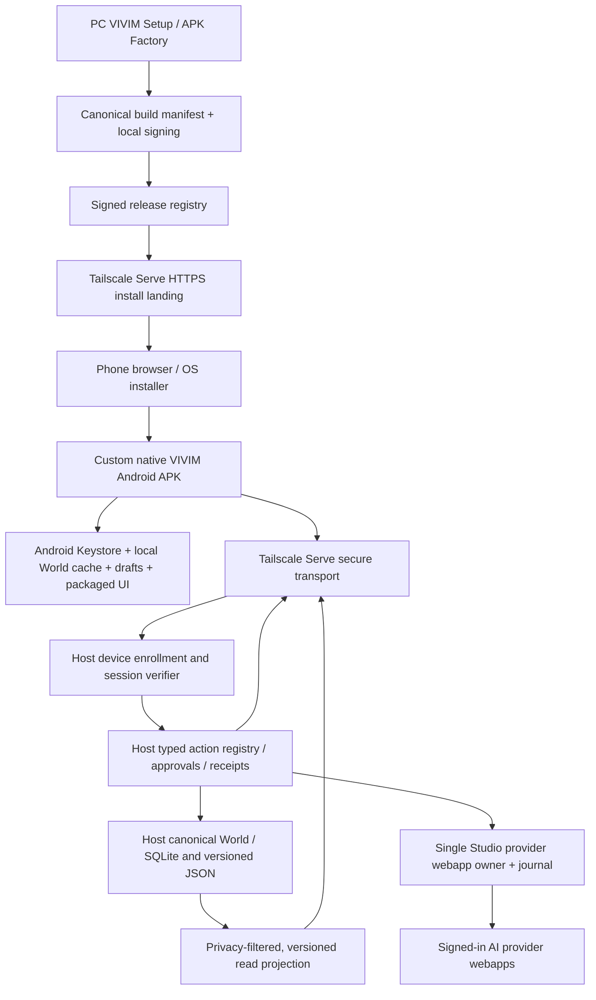

# APK07 architecture, state machines and interoperable contracts

**Status:** proposed design, not an assertion of implemented endpoints. Must reconcile every contract against source, schema indices and live Host before coding. Existing source: `apps/vivim-host/direct-phone.mjs`, `apps/vivim-host/control/*`, `apps/mobile-relay/*`, `studio/android/*`, `docs/design/UNIVERSAL-TEXT-CONTROL-V1.md`, GUI07.

## 1. Architecture and authority



**No second authority**: Android can own local drafts and local-only view preferences, but not PC browser control or canonical World commits. **No silent Cloud**: direct-only modes never fail over to Vercel. **No unconditional trust** in model output, QR scan, Tailscale username, browser origin, APK branding or local draft.

## 2. Protocol namespaces (proposals)

| Type | Schema ID | Owner | Durable? |
|---|---|---|---|
| Build input | `vivim.apk-build-profile/1` | PC APK Factory | versioned, user-controlled |
| Release manifest | `vivim.apk-release/1` | signed PC publishing service | immutable for a given SHA |
| Enrollment challenge | `vivim.device-enrollment/1` | PC Host | single-use, short lived |
| Device grant | `vivim.device-grant/1` | PC Host auth store | persistent, revocable |
| Device request | `vivim.device-request/1` | Android + Host verified transport | journaled by idempotency key |
| Device receipt | `vivim.device-receipt/1` | PC Host | append-only, redacted |
| Phone replica | `vivim.phone-projection/1` | Host writer / phone local store | revisioned, privacy scoped |
| Offline local change | `vivim.phone-draft/1` | Android only | durable until accepted/rejected |
| Export archive | `vivim.world-portable-archive/1` | owner-approved PC/phone exporter | signed/checksummed if selected |

**Rules:** strictly typed validation; bounded input; precise source IDs; canonical revision; privacy classification and consent; no authority from client-originated `risk`, `approved` or `verified` booleans. Inspect the already-existing `vivim.ui-proposal/1`, `vivim.ui-revision/1`, `vivim.control-*`, bootstrap schema and app status contracts before adding an overlapping model.

## 3. Release manifest sketch (illustrative; not a live route)

```json
{
  "schema": "vivim.apk-release/1",
  "releaseId": "apkrel_opaque",
  "channel": "personal",
  "profileDigest": "sha256:...",
  "applicationId": "inc.vivim.app.useropaque",
  "versionCode": 2,
  "versionName": "1.0.1",
  "minSdk": 26,
  "targetSdk": 34,
  "signing": { "mode": "user-owned", "certSha256": "hex...", "rotationLineage": null },
  "artifact": { "fileName": "vivim-personal-1.0.1.apk", "sha256": "hex...", "bytes": 0 },
  "assetBundleVersion": "mobile-shell-v1",
  "supportedHostProtocol": { "min": 1, "max": 1 },
  "createdAt": "ISO-8601",
  "validUntil": null
}
```

The signer certificate fingerprint alone is **not** a signature over JSON. Bind manifest to APK via a verified signed release metadata mechanism, or serve it over authenticated Host HTTPS and compare on-device APK signing certificate/artifact hash. Local agent must choose a real trust bootstrap; don't falsely call SHA-256 authenticated. Never expose build-time keystore paths/passphrases.

## 4. Enrollment states

```text
UNENROLLED → CHALLENGE_REQUESTED → PHONE_KEY_GENERATED → AWAITING_OWNER_APPROVAL
  → ACTIVE → {SUSPENDED, REVOKED, EXPIRED}
  → (new one-time enrollment; old key cannot reactivate)
```

1. PC validates that installer/paired-device request arrived via expected Tailscale Serve path (network boundary, not authorization).
2. Host emits random one-time challenge with expiry, expected Host ID and non-secret display code; route must be authenticated or purposefully guarded against enumeration/DoS.
3. Android generates long-lived device signing key in Android Keystore, binds public key to challenge/Host instance and proves possession with a signature.
4. PC owner compares short code + device descriptor and approves explicit scopes. If the approval is remote, require separate previously established owner authenticator or active user-presence mechanism.
5. Host commits grant with immutable device ID, key fingerprint, scopes, issue/expiry/revocation, active sessions and exact tailnet user metadata as advisory signal.
6. Android obtains scoped session proof and fetches a bounded initial projection; never receives Host's owner admin token or private browser CDP credentials.

### Enrollment API sketch (not existing)

- `POST /mobile/api/enrollment/start` — returns challenge ID, expiry, server nonce and verification context; rate limited.
- `POST /mobile/api/enrollment/prove` — public key + signed transcript + requested scopes; creates **pending** entry only.
- `GET /mobile/api/enrollment/status?id=...` — bounded state for that challenge, no secret delivery through query/referrer.
- **PC-only** `POST /api/host/devices/:id/approve` — require existing Host owner auth, origin/csrf and explicit scope preview.
- `POST /mobile/api/device/session` — device key proofs; short session expiry with rotation.
- **PC-only** `POST /api/host/devices/:id/revoke` — immediate denial + cleanup/tombstone.
- `GET /mobile/api/device/capabilities` — actual capabilities by device role and Host readiness.

**Open design:** whether session proof uses signed canonical request headers or a short-lived bearer issued only after device signature. For either, keep bearer out of URL/localStorage, use strict SameSite/HttpOnly cookies when applicable, origin+CSRF enforcement and replay nonce. Native-WebView cookie behavior and SameSite need real-device tests. Do not make signatures in JavaScript readable by arbitrary pages; native bridge must be strongly origin-bound or route through native networking.

## 5. Remote operation / receipt state machine

```text
DRAFT_LOCAL → PREVIEWED → AWAITING_APPROVAL → ACCEPTED/QUEUED → CLAIMED
  → {APPLIED → VERIFIED, FAILED, UNCERTAIN, REVOKED}
```

`UNCERTAIN` is a terminal safety stop until explicit reconciliation. A reconnect can refresh status by receipt ID; it must **not** resubmit a provider send because the response was lost. The Host is the only author of `APPLIED/VERIFIED` receipts. Android can render a cached event but must label it stale and timestamp it.

Illustrative device request:

```json
{
  "schema": "vivim.device-request/1",
  "requestId": "cmd-opaque-unique",
  "deviceId": "device_opaque",
  "idempotencyKey": "random-client-key",
  "actionId": "ui.theme.set_preset",
  "args": { "preset": "ink" },
  "baseRevision": "world-or-action-revision",
  "planDigest": "sha256:...",
  "approvalRef": "scoped-host-grant-id",
  "expectedEffects": ["theme_revision"],
  "createdAt": "ISO-8601"
}
```

Never trust `approvalRef`, `planDigest`, `deviceId` or `expectedEffects` without independent Host lookup and MAC/signature verification. Separate a plain natural-language *intent* sent to a planner from an authorized typed *effect*. Sensitive arguments should be rejected from unsafe logs and cloud proxies.

## 6. Bidirectional data and privacy

- **Upstream phone → Host**: device-authenticated action intent, draft revision/hash, limited attachments with explicit user selection and content-size bound; no browser control.
- **Downstream Host → phone**: authorized projection with source revision, modifiedAt, privacy class, origin evidence/claim status, content digest and tombstones. Do not send PC-private D06 or secrets.
- **World sync**: host-selected initial snapshot and incremental changes. Local UI journals drafts; CAS merge/review conflict before canonical write. Deletions/revocations win over stale local cache; never rehydrate rejected memories by offline resync.
- **UI state**: `vivim.ui-revision/1` Host-authoritative; local phone provisional design preview can be committed only via typed `ui-proposal/1` with baseRevision, owner review and CAS.
- **Context bundles**: Host builds read-only selection manifest and consent preview. Actual selected excerpts leave PC only toward explicitly approved destination; no default whole-memory dump to phone or any provider.

## 7. Compatibility negotiation

Every Android app and Host announce supported protocol ranges and renderer revision. If no compatible overlap: present **upgrade required** or **limited offline** truth, never silently parse unknown fields as grants. Release metadata needs `minHostProtocol`, `maxHostProtocol`, `localSchemaVersion`, `assetBundleVersion` and migration state. Custom APK update may change bundled UI without changing Host world schema. Backward-compatible additive fields only until version rollover; test an N−1 phone against N Host and vice versa.

## 8. Minimal implementation boundaries

- Add `apps/vivim-host/apk/` (proposed) for build profile validator, artifact manifest, download/QR and enrollment orchestration, reusing `direct-phone.mjs` as gate/router. **Do not route package bytes through generic static file server or accept caller-supplied file paths.**
- Expand Host control through existing UTC catalogue/planner/executor seam, not a second mobile mutation service.
- Add small Android-native modules next to `studio/android/src/` for Keystore, enrollment, share, notification, offline assets/storage and signed update review. Preserve `MainActivity` behavior until replacement is demonstrated.
- Reuse `apps/mobile-relay` renderer from packaged assets or versioned content, avoid an alternative forked JavaScript application. Store package/app identity separately from current WebView pairing cookie.
- Keep Studio Chrome ownership and webapp interaction exclusively with existing Studio runtime; Android never starts a profile or provider API call.

## 9. Critical integration hazards

1. Direct Host uses `tailscale-user-login` only; any other device under same user may currently reach privileged relay endpoints. Per-device grants must guard *all* mutable existing Direct endpoints, not just new APK endpoints; stage old clients/migration carefully.
2. Current Direct relay creates a session cookie internally from process secret; do not mistake that for Android device login. Retain previously working phone path during migration without broadening control.
3. Existing action catalogue contains mostly unverified `adapter_pending`; UI must not imply live effect.
4. Existing `FALLBACK` provider list sets signedIn true; replace with genuine Host signed-in readiness/age and executable target contract.
5. Device-scoped security and local cache revocation require handling compromise/Host loss and tombstone semantics. Revoke cannot erase a truly offline stolen phone instantly; document this limit and add local lock/encryption.
6. Build identity and update key are **durable product data**. A database reset or fresh checkout cannot invent a different signer for an already-installed package.
