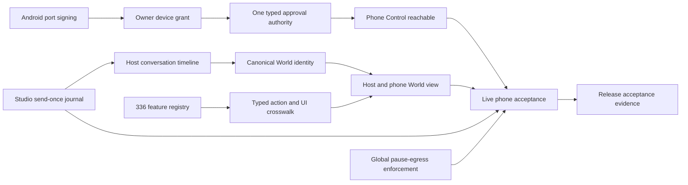

# Five-focus post-integration gap reassessment — 2026-11-01

**Source:** [machine-readable 39-gap reassessment](POST-INTEGRATION-FIVE-FOCUS-GAPS-2026-11-01.v1.json) · [original 39-gap baseline](ACTIVATION-GAPS.v1.json) · [120-step user-journey graph](USER-JOURNEY-ACTIVATION-GRAPH.v1.json)

**Inspected GitHub commit:** `e728c9b3d7a026b32a5e8b89326345cb2dc312e7` (before this analysis document was committed). **Method:** compare original journey gaps with current `main` source paths, catalog, Host and mobile entry points, Studio journal and Android source, plus source file catalog drift. No local browser, Node workspace, Android build, or physical phone tests were executed. Do not use this document to mark the roadmap or source features live-accepted.

## ERA 1 — What changed compared with the starting point

| Category | Reassessed | Interpretation |
|---|---:|---|
| Original gaps | **39** | Keep G01–G39 stable rather than inventing a replacement backlog |
| Source-advanced (not accepted) | **10** | Evidence of engineering progress but unmet acceptance / full reachability |
| Freshly source-confirmed open | **6** | Current source still exposes the missing seam |
| Runtime acceptance not proven | **5** | Requires PC, browser, package or Android evidence |
| Baseline carry-forward | **18** | Not deeply reinspected in this pass; do not claim source proof |
| Fully live-accepted closures | **0** | No full Host + APK receipts supplied |

Baseline severity remains **17 P0 / 20 P1 / 2 P2**. Severity does not equate to runtime failure; it is priority for proof or implementation.

### Five-focus scorecard

| Focus | Gaps | P0 | Source advanced | Confirmed open | Meaning |
|---|---:|---:|---:|---:|---|
| 1 · Trusted PC ↔ phone identity | 5 | 4 | 3 | 0 | Native signer and device grants improved; physical trust pending |
| 2 · Conversation ↔ Personal World | 9 | 4 | 2 | 2 | Journal receipts improved; World identity and view integration pending |
| 3 · Natural language ↔ typed Host actions | 6 | 3 | 2 | 4 | Catalog exists; phone tab and authority convergence missing |
| 4 · Bootstrap ↔ personalization / Build | 7 | 1 | 2 | 0 | Bootstrap scheduler and Build source advance; activation acceptance pending |
| 5 · Capability ↔ navigation / delivery | 12 | 5 | 1 | 0 | Host shell, navigation, MSI and index remain partial |

**Most significant implementation gains:** Studio relay now binds one canonical request key, verifies journal send/reply stages, compares phone reply bytes to journal digest and records a separately authenticated phone-render acknowledgment. Android no longer injects an all-frame Keystore object and now uses a nonce-bound main-frame message port. Device approval/revoke and owner preferences gained typed Host actions; the typed catalog has **19 actions, 17 source-wired, 2 unavailable, 0 live-verified**. None proves a running consumer journey.

## ERA 2 — Reopened and still-dormant wiring (highest-value source findings)

### R01 · P0 · Phone Control tab is not rendered because renderTabs() does not handle v-control.
- **Existing gap:** G26. **Category:** reachable_ui_missing.
- **Code evidence:** `apps/mobile-relay/app.js`; `apps/mobile-relay/index.html`; `apps/mobile-relay/control-phone.mjs`.
- **Depends on:** G13.
- **Acceptance:** Paired phone tap Control -> actual form visible, plans/receipts work; no hidden v-soon view.

### R02 · P0 · Owner-token device approval/revocation API writes enrollment directly outside the typed action journal.
- **Existing gap:** G06. **Category:** parallel_write_authority.
- **Code evidence:** `apps/vivim-host/server.mjs`; `apps/vivim-host/control/dispatcher.mjs`.
- **Depends on:** G13.
- **Acceptance:** All owner-visible grant changes use one typed planned effect + durable receipt, including old endpoints.

### R03 · P0 · Host phone-command timeline and Studio saved-session World retain distinct ID derivation and presentation paths.
- **Existing gap:** G15. **Category:** unified_world_identity.
- **Code evidence:** `apps/vivim-host/conversations/live-projection.mjs`; `studio/src/studio/world-service.mjs`.
- **Depends on:** G17.
- **Acceptance:** One verified conversation resolves consistently PC World, phone status, capture and restart.

### R04 · P0 · Host landing Personal World is still a local mirror placeholder despite Studio World implementation.
- **Existing gap:** G22. **Category:** world_surface_placeholder.
- **Code evidence:** `apps/vivim-host/public/index.html`; `studio/src/studio/ui/world-view.mjs`.
- **Depends on:** G15, G21.
- **Acceptance:** From installed Host, navigate to actual Studio-backed World, not a placeholder.

### R05 · P0 · Global pause-egress action is catalogued but enforcement_missing.
- **Existing gap:** G35. **Category:** unenforced_emergency_stop.
- **Code evidence:** `apps/vivim-host/control/action-catalog.v1.json`; `apps/vivim-host/control/dispatcher.mjs`.
- **Depends on:** G06.
- **Acceptance:** One approved pause blocks all outbound effects at the shared owner and logs receipts.

### R06 · P0 · No real host+Studio+APK pass, trusted device receipts, or restart send-once proof has been supplied.
- **Existing gap:** G17. **Category:** runtime_acceptance.
- **Code evidence:** `docs/agents/LOCAL-HOST-APK-ACCEPTANCE-2026-11-01.md`; `tools/integration/local-readiness.mjs`.
- **Depends on:** G11, G12.
- **Acceptance:** 20 selected Node tests + build + A01-A12 hardware receipts.

### R07 · P1 · Old source file catalog is behind newly created and modified source files; journey/atomic link coverage remains 25/120.
- **Existing gap:** G39. **Category:** discovery_index_drift.
- **Code evidence:** `docs/capabilities/source-file-catalog.json`; `docs/capabilities/journey-capability-crosswalk.v1.json`.
- **Depends on:** No additional source dependency.
- **Acceptance:** Run index:refresh; source-check and crosswalk give current pinned SHA and no stale narrative.

### R08 · P1 · Only 17 of 19 typed action entries are source-wired; 336 capability records are requirements, not action implementations.
- **Existing gap:** G28. **Category:** capability_scope.
- **Code evidence:** `apps/vivim-host/control/action-catalog.v1.json`; `docs/capabilities/atomic-registry.json`.
- **Depends on:** G26.
- **Acceptance:** Explicit feature-to-action-to-UI-to-owner-executor-to-live-receipt matrix.

**Security distinction:** R02 is *not* evidence that an unauthenticated outsider can change grants. The alternate path is owner-token-authenticated, but it bypasses the newer typed-action effect journal and approval receipt contract, violating the intended single authority.

**Reachability distinction:** The phone Control module is present and the HTML defines `#v-control`, but the `renderTabs()` implementation only switches `v-talk`, `v-soon`, `v-start`, and `v-build`. Merely having a Control tab button and handlers does not make its screen reachable.

**World identity distinction:** The Host phone timeline uses command-derived IDs and journal evidence; Studio's saved capture World assigns separate session-derived IDs. That mismatch is not necessarily a data-loss defect, but there is still no accepted canonical cross-reference guaranteeing that one user journey appears as one conversation everywhere.

### Dependency network

### Source index / scope integrity

- **336** registry requirements are not 336 verified actions. The typed Host catalog has **19** actions and **17** source-wired actions. These inventories do not have one-to-one semantics.
- The crosswalk currently connects only **25/120** journey steps to candidate atomic records; **95** have no candidate links. Absence of an index link is **not** evidence that the feature is absent.
- The old source catalog has **413** entries. A broad current-tree scan found **458** candidate source paths, **45** without catalog entries and **55** indexed paths whose blob SHA differs. The scan's path filter is documented in JSON and differs from the canonical reindex generator.
- Refresh through `npm run index:refresh` and re-run `npm run check:index`; don't manually overwrite authoritative source-symbol catalogs with these approximate counts.

### All 39 original gaps — current source classification

| Gap | Baseline priority | Current evidence state | Short title | Source inspected this pass |
|---|---|---|---|---|
| G01 | P0 | Needs runtime acceptance | MSI consumer runtime remains unaccepted | Baseline only |
| G02 | P0 | Needs runtime acceptance | Release authenticity and signed update continuity | Baseline only |
| G03 | P0 | Needs runtime acceptance | Workspace and browser startup are not one seamless service | Baseline only |
| G04 | P0 | Needs runtime acceptance | Provider-ready is not proof of authenticated account | Baseline only |
| G05 | P1 | Carry-forward · recheck | Multi-account and model capability selection are incomplete | Baseline only |
| G06 | P0 | Confirmed open | User authorization is fragmented across prompt paths | `apps/vivim-host/server.mjs` |
| G07 | P2 | Carry-forward · recheck | Provider performance analytics is not in ordinary navigation | Baseline only |
| G08 | P1 | Advanced · not accepted | Full D03-D07 scheduler is dormant in guided bootstrap | `apps/vivim-host/onboarding/service.mjs` |
| G09 | P1 | Carry-forward · recheck | Bootstrap correction and source review remain limited | Baseline only |
| G10 | P0 | Needs runtime acceptance | Private Direct configuration has no consumer wizard | Baseline only |
| G11 | P0 | Advanced · not accepted | Android package install not accepted on physical device | `studio/android/src/inc/vivim/app/MainActivity.java` |
| G12 | P0 | Advanced · not accepted | Browser-to-native pairing needs live deep-link acceptance | `apps/mobile-relay/device-enrollment.mjs` |
| G13 | P0 | Advanced · not accepted | Simple paired status is weaker than device-bound trust | `apps/vivim-host/direct-phone.mjs` |
| G14 | P1 | Carry-forward · recheck | Offline shell exists without accepted World synchronization | Baseline only |
| G15 | P0 | Advanced · not accepted | Conversation IDs and live state have multiple authorities | `apps/vivim-host/conversations/live-projection.mjs` |
| G16 | P1 | Carry-forward · recheck | File attach capability lacks consistent user-ready enforcement | Baseline only |
| G17 | P0 | Advanced · not accepted | Send-once and reconciliation need full journey acceptance | `studio/bin/lib/relay-chat-studio.mjs` |
| G18 | P1 | Carry-forward · recheck | Saved conversation capsules are isolated from phone and Host | Baseline only |
| G19 | P1 | Carry-forward · recheck | Browser Companion extension is implemented but manual/unpaired | Baseline only |
| G20 | P1 | Carry-forward · recheck | Conversation discovery offers only partial visible sidebar coverage | Baseline only |
| G21 | P0 | Confirmed open | Capture acceptance is not automatically visible in Personal World | `studio/src/studio/world-service.mjs` |
| G22 | P0 | Confirmed open | Full Studio World is stranded behind Host and phone placeholders | `apps/vivim-host/public/index.html` |
| G23 | P1 | Carry-forward · recheck | JSON export import exists in Studio but lacks front-door discovery | Baseline only |
| G24 | P0 | Advanced · not accepted | Phone AI Build path lacks accepted full activation | `apps/mobile-relay/build-canvas.mjs` |
| G25 | P1 | Carry-forward · recheck | Two personal app builders operate with separate surfaces | Baseline only |
| G26 | P0 | Confirmed open | Phone Control UI rendered unreachable by its own tab switcher | `apps/mobile-relay/app.js` |
| G27 | P1 | Confirmed open | Unknown command AI fallback is not actually wired | `apps/mobile-relay/control-phone.mjs` |
| G28 | P1 | Advanced · not accepted | Universal text control covers only a narrow action catalog | `apps/vivim-host/control/action-catalog.v1.json` |
| G29 | P0 | Carry-forward · recheck | Personal Agent and Work are hidden from main VIVIM navigation | Baseline only |
| G30 | P1 | Carry-forward · recheck | Dynamic Context Bundles are backend-only to ordinary users | Baseline only |
| G31 | P1 | Carry-forward · recheck | Multi-model council and recipe engine inaccessible in main surface | Baseline only |
| G32 | P1 | Carry-forward · recheck | Personal data intelligence indexes counts but not assets | Baseline only |
| G33 | P2 | Carry-forward · recheck | Provider saved-memory changes are not evidenced to users | Baseline only |
| G34 | P1 | Advanced · not accepted | Approval and authority history inaccessible to normal user | `apps/vivim-host/public/control-panel.js` |
| G35 | P0 | Confirmed open | Global pause-egress is catalogued but has no enforcement | `apps/vivim-host/control/action-catalog.v1.json` |
| G36 | P1 | Carry-forward · recheck | User correction does not cascade across stored authorities | Baseline only |
| G37 | P1 | Carry-forward · recheck | Host worker diagnostics do not complete self-service recovery | Baseline only |
| G38 | P1 | Carry-forward · recheck | Capability activation engine not wired into every requested view | Baseline only |
| G39 | P1 | Advanced · not accepted | Roadmap and source-symbol index are not user-journey-aware | `tools/docs/typed-action-source-audit.mjs` |

## ERA 3 — Implementation waves, release gates and what the PC must prove

### Wave 0: unblock the real user path (source edits)

1. **R01 / G26:** Unhide the phone Control panel in the tab renderer; verify a signed-in phone can reach and use text planning. Do not add a second action executor.
2. **R02 / G06:** Remove or funnel the remaining owner-token direct device mutation route through the same R2 typed journal; keep owner authentication and approval requirements intact.
3. **R05 / G35:** Implement an actual Host-owned pause-egress enforcement gate at every outbound effect owner, with explicit resume and durable receipts. Leave the catalog action unavailable until enforcement is real.
4. **R03 / G15:** Write one explicit ID crosswalk between Studio's captured sessions/turns and Host's command/World timeline; preserve source IDs and do not invent provider thread identity.
5. **R04 / G22:** Replace the Host's Personal World mirror placeholder with a user-reachable, authorized Studio-backed World view, without moving browser authority into the Host UI.

### Wave 1: prove each layer locally (not another speculative coding sprint)

6. Run `npm run check:local-release` and fix any *actual* failing tests; it selects 20 files but has not been run on the private local checkout from this conversation.
7. Compile the no-Gradle APK on the user's Windows PC with JDK 17+ and Android SDK 34; run the [A01–A12 acceptance checklist](../agents/LOCAL-HOST-APK-ACCEPTANCE-2026-11-01.md) against exactly one Studio owner and Direct worker.
8. Preserve a verified one-send/reply/phone-render-receipt sequence across one restart. When uncertain, inspect the original request key; never resend.
9. Accept the consumer MSI from installed Program Files separately from running in the repository checkout. Do not infer installer readiness from source staging.

### Wave 2: broaden capability coverage without duplicating authorities

10. Map each priority journey step to an explicit action-capability-UI-executor-evidence tuple; prioritize provider account readiness, personalization review/correction, offline and Build activation, saved conversations/exports, Personal Agent/Work, and model selection.
11. Keep unknown-command AI interpretation as *interpretation only*: candidate typed actions go back through the Host planner with scoped owner approval. Never allow a model to grant a capability or execute arbitrary code.
12. Refresh source-symbol and document indexes, validate them and only then update the roadmap status using actual receipts.

### Strict release blockers

- **Privacy/safety:** A confirmed alternative write path or unenforced network pause remains a product-authority gap; authenticated access is not a substitute for one effect journal.
- **Functional:** Hidden Control and placeholder World remain unactivated interfaces even if their underlying modules pass tests.
- **Runtime:** No physical APK signing/enrollment/revocation, Studio provider-send/reply, Windows MSI, or hostile-iframe acceptance has been supplied in this session.
- **Evidence:** `source_wired` is never `verified`; a matching string, symbol or simulated JS handshake is not a running product.

### Repo ownership and local paths

- New machine gap matrix: `docs/ux/POST-INTEGRATION-FIVE-FOCUS-GAPS-2026-11-01.v1.json`.
- Original baseline retained: `docs/ux/ACTIVATION-GAPS.v1.json`.
- Current code acceptance instructions: `docs/agents/LOCAL-HOST-APK-ACCEPTANCE-2026-11-01.md`.
- Local PC root: `C:\0-BlackBoxProject-0\vivim-web-harness`. GitHub root: `https://github.com/owenservera/vivim-web-harness`.

**Scope of this pass:** analysis and source-linked documentation only. No duplicate roadmap authority, no change to activation status without tests, no branch, no runner/Chrome/phone side effect.
