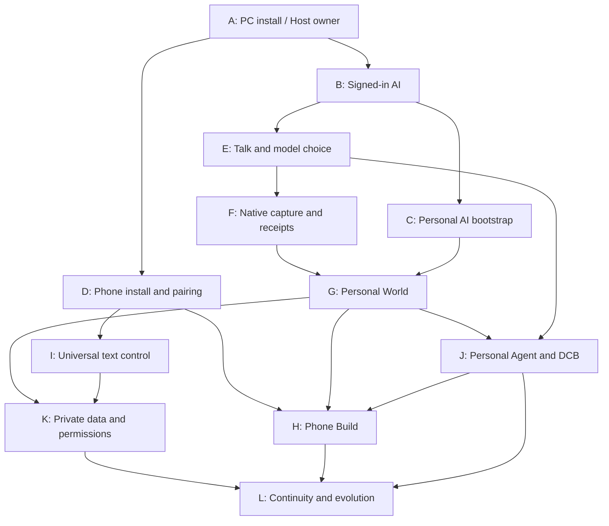

# VIVIM — Full User Journey Tree and Dormant-Capability Audit

**Date:** 2026-11-01  
**Source baseline:** `035524e572fe3c7ec03c15723c2cdee0b79bdac7` (the commit audited, not a live test receipt)  
**Maintained graph:** [120 atomic actions](USER-JOURNEY-ACTIVATION-GRAPH.v1.json) · [39 activation gaps](ACTIVATION-GAPS.v1.json)  
**Local checkout root:** `C:\0-BlackBoxProject-0\vivim-web-harness`

## Read this correctly

This is a **source reachability** audit, not a live acceptance certificate. States:

- **E — exposed:** UI path and its handler are present; user/device acceptance not implied.
- **P — partial:** UI/API/workers are connected in part, but the intended user outcome is not yet evidenced end-to-end.
- **H — hidden / alternate UI:** code and often a Studio API or Studio UI exist, but the target Host/phone entrypoint does not expose them.
- **I — inert:** a visible UI entrypoint leads to a placeholder or inaccessible panel.
- **V — needs acceptance:** the implementation is recent or depends on installed Windows/Android proof.

**Snapshot:** 120 atomic actions, 12 root journeys, 36 subjourneys, 150 DAG edges. These classifications are not percentages of software completed.

## Where the real product breaks despite existing code

1. **Host navigation is not the Studio World.** `apps/vivim-host/public/host.js::select` shows stub copy for Today/Talk/Agents/Self/Build, while `studio/src/studio/ui/world-view.mjs::mountWorldView` and `studio/src/studio/integration-hub.mjs` expose substantial real functionality.
2. **Phone Control has code but the tab goes to Coming soon.** `apps/mobile-relay/index.html` has `#v-control` and loads `control-phone.mjs`; `apps/mobile-relay/app.js::renderTabs` instead shows `#v-soon` for Control. This is a concrete navigation bug, not unimplemented control code.
3. **Seven-pass scheduler, two-pass consumer wiring.** `apps/vivim-host/bootstrap/scheduler.mjs::PASS_ORDER` lists F02/F01/D03–D07, but `apps/vivim-host/onboarding/service.mjs::PASSES` is F02/F01.
4. **Three conversation state representations.** Phone localStorage conversation list, Studio's authoritative conversation runtime and Host's metadata-only live projection have no single mounted consumer read model.
5. **Two app-building worlds.** Studio's personal-app API persists blueprints and content, while phone Build submits Host UI revisions. There is no established single app object/version lifecycle.
6. **Advanced Agent/World/Data tools are not ordinary VIVIM controls.** Studio routes for World, search, transfer, personal agents, context bundles, multi-model orchestration and recipes exist. Host and phone home navigation are not connected to the same suite.
7. **Configured does not imply authorized or safe.** The control catalog explicitly marks network pause as `enforcement_missing`; simple pairing state is not Keystore proof of device trust. These are security and authority gaps, not cosmetic UX polish.

## Interwoven dependency view

The tree is three levels deep: **journey → subjourney → atomic action**. Dependencies cross between branches, rather than simply following the written order.

## All 120 atomic actions — source-mapped

The text after each action is the primary code entrypoint; `←` shows cross-branch and within-branch prerequisite IDs. The activation gap, if present, opens into the companion JSON.

### A. Install and own a working PC

#### A1 — Distribute

- **J001** [V] Obtain Windows MSI — [`src-tauri/tauri.conf.json`](../../src-tauri/tauri.conf.json) `#targets` · **G01 (P0)**
- **J002** [V] Stage Node and Host runtime into release — [`tools/packaging/prepare-host-runtime.mjs`](../../tools/packaging/prepare-host-runtime.mjs) `#nodeBin` · **G01 (P0)** ← J001
- **J003** [V] Verify signed APK and bundle into MSI — [`tools/packaging/prepare-host-runtime.mjs`](../../tools/packaging/prepare-host-runtime.mjs) `#manifest.artifact` · **G02 (P0)** ← J002
- **J004** [V] Install MSI on consumer Windows without repo — [`src-tauri/src/main.rs`](../../src-tauri/src/main.rs) `#main` · **G01 (P0)** ← J003

#### A2 — Configure PC

- **J005** [P] Start Host from installed directory — [`src-tauri/src/main.rs`](../../src-tauri/src/main.rs) `#fn start(` · **G01 (P0)** ← J002
- **J006** [E] Inspect Host health and readiness — [`apps/vivim-host/server.mjs`](../../apps/vivim-host/server.mjs) `#hostSnapshot` ← J005
- **J007** [E] Choose personal workspace location — [`apps/vivim-host/public/onboarding.js`](../../apps/vivim-host/public/onboarding.js) `#stepComputer` ← J006
- **J008** [E] Detect available browsers and prerequisites — [`apps/vivim-host/onboarding/environment.mjs`](../../apps/vivim-host/onboarding/environment.mjs) `#detectEnvironment` ← J007

#### A3 — Open World

- **J009** [P] Open dedicated browser and Studio owner — [`apps/vivim-host/onboarding/service.mjs`](../../apps/vivim-host/onboarding/service.mjs) `#status` · **G03 (P0)** ← J007, J008
- **J010** [P] Resume previously configured World after reboot — [`apps/vivim-host/server.mjs`](../../apps/vivim-host/server.mjs) `#manifestComplete` · **G03 (P0)** ← J009

### B. Connect real AI accounts

#### B1 — Discover sign-ins

- **J011** [E] Open a native provider sign-in window — [`apps/vivim-host/onboarding/service.mjs`](../../apps/vivim-host/onboarding/service.mjs) `#openSignIn` ← J009
- **J012** [P] Sign in personally without sharing credentials — [`apps/vivim-host/onboarding/studio-port.mjs`](../../apps/vivim-host/onboarding/studio-port.mjs) `#createStudioPort` · **G04 (P0)** ← J011
- **J013** [E] Discover provider tabs without claiming authentication — [`studio/src/studio/conversation-api.mjs`](../../studio/src/studio/conversation-api.mjs) `#conversation-targets` ← J012
- **J014** [P] Check genuinely authenticated provider readiness — [`apps/vivim-host/onboarding/service.mjs`](../../apps/vivim-host/onboarding/service.mjs) `#check` · **G04 (P0)** ← J013, J011, J012

#### B2 — Select AI

- **J015** [P] Show accurate account connection states — [`apps/vivim-host/public/onboarding.js`](../../apps/vivim-host/public/onboarding.js) `#stepAccounts` · **G04 (P0)**
- **J016** [E] Choose a main AI provider — [`apps/vivim-host/onboarding/service.mjs`](../../apps/vivim-host/onboarding/service.mjs) `#setPrimary` ← J015
- **J017** [P] Select model and thinking effort — [`apps/mobile-relay/app.js`](../../apps/mobile-relay/app.js) `#renderComposer` · **G05 (P1)** ← J016
- **J018** [H] Switch between multiple accounts for one provider — [`studio/src/profiles/sites/index.mjs`](../../studio/src/profiles/sites/index.mjs) `#getReadAdapter` · **G05 (P1)** ← J017

#### B3 — Confirm scope

- **J019** [P] Review provider-send and data-use authority — [`apps/vivim-host/public/onboarding.js`](../../apps/vivim-host/public/onboarding.js) `#stepMain` · **G06 (P0)**
- **J020** [H] View empirical provider performance — [`studio/src/studio/provider-performance-routes.mjs`](../../studio/src/studio/provider-performance-routes.mjs) `#registerProviderPerformanceRoutes` · **G07 (P2)** ← J019

### C. Bootstrap Personal AI

#### C1 — Review authority

- **J021** [E] Review exact bootstrap prompt contents — [`apps/vivim-host/onboarding/service.mjs`](../../apps/vivim-host/onboarding/service.mjs) `#review` ← J014, J016
- **J022** [E] Grant bounded one-generation bootstrap approval — [`apps/vivim-host/onboarding/service.mjs`](../../apps/vivim-host/onboarding/service.mjs) `#approveAndStart` ← J021
- **J023** [P] Create an owned provider-native bootstrap conversation — [`apps/vivim-host/onboarding/studio-port.mjs`](../../apps/vivim-host/onboarding/studio-port.mjs) `#createStudioPort` ← J022
- **J024** [P] Send F02 preferences prompt exactly once — [`apps/vivim-host/bootstrap/scheduler.mjs`](../../apps/vivim-host/bootstrap/scheduler.mjs) `#createBootstrapScheduler` · **G08 (P1)** ← J023

#### C2 — Execute fast pass

- **J025** [P] Ingest evidence-grounded visual preferences — [`apps/vivim-host/bootstrap/runtime.mjs`](../../apps/vivim-host/bootstrap/runtime.mjs) `#ingestF02` ← J024
- **J026** [P] Send F01 personal-context prompt exactly once — [`apps/vivim-host/bootstrap/scheduler.mjs`](../../apps/vivim-host/bootstrap/scheduler.mjs) `#PASS_ORDER` · **G08 (P1)** ← J025
- **J027** [P] Ingest F01 observations and provenance — [`apps/vivim-host/bootstrap/runtime.mjs`](../../apps/vivim-host/bootstrap/runtime.mjs) `#ingestF01` ← J026
- **J028** [E] Render personal visual choices on phone — [`apps/mobile-relay/visual-bootstrap.mjs`](../../apps/mobile-relay/visual-bootstrap.mjs) `#applyHostProjection` ← J027, J025

#### C3 — Enrich and recover

- **J029** [H] Schedule full D03 through D07 passes — [`apps/vivim-host/bootstrap/scheduler.mjs`](../../apps/vivim-host/bootstrap/scheduler.mjs) `#PASS_ORDER` · **G08 (P1)** ← J026, J027
- **J030** [P] Reconcile uncertain passes and allow corrections — [`apps/vivim-host/onboarding/service.mjs`](../../apps/vivim-host/onboarding/service.mjs) `#personalization` · **G09 (P1)** ← J029

### D. Install and pair Android

#### D1 — Install app

- **J031** [P] Expose private HTTPS APK download on PC — [`apps/vivim-host/public/onboarding.js`](../../apps/vivim-host/public/onboarding.js) `#stepPhone` · **G10 (P0)** ← J003, J009
- **J032** [P] Download signed APK through Direct route — [`apps/vivim-host/direct-phone.mjs`](../../apps/vivim-host/direct-phone.mjs) `#api/apk/download` · **G02 (P0)** ← J031
- **J033** [V] Approve installation in Android package installer — [`studio/android/src/inc/vivim/app/MainActivity.java`](../../studio/android/src/inc/vivim/app/MainActivity.java) `#MainActivity` · **G11 (P0)** ← J032
- **J034** [P] Open actual installed Android shell — [`studio/android/src/inc/vivim/app/MainActivity.java`](../../studio/android/src/inc/vivim/app/MainActivity.java) `#onCreate` · **G11 (P0)** ← J033, J032

#### D2 — Pair identity

- **J035** [E] Mint single-use 10-minute pairing token — [`apps/vivim-host/apk/pairing.mjs`](../../apps/vivim-host/apk/pairing.mjs) `#createToken` ← J034
- **J036** [P] Scan QR and hand off browser to native app — [`apps/mobile-relay/app.js`](../../apps/mobile-relay/app.js) `#showAppHandoff` · **G12 (P0)** ← J035
- **J037** [P] Redeem one-use token at Direct endpoint — [`apps/mobile-relay/pairing-link.mjs`](../../apps/mobile-relay/pairing-link.mjs) `#redeemDevicePairToken` · **G12 (P0)** ← J036
- **J038** [H] Prove Keystore device identity and scoped grant — [`apps/vivim-host/apk/enrollment.mjs`](../../apps/vivim-host/apk/enrollment.mjs) `#createEnrollment` · **G13 (P0)** ← J037

#### D3 — Resume

- **J039** [P] Show paired device and real connection freshness — [`apps/vivim-host/onboarding/service.mjs`](../../apps/vivim-host/onboarding/service.mjs) `#status` · **G13 (P0)** ← J038
- **J040** [P] Recover device connection and offline view — [`studio/android/src/inc/vivim/app/MainActivity.java`](../../studio/android/src/inc/vivim/app/MainActivity.java) `#loadOfflineShell` · **G14 (P1)** ← J039

### E. Everyday Talk

#### E1 — Compose

- **J041** [E] Open Talk composer from phone — [`apps/mobile-relay/app.js`](../../apps/mobile-relay/app.js) `#renderComposer` ← J034, J014
- **J042** [P] Select target provider model effort — [`apps/mobile-relay/app.js`](../../apps/mobile-relay/app.js) `#renderComposer` · **G05 (P1)** ← J041
- **J043** [P] Create or reopen durable conversation identity — [`apps/mobile-relay/app.js`](../../apps/mobile-relay/app.js) `#newConv` · **G15 (P0)** ← J042
- **J044** [P] Attach a file where provider supports it — [`apps/mobile-relay/app.js`](../../apps/mobile-relay/app.js) `#renderComposer` · **G16 (P1)** ← J043

#### E2 — Send/observe

- **J045** [P] Review and approve actual provider send — [`apps/mobile-relay/app.js`](../../apps/mobile-relay/app.js) `#send` · **G06 (P0)**
- **J046** [P] Queue one idempotent Host bridge command — [`studio/src/studio/bridge-commands.mjs`](../../studio/src/studio/bridge-commands.mjs) `#createBridgeStore` · **G15 (P0)** ← J045, J041, J042
- **J047** [P] Submit in the single browser-owned thread — [`studio/src/capture/conversation-runtime.mjs`](../../studio/src/capture/conversation-runtime.mjs) `#submit` · **G17 (P0)** ← J046
- **J048** [P] Read verified streaming and settled reply — [`harness/src/core/reply.mjs`](../../harness/src/core/reply.mjs) `#readReply` · **G17 (P0)** ← J047

#### E3 — Continue

- **J049** [P] Reopen history with accurate source coverage — [`studio/src/studio/ui/chat.mjs`](../../studio/src/studio/ui/chat.mjs) `#historyRow` · **G18 (P1)**
- **J050** [P] Reconcile unknown send outcome without retry — [`studio/src/studio/conversation-tools.mjs`](../../studio/src/studio/conversation-tools.mjs) `#reconcile_conversation` · **G17 (P0)** ← J049

### F. Capture native AI evidence

#### F1 — Discover

- **J051** [H] Detect provider tabs via passive companion — [`apps/browser-companion/sensor.mjs`](../../apps/browser-companion/sensor.mjs) `#installSensor` · **G19 (P1)** ← J009, J041
- **J052** [H] Pair optional extension to Studio ingress — [`studio/src/studio/browser-companion/ingress.mjs`](../../studio/src/studio/browser-companion/ingress.mjs) `#pairCompanion` · **G19 (P1)** ← J051
- **J053** [P] Find rendered conversation URLs with coverage — [`studio/src/capture/chatgpt-chat-index.mjs`](../../studio/src/capture/chatgpt-chat-index.mjs) `#chatIndexExpression` · **G20 (P1)** ← J052, J041, J051
- **J054** [P] Select conversations explicitly for capture — [`studio/src/studio/ui/chat.mjs`](../../studio/src/studio/ui/chat.mjs) `#SELECTED_KEY` · **G20 (P1)** ← J053

#### F2 — Capture

- **J055** [P] Capture provider stream and DOM evidence — [`studio/src/studio/server.mjs`](../../studio/src/studio/server.mjs) `#Recorder` · **G21 (P0)** ← J054
- **J056** [P] Associate native thread account and turn — [`studio/src/capture/conversation-runtime.mjs`](../../studio/src/capture/conversation-runtime.mjs) `#ConversationRuntime` · **G21 (P0)** ← J055
- **J057** [H] Build a saved conversation capsule — [`studio/src/studio/conversation-tools.mjs`](../../studio/src/studio/conversation-tools.mjs) `#conversation_capsule` · **G18 (P1)** ← J056
- **J058** [P] Derive replayable transcript and evidence — [`studio/src/studio/integration-hub.mjs`](../../studio/src/studio/integration-hub.mjs) `#createIntegrationHub` · **G21 (P0)** ← J057

#### F3 — Prove

- **J059** [H] Review acceptance receipts and fidelity — [`studio/src/studio/server.mjs`](../../studio/src/studio/server.mjs) `#readAcceptance` · **G21 (P0)**
- **J060** [P] Recover capture mappings after provider UI drift — [`studio/src/profiles/sites/index.mjs`](../../studio/src/profiles/sites/index.mjs) `#listReadAdapters` · **G20 (P1)** ← J059

### G. Explore Personal World

#### G1 — Explore

- **J061** [H] Open functional World not placeholder — [`studio/src/studio/ui/world-view.mjs`](../../studio/src/studio/ui/world-view.mjs) `#mountWorldView` · **G22 (P0)** ← J055, J057
- **J062** [H] Browse saved conversations with confidence state — [`studio/src/studio/world-service.mjs`](../../studio/src/studio/world-service.mjs) `#conversations` · **G22 (P0)** ← J061
- **J063** [H] Search personal messages notes and projects — [`studio/src/studio/world-search.mjs`](../../studio/src/studio/world-search.mjs) `#registerWorldSearchRoutes` · **G22 (P0)** ← J062
- **J064** [H] Inspect provenance coverage and native source — [`studio/src/studio/ui/world-view.mjs`](../../studio/src/studio/ui/world-view.mjs) `#coverageView` · **G22 (P0)** ← J063

#### G2 — Organize

- **J065** [H] Create and edit project records — [`studio/src/studio/world-service.mjs`](../../studio/src/studio/world-service.mjs) `#createProject` · **G22 (P0)**
- **J066** [H] Create or edit notes and structured units — [`studio/src/studio/world-service.mjs`](../../studio/src/studio/world-service.mjs) `#writeNote` · **G22 (P0)** ← J065, J062
- **J067** [H] Connect selected passages to projects — [`studio/src/studio/world-relations.mjs`](../../studio/src/studio/world-relations.mjs) `#createWorldRelations` · **G22 (P0)** ← J066
- **J068** [H] Navigate relationships as an evidence graph — [`studio/src/studio/ui/world-view.mjs`](../../studio/src/studio/ui/world-view.mjs) `#graphProjection` · **G22 (P0)** ← J067

#### G3 — Transfer

- **J069** [H] Export chosen World records as JSON — [`studio/src/studio/world-transfer.mjs`](../../studio/src/studio/world-transfer.mjs) `#createWorldTransfer` · **G23 (P1)** ← J065, J066
- **J070** [H] Validate and import JSON restore safely — [`studio/src/studio/world-transfer.mjs`](../../studio/src/studio/world-transfer.mjs) `#registerWorldTransferRoutes` · **G23 (P1)** ← J069

### H. Build personal apps

#### H1 — Propose

- **J071** [E] Open AI-driven Build canvas — [`apps/mobile-relay/app.js`](../../apps/mobile-relay/app.js) `#mountBuild` ← J034, J028
- **J072** [P] Describe desired UI screen in natural language — [`apps/mobile-relay/build-canvas.mjs`](../../apps/mobile-relay/build-canvas.mjs) `#mountBuildCanvas` · **G24 (P0)** ← J071
- **J073** [P] Send one design prompt to signed-in AI — [`apps/mobile-relay/app.js`](../../apps/mobile-relay/app.js) `#mountCompose` · **G24 (P0)** ← J072, J014
- **J074** [P] Parse and validate AI generated UI proposal — [`apps/mobile-relay/generative-ui/compiler.mjs`](../../apps/mobile-relay/generative-ui/compiler.mjs) `#compileUiProposal` · **G24 (P0)** ← J073

#### H2 — Activate

- **J075** [P] Preview visual change before applying — [`apps/mobile-relay/build-canvas.mjs`](../../apps/mobile-relay/build-canvas.mjs) `#proposalCard` · **G24 (P0)** ← J074
- **J076** [P] Activate approved revision and persist receipt — [`apps/mobile-relay/generative-ui/phone-surface.mjs`](../../apps/mobile-relay/generative-ui/phone-surface.mjs) `#sendProposal` · **G24 (P0)** ← J075
- **J077** [P] Interact with UI by typed visual intent — [`apps/mobile-relay/generative-ui/phone-surface.mjs`](../../apps/mobile-relay/generative-ui/phone-surface.mjs) `#intentToOp` · **G24 (P0)** ← J076
- **J078** [P] Undo last approved design change — [`apps/mobile-relay/build-canvas.mjs`](../../apps/mobile-relay/build-canvas.mjs) `#undo` · **G24 (P0)** ← J077, J076

#### H3 — Persist

- **J079** [H] Create durable personal app from a template — [`studio/src/studio/personal-app-routes.mjs`](../../studio/src/studio/personal-app-routes.mjs) `#registerPersonalAppRoutes` · **G25 (P1)** ← J076, J065
- **J080** [H] Manage app notes tasks and screen history — [`studio/src/studio/personal-app-routes.mjs`](../../studio/src/studio/personal-app-routes.mjs) `#content/items` · **G25 (P1)** ← J079

### I. Universal text control

#### I1 — Understand

- **J081** [I] Open working Control UI from phone tab — [`apps/mobile-relay/control-phone.mjs`](../../apps/mobile-relay/control-phone.mjs) `#submit` · **G26 (P0)** ← J040
- **J082** [I] Enter plain-language configuration request — [`apps/mobile-relay/control-phone.mjs`](../../apps/mobile-relay/control-phone.mjs) `#preview` · **G26 (P0)** ← J081
- **J083** [P] Recognize known deterministic NLCL action — [`apps/vivim-host/control/intent-planner.mjs`](../../apps/vivim-host/control/intent-planner.mjs) `#createControlPlanner` · **G27 (P1)** ← J082
- **J084** [H] Interpret unfamiliar request through signed-in AI — [`apps/mobile-relay/control-phone.mjs`](../../apps/mobile-relay/control-phone.mjs) `#renderResult` · **G27 (P1)** ← J083

#### I2 — Authorize

- **J085** [P] Prepare scoped deterministic action plan — [`apps/vivim-host/control/dispatcher.mjs`](../../apps/vivim-host/control/dispatcher.mjs) `#plan` · **G26 (P0)** ← J083
- **J086** [P] Display actual readiness risk and permissions — [`apps/vivim-host/control/action-catalog.v1.json`](../../apps/vivim-host/control/action-catalog.v1.json) `#actions` · **G28 (P1)** ← J085
- **J087** [P] Approve plan digest and execute only once — [`apps/vivim-host/control/dispatcher.mjs`](../../apps/vivim-host/control/dispatcher.mjs) `#execute` · **G26 (P0)** ← J086, J085
- **J088** [P] Inspect durable receipt and undo when possible — [`apps/vivim-host/control/dispatcher.mjs`](../../apps/vivim-host/control/dispatcher.mjs) `#status` · **G28 (P1)** ← J087

#### I3 — Expand

- **J089** [P] Edit theme and hard privacy limits through same contract — [`apps/vivim-host/control/dispatcher.mjs`](../../apps/vivim-host/control/dispatcher.mjs) `#createExecutors` · **G28 (P1)** ← J087
- **J090** [H] Make every enabled capability text-operable — [`apps/vivim-host/control/action-catalog.v1.json`](../../apps/vivim-host/control/action-catalog.v1.json) `#readinessStates` · **G28 (P1)** ← J089

### J. Personal Agent and multi-AI

#### J1 — Personal identity

- **J091** [H] Open Personal Agent from everyday navigation — [`studio/src/studio/personal-agent-routes.mjs`](../../studio/src/studio/personal-agent-routes.mjs) `#registerPersonalAgentRoutes` · **G29 (P0)** ← J061, J016
- **J092** [H] Initialize private local personal agent — [`studio/src/agents/personal-agent-service.mjs`](../../studio/src/agents/personal-agent-service.mjs) `#initialize` · **G29 (P0)** ← J091
- **J093** [H] Inspect grounded self knowledge and uncertainty — [`studio/src/agents/personal-agent-service.mjs`](../../studio/src/agents/personal-agent-service.mjs) `#selfKnowledge` · **G29 (P0)** ← J092, J062
- **J094** [H] Search and manage agent memory tiers — [`studio/src/agents/personal-agent-service.mjs`](../../studio/src/agents/personal-agent-service.mjs) `#searchMemory` · **G29 (P0)** ← J093

#### J2 — Task/context

- **J095** [H] Create a user-directed persistent Work item — [`studio/src/agents/personal-agent-service.mjs`](../../studio/src/agents/personal-agent-service.mjs) `#createWorkItem` · **G29 (P0)**
- **J096** [H] Track actionable progress and next steps — [`studio/src/agents/personal-agent-work.mjs`](../../studio/src/agents/personal-agent-work.mjs) `#transitionWork` · **G29 (P0)** ← J095
- **J097** [H] Assemble dynamic scoped context bundle — [`harness/src/context/dcb-composer.mjs`](../../harness/src/context/dcb-composer.mjs) `#createDCBComposer` · **G30 (P1)** ← J096, J093
- **J098** [H] Preview work from stored provider reply — [`studio/src/studio/personal-agent-routes.mjs`](../../studio/src/studio/personal-agent-routes.mjs) `#preview-provider-reply` · **G29 (P0)** ← J097

#### J3 — Multi-AI

- **J099** [H] Run user-approved multi-AI orchestration pattern — [`studio/src/studio/orchestrator-routes.mjs`](../../studio/src/studio/orchestrator-routes.mjs) `#registerOrchestratorRoutes` · **G31 (P1)** ← J092, J014
- **J100** [H] Choose and run recipe across available AI tools — [`studio/src/studio/recipe-routes.mjs`](../../studio/src/studio/recipe-routes.mjs) `#registerRecipeRoutes` · **G31 (P1)** ← J099

### K. Privacy data and ownership

#### K1 — Inventory

- **J101** [H] Inspect known personal data ingress classes — [`apps/vivim-host/data-intelligence/catalog.mjs`](../../apps/vivim-host/data-intelligence/catalog.mjs) `#readIngressRegistry` · **G32 (P1)** ← J055, J025
- **J102** [H] Explore actual indexed private data assets — [`apps/vivim-host/data-intelligence/catalog.mjs`](../../apps/vivim-host/data-intelligence/catalog.mjs) `#projectDataInventory` · **G32 (P1)** ← J101
- **J103** [H] Inspect custody and source coverage of records — [`studio/src/studio/ui/world-view.mjs`](../../studio/src/studio/ui/world-view.mjs) `#identityRows` · **G22 (P0)** ← J102
- **J104** [H] Detect changes in provider stored memory — [`studio/src/profiles/sites/index.mjs`](../../studio/src/profiles/sites/index.mjs) `#getReadAdapter` · **G33 (P2)** ← J103, J057

#### K2 — Enforce privacy

- **J105** [P] Set and clear hard personal limits — [`apps/vivim-host/control/dispatcher.mjs`](../../apps/vivim-host/control/dispatcher.mjs) `#createExecutors` · **G28 (P1)**
- **J106** [H] Grant and revoke device-specific scopes — [`apps/vivim-host/apk/enrollment.mjs`](../../apps/vivim-host/apk/enrollment.mjs) `#createEnrollment` · **G13 (P0)** ← J105, J038
- **J107** [H] Inspect approvals and provider-send authority — [`apps/vivim-host/bootstrap/owner-auth.mjs`](../../apps/vivim-host/bootstrap/owner-auth.mjs) `#verifyOwnerToken` · **G34 (P1)** ← J106
- **J108** [H] Pause all outbound activity with enforced gate — [`apps/vivim-host/control/action-catalog.v1.json`](../../apps/vivim-host/control/action-catalog.v1.json) `#vivim.network.pause_egress` · **G35 (P0)** ← J107, J087

#### K3 — Correct and export

- **J109** [H] Preview privacy implications of exporting JSON — [`studio/src/studio/world-transfer.mjs`](../../studio/src/studio/world-transfer.mjs) `#createWorldTransfer` · **G23 (P1)** ← J069
- **J110** [H] Correct or delete owned records with version history — [`studio/src/studio/world-service.mjs`](../../studio/src/studio/world-service.mjs) `#writeNote` · **G36 (P1)** ← J109

### L. Continuity recovery and evolution

#### L1 — Recover

- **J111** [P] Recover uncertain jobs without accidental replay — [`apps/vivim-host/bootstrap/scheduler.mjs`](../../apps/vivim-host/bootstrap/scheduler.mjs) `#createBootstrapScheduler` · **G17 (P0)** ← J047, J048
- **J112** [H] Inspect and recover crashed Host workers — [`apps/vivim-host/runtime/supervisor.mjs`](../../apps/vivim-host/runtime/supervisor.mjs) `#createRuntimeSupervisor` · **G37 (P1)** ← J111
- **J113** [H] Synchronize durable conversation IDs across devices — [`apps/vivim-host/conversations/live-projection.mjs`](../../apps/vivim-host/conversations/live-projection.mjs) `#createLiveStateProjection` · **G15 (P0)** ← J112, J047, J061
- **J114** [P] Reopen offline-first phone shell and reconnect — [`studio/android/src/inc/vivim/app/MainActivity.java`](../../studio/android/src/inc/vivim/app/MainActivity.java) `#loadOfflineShell` · **G14 (P1)** ← J113

#### L2 — Upgrade

- **J115** [H] Apply signed Android upgrade with continuity — [`apps/vivim-host/apk/registry.mjs`](../../apps/vivim-host/apk/registry.mjs) `#registerRelease` · **G02 (P0)** ← J032, J038
- **J116** [H] Revoke stolen phone and rotate trust credential — [`apps/vivim-host/apk/enrollment.mjs`](../../apps/vivim-host/apk/enrollment.mjs) `#createEnrollment` · **G13 (P0)** ← J115, J106
- **J117** [H] Back up and restore selected World JSON — [`studio/src/studio/world-transfer.mjs`](../../studio/src/studio/world-transfer.mjs) `#registerWorldTransferRoutes` · **G23 (P1)** ← J116, J069
- **J118** [P] Show truthful system health and progress — [`apps/vivim-host/public/host.js`](../../apps/vivim-host/public/host.js) `#renderDiagnosis` · **G37 (P1)** ← J117

#### L3 — Evolve

- **J119** [H] Activate or undo proposed capabilities safely — [`apps/vivim-host/bootstrap/capability-activation.mjs`](../../apps/vivim-host/bootstrap/capability-activation.mjs) `#createCapabilityActivationEngine` · **G38 (P1)** ← J076, J105
- **J120** [H] Show complete journey and next unblocked action — [`tools/integration/check.mjs`](../../tools/integration/check.mjs) `#walk(dir)` · **G39 (P1)** ← J119, J118, J110

## Detailed dormant-feature register (39)

| Gap | Priority | Feature stranded or broken | Primary source | Required integration |
|---|---|---|---|---|
| G01 | **P0** | MSI consumer runtime remains unaccepted | [`src-tauri/src/main.rs`](../../src-tauri/src/main.rs) | Rebuild MSI and test installed Host on clean Windows without Node or repository |
| G02 | **P0** | Release authenticity and signed update continuity | [`apps/vivim-host/apk/registry.mjs`](../../apps/vivim-host/apk/registry.mjs) | Extract signer from APK, pin continuity, verify upgrading physical Android |
| G03 | **P0** | Workspace and browser startup are not one seamless service | [`apps/vivim-host/onboarding/service.mjs`](../../apps/vivim-host/onboarding/service.mjs) | Add Host-owned guided lifecycle and restore health receipts |
| G04 | **P0** | Provider-ready is not proof of authenticated account | [`apps/vivim-host/onboarding/service.mjs`](../../apps/vivim-host/onboarding/service.mjs) | Verify account identity and readiness against provider-native evidence with unknown fallback |
| G05 | **P1** | Multi-account and model capability selection are incomplete | [`apps/mobile-relay/app.js`](../../apps/mobile-relay/app.js) | Expose observed account identities and model capability availability per tab/account |
| G06 | **P0** | User authorization is fragmented across prompt paths | [`apps/vivim-host/public/onboarding.js`](../../apps/vivim-host/public/onboarding.js) | Make inspectable approvals and exact effect scope consistent while retaining Host authority |
| G07 | **P2** | Provider performance analytics is not in ordinary navigation | [`studio/src/studio/provider-performance-routes.mjs`](../../studio/src/studio/provider-performance-routes.mjs) | Add grounded provider performance view with measured coverage flags |
| G08 | **P1** | Full D03-D07 scheduler is dormant in guided bootstrap | [`apps/vivim-host/bootstrap/scheduler.mjs`](../../apps/vivim-host/bootstrap/scheduler.mjs) | Wire user-approved progressive deep passes after fast personalization with durable receipts |
| G09 | **P1** | Bootstrap correction and source review remain limited | [`apps/vivim-host/onboarding/service.mjs`](../../apps/vivim-host/onboarding/service.mjs) | Provide privacy-safe inspect correct retain provenance workflow in World |
| G10 | **P0** | Private Direct configuration has no consumer wizard | [`apps/vivim-host/public/onboarding.js`](../../apps/vivim-host/public/onboarding.js) | Expose safe Host-guided Tailscale origin discovery status and setup without public exposure |
| G11 | **P0** | Android package install not accepted on physical device | [`studio/android/src/inc/vivim/app/MainActivity.java`](../../studio/android/src/inc/vivim/app/MainActivity.java) | Run real device install, deep-link handoff, reconnect and Android permission acceptance |
| G12 | **P0** | Browser-to-native pairing needs live deep-link acceptance | [`apps/mobile-relay/pairing-link.mjs`](../../apps/mobile-relay/pairing-link.mjs) | Show camera URL opens APK and only native app redeems once; preserve QR expiry behavior |
| G13 | **P0** | Simple paired status is weaker than device-bound trust | [`apps/vivim-host/apk/pairing.mjs`](../../apps/vivim-host/apk/pairing.mjs) | Bind proof-of-possession, owner grants, revocation and pairing state, and verify devices separately |
| G14 | **P1** | Offline shell exists without accepted World synchronization | [`studio/android/src/inc/vivim/app/MainActivity.java`](../../studio/android/src/inc/vivim/app/MainActivity.java) | Define offline-safe local actions, sync queue, conflict and reconnect receipts |
| G15 | **P0** | Conversation IDs and live state have multiple authorities | [`apps/mobile-relay/app.js`](../../apps/mobile-relay/app.js) | Connect a single authoritative conversation projection to PC and phone preserving original native thread identities |
| G16 | **P1** | File attach capability lacks consistent user-ready enforcement | [`apps/mobile-relay/app.js`](../../apps/mobile-relay/app.js) | Expose attachments only when supported and verify native provider upload outcomes |
| G17 | **P0** | Send-once and reconciliation need full journey acceptance | [`studio/src/capture/conversation-runtime.mjs`](../../studio/src/capture/conversation-runtime.mjs) | Run dedicated Chrome exact-once multi-turn real provider receipt and no resend on uncertainty |
| G18 | **P1** | Saved conversation capsules are isolated from phone and Host | [`studio/src/studio/conversation-tools.mjs`](../../studio/src/studio/conversation-tools.mjs) | Connect read-only saved capsule adapter behind Host, truthfully label incomplete coverage |
| G19 | **P1** | Browser Companion extension is implemented but manual/unpaired | [`apps/browser-companion/sensor.mjs`](../../apps/browser-companion/sensor.mjs) | Offer optional explicit user-driven extension installation and actual authenticated observation check |
| G20 | **P1** | Conversation discovery offers only partial visible sidebar coverage | [`studio/src/capture/chatgpt-chat-index.mjs`](../../studio/src/capture/chatgpt-chat-index.mjs) | Make discovery scope truthful and support user-selected capture incrementally |
| G21 | **P0** | Capture acceptance is not automatically visible in Personal World | [`studio/src/studio/server.mjs`](../../studio/src/studio/server.mjs) | Produce session receipts and display coverage before promoting data to durable World |
| G22 | **P0** | Full Studio World is stranded behind Host and phone placeholders | [`studio/src/studio/ui/world-view.mjs`](../../studio/src/studio/ui/world-view.mjs) | Reuse existing Studio World components/API via authenticated Host-owned façade; activate Today, Projects, Notes, Find, Relations |
| G23 | **P1** | JSON export import exists in Studio but lacks front-door discovery | [`studio/src/studio/world-transfer.mjs`](../../studio/src/studio/world-transfer.mjs) | Expose explicit JSON backup preview import and restore with custody and secret warnings |
| G24 | **P0** | Phone AI Build path lacks accepted full activation | [`apps/mobile-relay/build-canvas.mjs`](../../apps/mobile-relay/build-canvas.mjs) | Exercise natural language request to exact approved saved UI surface and undo on real phone |
| G25 | **P1** | Two personal app builders operate with separate surfaces | [`studio/src/studio/personal-app-routes.mjs`](../../studio/src/studio/personal-app-routes.mjs) | Map local app identity and versioned screen model across Studio, Host and mobile before unifying |
| G26 | **P0** | Phone Control UI rendered unreachable by its own tab switcher | [`apps/mobile-relay/app.js`](../../apps/mobile-relay/app.js) | Route Control tab to its existing panel and ensure Direct authentication/plan/approve is visible |
| G27 | **P1** | Unknown command AI fallback is not actually wired | [`apps/mobile-relay/control-phone.mjs`](../../apps/mobile-relay/control-phone.mjs) | Use existing owned provider harness only to interpret intents, never to authorize action execution |
| G28 | **P1** | Universal text control covers only a narrow action catalog | [`apps/vivim-host/control/action-catalog.v1.json`](../../apps/vivim-host/control/action-catalog.v1.json) | Generate action inventory from UI controls, extend typed executors/approvals one-by-one with evidence |
| G29 | **P0** | Personal Agent and Work are hidden from main VIVIM navigation | [`studio/src/studio/personal-agent-routes.mjs`](../../studio/src/studio/personal-agent-routes.mjs) | Link existing Agent identity memory Work and self-knowledge into primary World, with Host grants |
| G30 | **P1** | Dynamic Context Bundles are backend-only to ordinary users | [`harness/src/context/dcb-composer.mjs`](../../harness/src/context/dcb-composer.mjs) | Expose token-bounded context preview and scope controls for agent/AI sends |
| G31 | **P1** | Multi-model council and recipe engine inaccessible in main surface | [`studio/src/studio/orchestrator-routes.mjs`](../../studio/src/studio/orchestrator-routes.mjs) | Reuse same single Studio owner and expose model selection, comparison, progress and receipts |
| G32 | **P1** | Personal data intelligence indexes counts but not assets | [`apps/vivim-host/data-intelligence/catalog.mjs`](../../apps/vivim-host/data-intelligence/catalog.mjs) | Build source-attributed asset index over existing authorities, never invent a new content store |
| G33 | **P2** | Provider saved-memory changes are not evidenced to users | [`studio/src/profiles/sites/index.mjs`](../../studio/src/profiles/sites/index.mjs) | Implement observable provider memory events and unknown/confirmed distinctions where supported |
| G34 | **P1** | Approval and authority history inaccessible to normal user | [`apps/vivim-host/bootstrap/owner-auth.mjs`](../../apps/vivim-host/bootstrap/owner-auth.mjs) | Add redacted who-what-when approvals view with revoke and receipt links |
| G35 | **P0** | Global pause-egress is catalogued but has no enforcement | [`apps/vivim-host/control/action-catalog.v1.json`](../../apps/vivim-host/control/action-catalog.v1.json) | Implement one Host-owned outbound effect gate across all send paths and validate denial on every actor |
| G36 | **P1** | User correction does not cascade across stored authorities | [`studio/src/studio/world-service.mjs`](../../studio/src/studio/world-service.mjs) | Add source-specific correction, retract and provenance-preserving reconciliation, no silent deletion claims |
| G37 | **P1** | Host worker diagnostics do not complete self-service recovery | [`apps/vivim-host/runtime/supervisor.mjs`](../../apps/vivim-host/runtime/supervisor.mjs) | Expose actionable health panels and safe recovery, never auto-repeat uncertain provider effects |
| G38 | **P1** | Capability activation engine not wired into every requested view | [`apps/vivim-host/bootstrap/capability-activation.mjs`](../../apps/vivim-host/bootstrap/capability-activation.mjs) | Make all capability toggles use scoped activation contract from UI and text with receipts |
| G39 | **P1** | Roadmap and source-symbol index are not user-journey-aware | [`tools/integration/check.mjs`](../../tools/integration/check.mjs) | Regenerate journey-to-source traces and add activation coverage checks to integration gate |

## Recommended integration lanes (preserve one owner and no duplicate harness actor)

| Lane | First gaps to resolve | Reuse instead of rebuilding | Acceptance |
|---|---|---|---|
| **Front door and navigation** | G22, G26, G29, G18 | Studio World, Agent UI and Host read façade | Host and phone both open real World, Control, saved history and Personal Agent |
| **Provider and durable conversation** | G04, G15, G17, G21 | Studio conversation runtime, exact-thread journal and capture receipts | One provider-native multistep chat is visibly consistent across PC and Android |
| **Install, pair and trust** | G01, G02, G10, G11, G12, G13, G14 | Existing MSI/APK, Direct and enrollment endpoints | Clean MSI install, signed phone APK install, scoped identity, disconnect/reconnect |
| **Deep bootstrap and DCB** | G08, G09, G30 | Scheduler, Host ledger, Studio personal-agent context route | Full approved sequence, citations, no repeat send, visible corrections |
| **Builder unification** | G24, G25, G38 | Phone UI revision and Studio persistent personal-app factory | One named app, validated AI proposal, Activate/Undo and restart persistence |
| **Universal commands and security** | G27, G28, G34, G35 | Typed Host dispatcher and journal | Every enabled user setting maps to an action, approval, effect and verifiable receipt |
| **Data asset intelligence** | G19, G20, G23, G32, G33, G36 | Optional companion, World search/transfer and data ingress registry | Source-attributed assets and user-controlled JSON backup without new shadow authority |
| **Operations and coverage** | G07, G31, G37, G39 | Existing metrics, orchestration, worker supervisor and source catalogs | Discoverable capabilities and source-backed progress by journey action |

## Operating rules

1. **Do not replace existing authorities.** Host owns approval and effect contracts; Studio owns the single browser/capture runtime; phone is a client. Never add a second Chrome controller.
2. **No green status for code presence.** Promote an action only after the actual UI route and, for external effects, an original receipt and real provider/device acceptance.
3. **Expose capabilities instead of duplicating them.** Prefer an authenticated Host adapter into Studio World/Personal Agent/recipes to writing a second memory or app store.
4. **No speculative feature activation.** A dormant backend function with missing permission, unclear scope, or unsafe failure behavior must stay disabled until its contract is satisfied.
5. **Review gaps when wiring changes.** Re-run `node tools/docs/check-user-journey.mjs`; a changed source anchor or stale status is a human-review prompt, not an automatic claim of success.
6. **Use both paths for repo work.** GitHub file paths are under `https://github.com/owenservera/vivim-web-harness/blob/main/`; local paths are under `C:\0-BlackBoxProject-0\vivim-web-harness\`.

**Immediate strategy:** activate existing capabilities starting with G26 and G22, while separately hardening G04/G13/G17/G35. These are leverage points: fixing one activates multiple downstream subjourneys.
